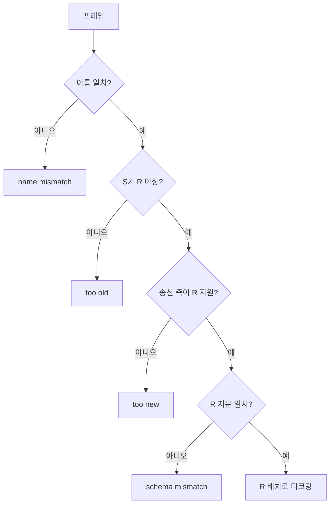
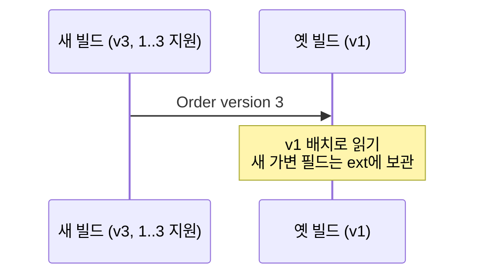
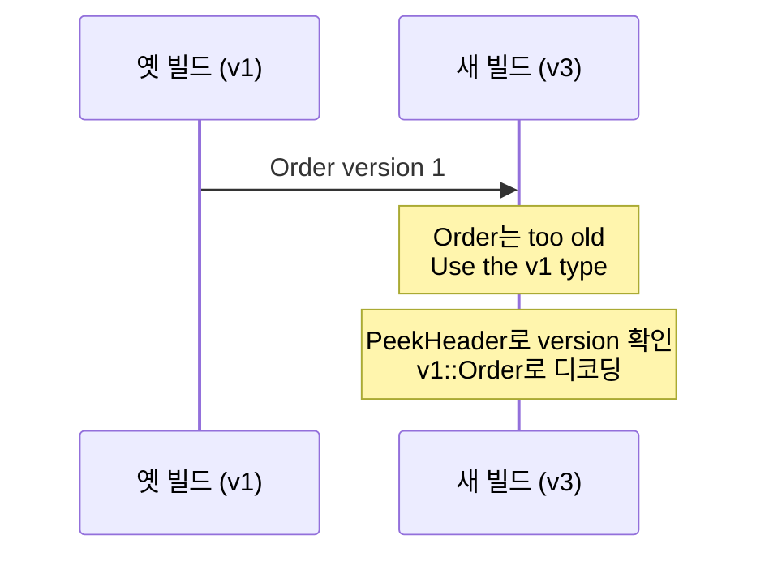
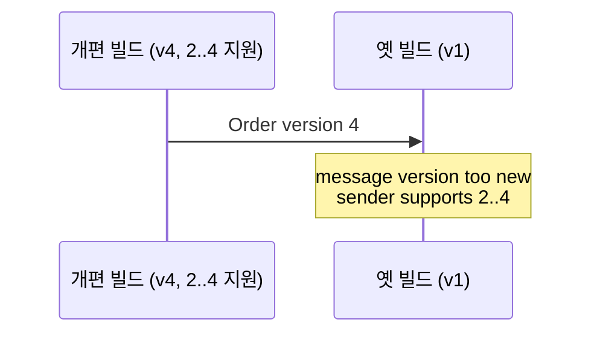
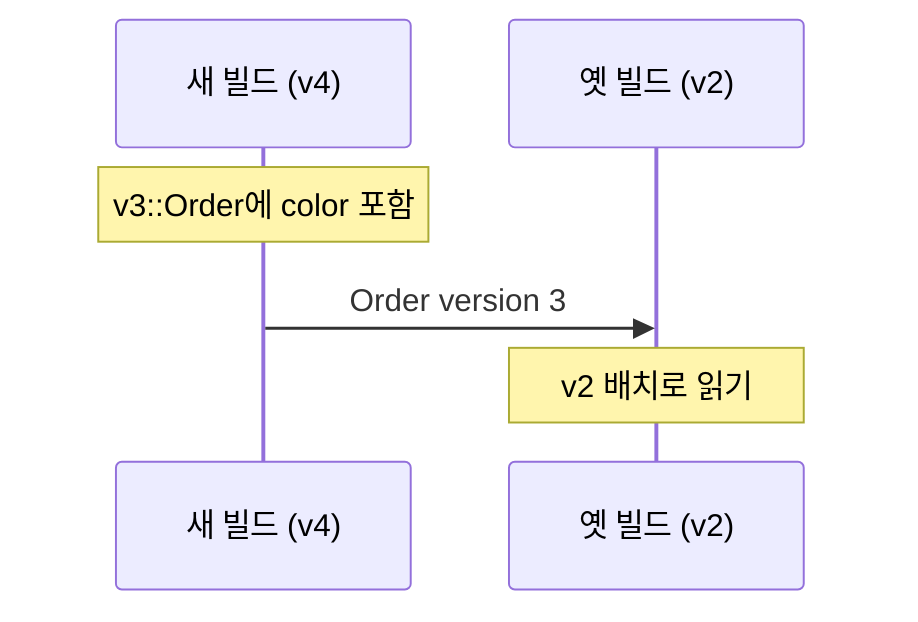

# 🌮 Protaco


[English](README.md) · [예제](examples/README.ko.md) · [상세 참조](docs/reference.ko.md)

Protaco는 Protocol Buffers, FlatBuffers처럼 메시지 정의에서 코드를 만드는 IDL(Interface Definition Language) 도구입니다. YAML에 메시지를 선언하면 `protacoc`가 C++과 C# 클래스를 만들고, 두 언어는 같은 바이트로 통신합니다. Python 출력은 개발 예정(TODO)입니다.


가볍습니다. 그래서 빠릅니다. 일반 프로젝트에 필요한 기능을 담은 경량 직렬화 라이브러리로, C++ 런타임은 헤더 하나, C# 런타임은 소스 파일 하나입니다. 복잡한 CMake 설정도, 별도 설치도, 프로젝트 추가나 lib/dll 링크도 필요 없습니다. 고정 길이 필드는 setter가 프레임 버퍼에 직접 기록하므로 고정 필드만 있는 메시지는 인코딩 단계가 아예 없습니다. 측정에서는 Protocol Buffers보다 인코딩 시간이 79~92% 짧았습니다([8.4](#84-protocol-buffers와-측정-비교)).


수신 측은 메시지 이름, version, 스키마 지문을 확인합니다. 서로 다른 메시지나 호환되지 않는 배치를 조용히 읽지 않고 오류로 돌려주므로 안정적이고 강건합니다. YAML 주석은 docstring이 되고, 필드별 변경 이력도 YAML 하나에 남습니다. 다른 YAML 메시지를 필드 타입이나 목록 원소로 사용할 수 있어 중첩 구조도 표현합니다.

현재는 Windows 전용입니다. 🐧 Linux 버전도 개발 예정인데, 기다리기 지루하시면 fork해서 먼저 만들어 주셔도 대환영입니다! 이 문서는 protacoc 0.5.0과 직렬화 형식 v3를 기준으로 합니다.

먼저 [RouteStop.yaml](examples/schemas/RouteStop.yaml)에 배달 경유지를 정의합니다.

```yaml
message: RouteStop
version: 1
namespace: demo
fields:
  - {key: orderId, type: string(16), desc: order number}
  - {key: address, type: string(48), desc: street address}
  - {key: etaMin, type: int, default: 15, desc: minutes until arrival}
```

[DeliveryRoute.yaml](examples/schemas/DeliveryRoute.yaml)은 이 메시지의 목록을 사용합니다.

```yaml
message: DeliveryRoute
version: 1
namespace: demo
fields:
  - {key: rider, type: string, required: true, desc: rider id}
  - {key: stops, type: list<RouteStop>, required: true, desc: stops}
  - {key: note, type: string, default: "", desc: why this route}
```

아래 C++과 C# 코드는 위 YAML에서 생성된 클래스를 사용합니다.

```cpp
#include "DeliveryRoute.g.h"   // protacoc가 DeliveryRoute.yaml에서 만든 헤더

demo::RouteStop stop;
stop.set_orderId("A-100");
stop.set_address("1 Pizza St");

demo::DeliveryRoute route;
route.set_rider("rider-7");
route.get_mutable_stops().push_back(stop);

const std::vector<uint8_t>& bytes = route.Serialize();
demo::DeliveryRoute back = protaco::ToObject<demo::DeliveryRoute>(bytes);
```

```csharp
var route = new demo.DeliveryRoute { Rider = "rider-7" };
route.Stops.Add(new demo.RouteStop { OrderId = "A-100", Address = "1 Pizza St" });
byte[] bytes = route.Serialize();   // C++과 같은 바이트
var back = Protaco.Codec.ToObject<demo.DeliveryRoute>(bytes);
```

## 목차

1. [개요](#1-개요)
2. [동작 구조](#2-동작-구조)
3. [시작하기](#3-시작하기)
4. [스키마 언어](#4-스키마-언어)
5. [확장 데이터](#5-확장-데이터)
6. [생성 API](#6-생성-api)
7. [버전 관리](#7-버전-관리)
8. [성능](#8-성능)
9. [텍스트 출력](#9-텍스트-출력)
10. [직렬화 형식 v3](#10-직렬화-형식-v3)
11. [제약 사항과 계획](#11-제약-사항과-계획)
12. [라이선스](#12-라이선스)

## 1. 개요

### 1.1 기능

- 📄 YAML이 곧 IDL입니다. 파일 하나에 메시지 하나를 선언하고, 메시지끼리는 이름으로 참조하므로 파일 순서를 신경 쓸 필요가 없습니다.
- C++은 header-only `*.g.h`, C#은 `*.g.cs`로 출력합니다. 따로 연결할 lib/dll이 없습니다. 생성 파일을 프로젝트에 넣으면 끝입니다!
- 🪶 C++ 런타임은 표준 라이브러리만, C# 런타임은 기본 framework만 사용합니다. 설치할 패키지가 하나도 없습니다.
- 생성할 때마다 코드 옆에 같은 버전의 런타임을 기록합니다. 그래서 생성기와 런타임 버전이 어긋날 일이 없습니다.
- ⚡ 고정 필드는 setter가 최종 바이트를 바로 기록합니다. C++은 값이 바뀌지 않았으면 마지막 `Serialize()` 결과를 그대로 돌려줍니다.
- 🛡️ 수신할 때 이름, version, 스키마 지문을 모두 확인합니다. 메시지가 깨진 채 조용히 읽히는 일이 없으니 안정적이고 강건합니다.
- 버전 관리가 강력합니다. 필드 하나하나에 `added`와 `removed`로 이력을 남기고, 지원하는 옛 version의 클래스까지 생성합니다!
- 🧩 스키마에 없는 키-값도 확장 데이터로 실어 보낼 수 있습니다. 필요 없으면 `allow_extension: false`로 끕니다.
- 📝 `ToString()` 한 줄로 필드와 확장 데이터를 로그에 남깁니다. 실용성에 초점을 맞춘 기능입니다.

### 1.2 Protocol Buffers와 비교

아래 C++ 비교의 크기는 protobuf 3.21.12를 v141 x64 Release로 빌드한 값입니다.

| 항목 | Protaco | Protocol Buffers (C++) |
|---|---|---|
| 런타임 | 헤더 하나, 약 41 KB, 링크 불필요 | libprotobuf CMake 대상 .cc 84개, 정적 라이브러리 약 20 MB |
| 의존성 | C++ 표준 라이브러리 | 런타임 라이브러리 링크, 버전 22부터 Abseil 의존 추가 |
| 생성기·런타임 | 생성 코드와 함께 같은 버전의 런타임 출력 | 설치된 런타임과 생성 코드 버전이 맞아야 하며 불일치 시 생성 헤더에서 컴파일 오류 |
| 고정 필드 | setter가 프레임에 직접 기록 | 직렬화 시 필드별 인코딩, 정수에 varint 사용 |
| 값이 그대로일 때 다시 직렬화 | 마지막 바이트 재사용(C++) | 다시 인코딩 |
| 메시지 식별 | 이름·version·스키마 지문 검사 | 데이터에 이름·스키마 미포함, 모르는 필드 보관, 없는 필드는 기본값 |
| 버전 관리 | YAML 하나에 지원 이력, 옛 version별 클래스 | 필드 번호로 변경 관리, 메시지당 클래스 하나 |
| 스키마 문법 | 단순한 YAML 문서, 직관적인 기능만, 주석이 docstring이 됨 | `.proto` 언어, 따로 익힐 문법이 있음 |
| 프레임 크기 | 고정 폭, 머리 28바이트 + 이름 + 지원 version당 4바이트 | 작은 정수가 많으면 varint로 더 작게 표현 |

성능과 프레임 크기는 메시지 구성에 따라 달라집니다. [측정 조건과 결과](#84-protocol-buffers와-측정-비교)를 함께 확인합니다.

## 2. 동작 구조

`protacoc`는 YAML을 읽어 메시지 클래스와 런타임을 생성합니다. C++ 프로젝트는 헤더를 include하고, C# 프로젝트는 소스 파일을 컴파일합니다. 생성된 메시지는 전송 수단과 관계없이 같은 프레임 바이트를 사용합니다.


메시지마다 `*.g.h`와 `*.g.cs`를 만들며, 지원하는 옛 version 클래스도 해당 파일에 들어갑니다. 중첩 메시지 참조는 메시지 이름으로 연결합니다.

## 3. 시작하기

### 3.1 요구 사항

- Windows, Visual Studio 2017 이상, v141 도구 집합(MSBuild 15).
- 생성기와 C# 런타임: .NET Framework 4.6.1, C# 7.3.
- C++ 런타임과 생성 헤더: C++14 호환.
- C++ 시험 실행 시에만 googletest의 `include\`, `lib\gtest.lib`, `lib\gtest_main.lib` 필요. `/MD`로 빌드한 라이브러리 사용.

Linux 지원과 Python 출력은 개발 예정입니다.

### 3.2 protacoc 빌드

저장소 루트에서 실행합니다.

```bat
build.cmd
```

생성기는 `build\bin\protacoc.exe`로 만들어집니다. 이 명령은 예제와 시험 코드 재생성, 시험, 예제 실행도 수행합니다. 단계와 환경 변수는 [빌드와 시험](docs/reference.ko.md#4-빌드와-시험)에 있습니다. Visual Studio에서는 [protaco.sln](protaco.sln)을 열 수 있습니다.

### 3.3 스키마 작성

앞의 `RouteStop.yaml`, `DeliveryRoute.yaml`을 `schemas` 폴더에 저장합니다. 파일 이름과 `message` 이름을 맞추고, 같은 실행에 넣는 파일은 같은 namespace를 사용합니다. 예제 원본은 [examples/schemas](examples/schemas)에 있습니다.

### 3.4 코드 생성

```bat
build\bin\protacoc.exe -I schemas --cpp_out gen\cpp --cs_out gen\cs
```

C++ 출력은 `RouteStop.g.h`, `DeliveryRoute.g.h`, `Protaco.hpp`입니다. C# 출력은 `RouteStop.g.cs`, `DeliveryRoute.g.cs`, `Protaco.cs`입니다.

C++ 프로젝트의 include 경로에 `gen\cpp`를 추가하고 `DeliveryRoute.g.h`를 include합니다. C# 프로젝트에는 `gen\cs`의 생성 소스와 런타임을 함께 넣습니다. 자세한 프로젝트 설정은 [예제 설명](examples/README.ko.md#2-빌드와-실행)에 있습니다.

### 3.5 명령행 옵션

| 옵션 | 용도 |
|---|---|
| `-I <dir>` | YAML 폴더, 여러 번 지정 가능 |
| `--cpp_out <dir>` | C++ 헤더와 런타임 출력 |
| `--cs_out <dir>` | C# 소스와 런타임 출력 |
| `--check` | 파일을 쓰지 않고 생성 결과가 최신인지 검사 |

출력 언어는 하나만 선택해도 됩니다. 나머지 옵션과 메시지 선택 방법은 [명령행 전체](docs/reference.ko.md#2-명령행)에 있습니다.

## 4. 스키마 언어

### 4.1 파일 규칙

- 파일 하나에 메시지 하나를 선언하며 파일 이름과 메시지 이름을 맞춥니다.
- 메시지 참조는 이름으로 해결합니다. 입력 파일 순서는 상관없습니다.
- 한 번의 protacoc 실행에 넣는 모든 파일은 같은 namespace여야 합니다(PC405). 다른 namespace는 실행과 출력 폴더를 나눕니다.
- 파일 맨 위 주석은 클래스 docstring이 됩니다. 필드 바로 위 주석, 같은 줄 끝 주석, `desc`는 필드 docstring이 됩니다.
- 최상위 키와 `fields:` 아래의 `- {key: ..., type: ...}` 형태를 사용합니다. 일반 YAML 전체를 지원하지 않으며, 흐름 목록 `[a, b]`는 PC102입니다.

### 4.2 메시지 키

```yaml
message: PizzaOrder
version: 2
min_version: 1
namespace: shop
allow_extension: true
desc: a pizza order
fields:
  - {key: orderId, type: string(32), desc: order number}
  - {key: giftNote, type: string, added: 2}
```

| 키 | 필수 | 의미 |
|---|---|---|
| `message` | 예 | 파일 이름과 같은 메시지 이름 |
| `version` | 예 | 현재 version, 1..65535 |
| `namespace` | 예 | `shop` 또는 `shop.orders`처럼 지정 |
| `fields` | 예 | 필드 목록 |
| `min_version` | 아니오 | 가장 오래된 지원 version, 기본값은 `version`. [버전 관리](#7-버전-관리) 참고 |
| `allow_extension` | 아니오 | 확장 데이터 허용 여부, 기본값 `true` |
| `desc` | 아니오 | docstring에 들어가는 설명 |

namespace에 점이 꼭 필요한 것은 아닙니다. `shop.orders`는 C++에서 `shop::orders`, C#에서 `shop.orders`가 됩니다.

**`allow_extension`은 메시지의 수신 규칙을 결정합니다.** `false`이면 확장 API를 생성하지 않으며, 같은 version에서 모르는 키를 거부합니다. 배포 전에 [확장 데이터](#5-확장-데이터) 정책을 정합니다.

### 4.3 필드 속성

| 속성 | 의미 | 규칙 |
|---|---|---|
| `key` | 필드와 접근자 이름 | 영문으로 시작하며 영문·숫자·`_` 사용 |
| `type` | 필드 타입 | [타입](#44-타입) 참고 |
| `required` | 수신 시 항목 존재 필수 | 가변 필드만 사용, 기본값 `false` |
| `default` | 초기값 | 생성 시 타입과 표현 검사 |
| `added` | 처음 추가된 version | 기본값 1, 현재 `version` 이하 |
| `removed` | 처음 제거된 version | `added`보다 크고 현재 `version` 이하 |
| `desc` | 필드 설명 | docstring에 기록 |

키는 `_`, `get_`, `set_`, `mutable_`로 시작할 수 없습니다. C++·C# 예약어와 생성 멤버 이름(`ext`, `buf`, `cache`, `serialize`, `tostring` 등)은 PC303입니다. 첫 글자를 대문자로 바꾼 C# 속성 이름끼리 겹치면 PC311입니다.

`required`는 `string`, `bytes`, `list<T>`, 메시지 필드에만 적용합니다. 항목이 없으면 `missing required`로 디코딩이 실패합니다. 고정 필드는 고정 영역에 항상 바이트가 있으므로 항목이 빠질 수 없습니다. 따라서 고정 필드의 `required`는 PC305로 거부하며, 값의 유효성은 받는 코드에서 검사합니다.

`default`는 protacoc가 생성 시점에 검사하고, 잘못된 값은 PC308로 거부합니다.

- `bool`: 따옴표 없는 `true` 또는 `false`.
- 정수: 따옴표, `+`, 불필요한 앞자리 0 없이 타입 범위 안의 값. `int64` 최솟값은 기본값으로 사용할 수 없습니다.
- `double`: 따옴표 없는 십진·지수 표기. NaN, 무한대, 무한대로 넘치는 값은 불가합니다.
- 문자열: ASCII만 허용하며, `string(N)`이면 N바이트 이하여야 합니다.
- `bytes`, 목록, 메시지: 명시적 기본값을 지원하지 않으며 빈 값으로 시작합니다.

### 4.4 타입

고정 길이 타입입니다.

| 타입 | 크기와 표현 | C++ / C# |
|---|---|---|
| `bool` | 1바이트 | `bool` / `bool` |
| `int` | 4바이트 | `int32_t` / `int` |
| `int64` | 8바이트 | `int64_t` / `long` |
| `double` | 8바이트, IEEE 754 | `double` / `double` |
| `string(N)` | N바이트, N은 1..4096, 남는 부분은 0 | `std::string` / `string` |

`string(N)`에 N바이트보다 긴 값을 넣으면 C++ setter는 `false`를 반환하고 기존 값을 유지합니다. C# setter는 `ArgumentException`을 던집니다.

가변 길이 타입입니다.

| 타입 | 표현 | C++ / C# |
|---|---|---|
| `string` | 길이가 바뀌는 문자열 | `std::string` / `string` |
| `bytes` | 0과 0xFF도 그대로 전달하는 바이너리 | `std::vector<uint8_t>` / `byte[]` |
| `list<T>` | 원소 타입과 원소 목록 | `std::vector<T>` / `List<T>` |
| 메시지 이름 | 다른 YAML 메시지의 중첩 본문 | 해당 생성 클래스 |

목록 원소는 `int`, `int64`, `double`, `string`, `bytes`, 메시지입니다. 목록의 목록, `list<bool>`, `list<string(N)>`은 PC404입니다. 중첩은 8단계까지이며 초과하면 PC406, 순환 참조는 PC403입니다.

고정 필드는 YAML에서 가변 필드 사이에 선언해도 본문 앞 고정 영역에 모입니다. 배치 순서는 추가된 version, 그다음 선언 순입니다.

## 5. 확장 데이터

### 5.1 언제 사용하는가

확장 데이터는 YAML에 없는 키-값 항목입니다. YAML과 version을 바꾸지 않고 일부 송신자만 배달 채널, 우선순위, 영수증 같은 부가 정보를 붙일 때 사용합니다. 수신 측이 모르는 항목도 보관하므로 중계 프로그램을 먼저 갱신하지 않아도 데이터를 전달할 수 있습니다.

프로토콜 계약의 일부가 될 데이터는 `added`를 지정한 정식 필드로 선언합니다. 실험, 선택적 부가 정보, 중계용 정보에는 확장 데이터를 사용합니다. 자주 보내는 고정 필드 메시지는 `allow_extension: false`로 닫으면 의도가 분명해집니다.

### 5.2 쓰기와 읽기

```cpp
route.GetMutableExt().SetString("channel", "web");
route.GetMutableExt().SetInt("priority", 2);
route.GetMutableExt().SetBytes("receipt", std::vector<uint8_t>{0, 0xFF});
std::string channel;
bool found = route.GetExt().GetString("channel", &channel);
```

```csharp
route.Ext.SetString("channel", "web");
route.Ext.SetInt("priority", 2);
route.Ext.SetBytes("receipt", new byte[] { 0, 0xFF });
bool found = route.Ext.TryGetString("channel", out string channel);
```

`SetBool`, `SetInt`, `SetInt64`, `SetDouble`, `SetString`, `SetBytes`는 성공 여부를 `bool`로 반환합니다. C++의 `Get*`는 키가 없거나 타입이 다르면 `false`이며 출력 인자를 그대로 둡니다. C#에서는 `TryGetBool`, `TryGetInt`, `TryGetInt64`, `TryGetDouble`, `TryGetString`, `TryGetBytes`를 사용합니다.

| 작업 | C++ | C# |
|---|---|---|
| 존재 확인 | `route.GetExt().Has("channel")` | `route.Ext.Has("channel")` |
| 삭제 | `route.GetMutableExt().Remove("channel")` | `route.Ext.Remove("channel")` |
| 항목 수 | `route.GetExt().Count()` | `route.Ext.Count` |
| 키 목록 | `route.GetExt().Keys()` | `route.Ext.Keys` |

다음 키는 `Set*`가 `false`를 반환합니다.

- 스키마의 모든 version에 등장하는 필드 키.
- `_`로 시작하는 키.
- 빈 키 또는 255바이트를 넘는 키.

### 5.3 전달과 타입

수신 측은 자기 스키마에 없는 키를 ext에 보관합니다. 다시 직렬화하면 해당 항목을 그대로 실으므로 중계 노드가 값을 몰라도 다음 수신자에게 전달됩니다. 더 새 version의 가변 필드도 옛 수신 측에서는 ext로 보관됩니다.

직접 설정하는 ext 값은 `bool`, `int`, `int64`, `double`, `string`, `bytes`입니다. 정식 필드처럼 스키마 검사를 하지 않으므로 읽는 코드가 키와 타입을 확인합니다. 항목마다 키 길이 1바이트, 키, 타입 1바이트, 값 길이 4바이트, 값으로 이루어진 TLV가 붙습니다. `ToString()`에서는 `ext{...}`로 볼 수 있습니다.

### 5.4 닫힌 메시지

`allow_extension: false`이면 확장 API가 생성되지 않습니다. 같은 version 프레임에 모르는 키가 있으면 `unknown key (allow_extension false)`로 실패합니다. 더 새 version의 프레임은 수신 측 version의 지문을 확인한 뒤 새 필드를 버립니다.

이 설정도 스키마 지문에 포함됩니다. 배포한 계약의 값을 그대로 바꾸면 호환되지 않으므로 처음부터 메시지의 확장 정책을 정합니다.

## 6. 생성 API

### 6.1 C++ 클래스

클래스는 `<ns>::<Name>`으로 생성됩니다. 아래 `<field>`는 YAML의 필드 키이며, `T`는 그 필드의 C++ 타입입니다.

| 항목 | API | 동작 |
|---|---|---|
| 생성자 | `<Name>()` | 모든 필드를 기본값으로 초기화, 고정 필드는 프레임 버퍼에 배치 |
| 고정 스칼라 | `T get_<field>() const`, `void set_<field>(T)` | 버퍼에 직접 읽고 쓰기 |
| 고정 문자열 | `std::string get_<field>() const`, `bool set_<field>(const std::string&)` | 길이 초과 시 `false`, 기존 값 유지 |
| 가변 필드 | `const T& get_<field>() const`, `void set_<field>(const T&)` | 가변 값 읽기·대입 |
| 가변 값 수정 | `T& get_mutable_<field>()` | 목록·bytes·중첩 메시지 참조, `string`에는 없음 |
| 확장 데이터 | `const protaco::CExt& GetExt() const`, `protaco::CExt& GetMutableExt()` | 열린 메시지만 생성 |
| 봉투 | `SetEnvelope(const protaco::Envelope&)`, `protaco::Envelope GetEnvelope() const` | 머리의 요청 id·상관 id·시각 |
| 직렬화 | `const std::vector<uint8_t>& Serialize() const` | 객체의 프레임 버퍼 참조 |
| 로그 | `std::string ToString(const protaco::TextStyle& = protaco::TextStyle()) const` | [텍스트 출력](#9-텍스트-출력) |
| 정적 정보 | `MsgName()`, `MsgVersion()`, `MsgMinVersion()`, `MsgSchemaHash()` | 분기와 진단 |

0.5.0의 확장 데이터 접근자는 `GetExt()`와 `GetMutableExt()`입니다. `get_`, `set_`, `get_mutable_`는 필드 접근자에만 사용하고, 나머지 공개 함수는 PascalCase로 구분합니다.

`Envelope`는 `id`(u32 요청 id), `corr`(u32 상관 id), `ts`(i64 시각, us)이며 프레임 머리에 직접 기록합니다. `Serialize()`의 참조는 객체를 바꾸기 전까지 사용할 수 있습니다. 포인터와 바이트 내용을 계속 보관해야 하면 복사합니다. [재사용 조건](#83-serialize-재사용)을 확인합니다.

옛 version은 `<ns>::v<N>::<Name>`으로 생성되며 그 version의 필드를 제공합니다. 버퍼, 필드 목록, 내부 상수는 private이고 런타임이 friend를 통해 접근합니다.

### 6.2 C++ 런타임

런타임은 `Protaco.hpp`, namespace는 `protaco`입니다.

- `ToObject<T>`는 vector 또는 포인터와 길이를 받습니다.

  ```cpp
  auto back = protaco::ToObject<demo::DeliveryRoute>(bytes);
  auto again = protaco::ToObject<demo::DeliveryRoute>(bytes.data(), bytes.size());
  ```

- 실패하면 `CParseError`를 던집니다. `GetError()`의 `path`와 `what`으로 위치와 이유를 확인합니다.

  ```cpp
  try { protaco::ToObject<demo::DeliveryRoute>(bytes); }
  catch (const protaco::CParseError& e) { std::cerr << e.GetError().path << ": " << e.GetError().what; }
  ```

- `TryToObject`는 예외 없이 결과를 반환하며 실패하면 출력 객체를 유지합니다. `error.path`는 `delivery.doorCode`, `stops[2].orderId` 같은 위치입니다.

  ```cpp
  demo::DeliveryRoute back; protaco::Error error;
  bool ok = protaco::TryToObject(bytes.data(), bytes.size(), &back, &error);
  ```

- `PeekHeader`는 본문을 디코딩하지 않고 `Header{name, version, minVersion, schemaHash, env, bodySize}`를 읽습니다.

  ```cpp
  protaco::Header header; protaco::Error error;
  bool ok = protaco::PeekHeader(bytes.data(), bytes.size(), &header, &error);
  ```

- `CExt`는 타입별 확장 데이터 API를 제공합니다.

  ```cpp
  route.GetMutableExt().SetInt("priority", 2);
  int32_t priority = 0; route.GetExt().GetInt("priority", &priority);
  ```

- `TextStyle`은 구분자, 괄호, 들여쓰기, 문자열 길이를 정합니다.

  ```cpp
  auto style = protaco::TextStyle::Pretty(); style.maxText = 32;
  auto log = route.ToString(style);
  ```

`CParseError`는 예외를 던진 모듈 안에서 처리하며 DLL 경계를 넘기지 않습니다. 예제의 `std::cerr`를 쓰려면 `<iostream>`을 include합니다.

### 6.3 C#

클래스는 `<ns>.<Name>`, 런타임은 `Protaco.cs`의 `Protaco` namespace입니다.

- 필드는 PascalCase 속성입니다. 고정 문자열은 길이를 넘기면 `ArgumentException`을 던집니다.

  ```csharp
  var route = new demo.DeliveryRoute { Rider = "rider-7" };
  route.Stops.Add(new demo.RouteStop { OrderId = "A-100", Address = "1 Pizza St" });
  ```

- 열린 메시지는 `Ext`를 제공합니다.

  ```csharp
  route.Ext.SetString("channel", "web");
  bool found = route.Ext.TryGetString("channel", out string channel);
  ```

- `Serialize()`는 호출마다 새 `byte[]`를 만듭니다. 봉투는 객체에 저장하지 않고 직렬화할 때 넘깁니다.

  ```csharp
  byte[] bytes = route.Serialize();
  byte[] tagged = route.Serialize(new Protaco.Envelope { Id = 1, Corr = 0, Ts = 0 });
  ```

- `ToString()`과 `ToString(TextStyle)`로 로그를 만듭니다.

  ```csharp
  string line = route.ToString();
  string pretty = route.ToString(Protaco.TextStyle.Pretty());
  ```

- `MsgName`, `MsgVersion`, `MsgMinVersion`, `MsgSchemaHash`는 상수입니다.

  ```csharp
  string name = demo.DeliveryRoute.MsgName;
  uint hash = demo.DeliveryRoute.MsgSchemaHash;
  ```

- 지원하는 옛 version은 별도 namespace에 생성됩니다. 아래는 7장의 스키마로 생성한 클래스입니다.

  ```csharp
  var oldOrder = new shop.v1.Order();
  ```

- `Codec.ToObject<T>`로 디코딩하며 봉투도 함께 받을 수 있습니다.

  ```csharp
  var back = Protaco.Codec.ToObject<demo.DeliveryRoute>(bytes);
  var taggedBack = Protaco.Codec.ToObject<demo.DeliveryRoute>(tagged, out Protaco.Envelope env);
  ```

- `Codec.TryToObject<T>`는 성공 여부와 `ProtacoException`을 반환합니다.

  ```csharp
  bool ok = Protaco.Codec.TryToObject<demo.DeliveryRoute>(bytes, out var back, out var error);
  if (!ok) System.Console.WriteLine(error.Path + ": " + error.What);
  ```

- `Codec.PeekHeader`는 본문 없이 머리를 확인합니다.

  ```csharp
  bool ok = Protaco.Codec.PeekHeader(bytes, out Protaco.Header header);
  ```

- 예외를 사용하는 디코딩은 `ProtacoException.Path`와 `What`을 확인합니다.

  ```csharp
  try { Protaco.Codec.ToObject<demo.DeliveryRoute>(bytes); }
  catch (Protaco.ProtacoException e) { System.Console.WriteLine(e.Path + ": " + e.What); }
  ```

런타임용 내부 멤버는 명시적 인터페이스 구현 뒤에 숨겨져 있습니다. 문자열 인코딩은 시스템 ANSI 코드 페이지인 `Encoding.Default`를 사용합니다.

## 7. 버전 관리

### 7.1 왜 필요한가

프로그램은 한꺼번에 갱신되지 않습니다. 새 빌드와 옛 빌드가 함께 통신하는 동안 어떤 메시지를 읽을 수 있고 언제 거부해야 하는지 명확해야 합니다. 프로토콜을 다루는 팀이라면 누구나 고민하는 문제입니다. Protaco는 YAML 하나에 지원하는 version의 이력을 기록하고, 수신 실패를 이름·version·지문별 오류로 알려줍니다.

| 변경 | YAML에서 할 일 | 옛 빌드에서 일어나는 일 |
|---|---|---|
| 작은 변경(필드 추가·제거) | `version` 올림, 필드에 `added`/`removed` | 계속 통신 |
| 개편 수준 변경 | `version` 올림, `min_version` 올림 | 이유 없이 죽거나 잘못 읽지 않고 정상 오류 |

### 7.2 작은 변경

필드를 추가하거나 제거할 때는 `version`을 올리고 해당 필드에 `added` 또는 `removed`를 지정합니다. `min_version`은 유지합니다. 그러면 옛 배치의 지문이 유지되어 새 빌드와 옛 빌드가 계속 통신할 수 있습니다. 옛 수신 측이 필수로 요구하는 가변 필드를 제거한 경우에는 [배치 규칙](#79-배치-규칙)에 따라 옛 클래스로 보냅니다.

### 7.3 개편 수준 변경

지원할 수 없는 옛 version은 `min_version`을 올려 종료합니다. 예를 들어 version 3에서 `min_version: 3`으로 바꾸면 옛 수신 측은 다음과 같은 정상 오류를 받습니다.

```text
message version too new: Order reads version 1, sender supports 3..3
```

새 빌드도 너무 오래된 프레임을 `message version too old`로 거부합니다. 이를 통해 서로 다른 배치를 잘못 읽는 일을 막습니다. 동작은 `SenderMinVersionAboveReader`, `OlderFrameNeedsOldType` 시험에서 확인합니다. 크게 바뀌는 필드는 기존 필드를 `removed`로 남기고 새 키의 필드를 `added`로 추가합니다.

### 7.4 version 선언

```yaml
message: Order
version: 3          # 현재 version
min_version: 1      # 가장 오래된 지원 version, 생략하면 version과 같음
namespace: shop
fields:
  - {key: id,     type: string(8)}
  - {key: weight, type: double, default: 0.5, added: 2}
  - {key: qty,    type: int, default: 1, removed: 3}  # 고정 바이트 유지, 기본값으로 채움
  - {key: note,   type: string, removed: 3}           # version 3부터 보내지 않음
  - {key: color,  type: string, required: true}
  - {key: tags,   type: list<string>, added: 2}
  - {key: label,  type: string, added: 3}
  - {key: rush,   type: bool, added: 3}
```

필드는 `added`에 적힌 version에서 처음 생깁니다. `removed`에 적힌 version부터는 없으며, 그 앞 version까지 존재합니다. `added`의 기본값은 1입니다.

`version`은 현재 version이고 `min_version`은 아직 지원하는 가장 오래된 version입니다. 생략하면 현재 version 하나만 지원합니다. 지원하는 version은 한 메시지당 최대 255개입니다.

### 7.5 생성 클래스

- `shop::Order`: 현재 version 3.
- `shop::v1::Order`, `shop::v2::Order`: 지원하는 옛 version마다 하나씩 생성, 필드도 해당 version 기준.
- C#: `shop.Order`, `shop.v1.Order`, `shop.v2.Order`.

프레임 머리에는 송신 측 `version`, `min_version`, 그리고 지원하는 각 version의 4바이트 스키마 지문이 실립니다. 새 version을 추가해도 옛 version의 지문은 유지됩니다. 지문의 계산 방법은 [상세 참조](docs/reference.ko.md#1-스키마-지문)에 있습니다.

### 7.6 수신 판정

수신 클래스의 version을 R, 프레임의 version을 S라고 할 때 다음 순서로 검사합니다.



1. 이름이 다르면 `message name mismatch: expected Order, got Heartbeat`입니다.
2. S가 R보다 작으면 `message version too old: Order reads version 3 or newer, got 1. Use the v1 type`입니다. 해당 옛 클래스가 생성된 경우에만 타입 안내가 붙습니다. `PeekHeader()`로 version을 확인하고 `v1::Order`로 읽습니다.
3. 송신 측의 `min_version`이 R보다 크면 `message version too new: Order reads version 1, sender supports 2..4`입니다.
4. 프레임의 R 지문이 수신 측 `MsgSchemaHash()`와 다르면 `schema mismatch: Order version 1 expected 0x..., got 0x...`입니다.
5. 통과하면 R의 고정 영역과 가변 필드만 읽습니다. 더 새 가변 필드는 열린 메시지라면 ext로 보관하고 닫힌 메시지라면 버립니다.

### 7.7 송신

클래스는 항상 자기 version으로 보냅니다. `min_version`부터 자기 version까지의 지문을 프레임에 넣습니다. 옛 배치가 필요한 상대에게는 `v1::Order` 같은 옛 클래스에 값을 채워 직렬화합니다.

### 7.8 배포 경우별 그림

새 빌드에서 옛 빌드로 보내는 경우입니다.



옛 빌드에서 새 빌드로 보내는 경우입니다.



개편 후 지원이 종료된 상대가 받는 경우입니다.



새 빌드가 옛 배치를 골라 보내는 경우입니다. version 4에서 제거한 필수 필드 `color`가 필요한 상대에게 version 3 클래스로 보냅니다.



### 7.9 배치 규칙

- 고정 필드는 추가된 version, 그다음 선언 순으로 배치합니다. 새 version의 고정 필드는 기존 고정 영역 끝에 붙습니다.
- 제거된 고정 필드의 바이트는 계속 유지하고 기본값으로 채웁니다. YAML의 해당 줄도 유지합니다.
- 제거된 가변 필드는 보내지 않습니다. `min_version`이 그 필드의 `removed`에 도달하면 YAML의 해당 줄을 지웁니다(PC313).
- 제거된 가변 필드가 옛 version에서 `required`였다면 새 프레임은 `missing required (frame version 4 read as 2)`로 거부될 수 있습니다. 이런 상대에게는 필드가 남아 있는 옛 클래스로 보냅니다.
- 필드 타입으로 쓰는 메시지는 `min_version`, `added`, `removed` 버전 기능을 사용할 수 없습니다(PC407). 중첩 본문에 version이 없기 때문입니다. 중첩 구조를 바꿔야 하면 새 메시지를 추가합니다.

### 7.10 배포된 스키마 바꾸기

배포 전에는 version을 유지한 채 자유롭게 고칩니다. **배포한 version의 계약은 동결합니다.**

- 필드 추가(`added`), 필드 제거(`removed`), `min_version` 상향은 각각 `version`을 올려 반영합니다. 새 메시지 추가는 언제나 가능합니다.
- 기존 필드의 타입, `required`, `default`, 이름, 순서를 바꾸거나 제거한 키를 재사용하면 옛 계약과 호환되지 않습니다. 기존 필드를 제거하고 새 키의 필드를 추가합니다.
- 메시지 이름과 `allow_extension` 변경도 기존 계약과 호환되지 않습니다. 새로운 메시지 계약으로 분리하거나 옛 version 지원을 종료해야 합니다.
- 호환되지 않는 스키마로 만든 프레임은 이름 또는 지문 검사에서 거부합니다.
- 주석, `desc`, `namespace`는 직렬화 바이트에 영향을 주지 않습니다.

실제 개정 파일과 빌드 간 교환은 [버전 관리 예제](examples/README.ko.md#6-버전-관리-예제)에 있습니다.

## 8. 성능

### 8.1 크기

| 구성 요소 | 크기 | 실행 조건 |
|---|---|---|
| `Protaco.hpp` | 1,455줄, 약 41 KB | C++14, 표준 라이브러리만 사용 |
| `Protaco.cs` | 1,221줄 | .NET Framework 4.6.1, C# 7.3, 패키지 없음 |
| `protacoc.exe` | 약 150 KB, 단일 파일 | .NET Framework 4.6.1 |

생성 C++ 클래스에는 reflection, descriptor 표, 가상 함수가 없습니다.

### 8.2 고정 필드 직접 기록

고정 필드는 프레임 버퍼 안에 자리가 정해져 있습니다. setter가 최종 바이트를 바로 기록하므로 고정 필드만 있고 ext가 비어 있으면 `Serialize()`에서 추가할 데이터가 없습니다.

```cpp
demo::Heartbeat beat;                    // 모든 필드 고정, allow_extension: false
beat.set_uptimeSec(10);                  // 프레임 버퍼에 바로 기록
const auto& bytes = beat.Serialize();    // 버퍼 그 자체, 복사·인코딩 없음
beat.set_uptimeSec(11);                  // bytes에도 바로 11이 보입니다
```

값이 바뀌지 않았으면 `Serialize()`를 다시 불러도 마지막 바이트를 그대로 줍니다. 고정 필드 setter로 바꾼 값은 버퍼에 이미 반영되어 있습니다.

고정 필드는 본문 앞에 모입니다. 가변 필드를 붙일 때는 전체 크기를 먼저 계산하고 할당 1회로 구성합니다.

### 8.3 Serialize 재사용

C++은 마지막 `Serialize()` 이후 가변 필드와 ext가 바뀌지 않았다면 가변 블록을 다시 만들지 않습니다.

- 가변 필드의 `set_` 호출, ext의 Set·Remove·대입, 디코딩으로 값이 바뀌면 다시 만듭니다.
- `get_mutable_<field>()`를 한 번이라도 호출한 객체는 이후 참조를 통한 수정을 추적할 수 없으므로 매번 가변 블록을 다시 만듭니다.
- 재사용 이득이 필요하면 목록·bytes·중첩 메시지도 `set_`으로 넣습니다.
- 복사본은 첫 직렬화 때 다시 만듭니다.
- C#은 호출마다 새 `byte[]`를 만들며 이 재사용을 하지 않습니다.

```cpp
route.set_stops(std::vector<demo::RouteStop>{stop});
const auto& first = route.Serialize();
const auto& again = route.Serialize();   // 가변 필드와 ext가 그대로면 재사용
```

위 예제는 `get_mutable_stops()`를 호출하지 않은 객체를 전제로 합니다. 0.5.0 디코더는 본문당 가변 필드 목록이 16개까지면 스택에 두어 그 목록의 힙 할당도 줄입니다.

### 8.4 Protocol Buffers와 측정 비교

Intel Core i9-13900H, Windows 11, MSVC 14.16(v141) x64 `/O2 /MD`, protobuf 3.21.12 정적 라이브러리, protaco 0.5.0의 결과입니다. 10,000회 예열 후 100,000회씩 20라운드를 실행한 평균입니다.

Fixed512는 고정 영역 512바이트, Fixed1K는 1,024바이트, Mixed256은 고정 영역 196바이트와 가변 문자열 2개입니다. 인코딩은 모든 필드 setter와 직렬화를 포함하고, 다시 직렬화는 값을 바꾸지 않은 객체를 사용합니다. 디코딩은 protaco의 `TryToObject()`와 protobuf의 재사용 메시지에 대한 `ParseFromArray()`를 비교합니다.

| 메시지, 동작 | protaco / protobuf | protaco 소요 시간 |
|---|---|---|
| Fixed512 인코딩 | 20.6 / 214.8 ns | 90% 짧음 |
| Fixed512 다시 직렬화 | 1.2 / 196.5 ns | 99% 짧음 |
| Fixed512 디코딩 | 61.6 / 240.1 ns | 74% 짧음 |
| Fixed1K 인코딩 | 40.1 / 482.2 ns | 92% 짧음 |
| Fixed1K 다시 직렬화 | 1.1 / 449.3 ns | 99% 짧음 |
| Fixed1K 디코딩 | 72.4 / 578.0 ns | 87% 짧음 |
| Mixed256 인코딩 | 20.2 / 98.3 ns | 79% 짧음 |
| Mixed256 다시 직렬화 | 1.3 / 80.0 ns | 98% 짧음 |
| Mixed256 디코딩 | 136.4 / 155.1 ns | 12% 짧음 |

스키마, 측정 코드와 재현 조건은 [benchmark/README.ko.md](benchmark/README.ko.md)에 있습니다.

프레임 크기(protaco / protobuf)는 Fixed512 556 / 571 B, Fixed1K 1,067 / 1,132 B, Mixed256 300 / 268 B입니다.

문자열이 있는 디코딩에서는 차이가 작습니다. protaco는 내부에서 새 객체로 디코딩하므로 이 MSVC 환경에서 15바이트를 넘는 문자열마다 할당이 생깁니다. protobuf는 재사용 메시지의 문자열을 다시 사용합니다. 수치는 이 메시지와 측정 환경의 결과이며 데이터 구성과 장비에 따라 달라집니다.

## 9. 텍스트 출력

`ToString()`은 필드를 YAML 순서로 출력하고, 확장 항목을 뒤쪽 `ext{...}`에 표시합니다.

```cpp
auto line = route.ToString();
auto pretty = route.ToString(protaco::TextStyle::Pretty());
```

```csharp
string line = route.ToString();
string pretty = route.ToString(Protaco.TextStyle.Pretty());
```

- 문자열: 따옴표와 escape 적용. `maxText`보다 길면 `"abcd"...(+12)`처럼 생략한 길이 표시.
- bytes: 크기와 앞 8바이트 표시. 예: `<11 bytes: FF D8 00 10 4A 46 49 46 ...>`.
- `TextStyle` 기본값: `separator = ", "`, `open = "{"`, `close = "}"`, `indent = 0`(한 줄), `maxText = 64`.
- `TextStyle::Pretty(indentWidth = 2)`: 들여쓴 여러 줄 출력. C#은 `Protaco.TextStyle.Pretty()`.
- ASCII 값은 두 언어에서 같은 결과. 길이 제한은 C++은 바이트 수, C#은 문자 수 기준.

전체 출력은 [예제 프로그램](examples/README.ko.md#45-텍스트-출력)에서 확인할 수 있습니다.

## 10. 직렬화 형식 v3

모든 정수는 little-endian입니다. 문자열은 NUL 종료 없이 원본 바이트로 기록합니다.

```text
Frame
  'P' 'C'          magic
  FrameVer u8      = 3
  NameLen  u8
  Name             메시지 이름
  MsgVer   u16     메시지 version
  MinVer   u16     송신 측이 지원하는 가장 오래된 version
  Id       u32 ┐
  Corr     u32 │   봉투
  Ts       i64 ┘
  BodyLen  u32     잘림과 뒤에 붙은 바이트 검출
  Schema   u32 × (MsgVer - MinVer + 1)   version MinVer..MsgVer의 지문
  Body

Body (중첩 메시지도 같은 모양)
  FixedLen u32     수신 측 고정 영역 크기와 같음(같은 version) 또는 더 큼(새 version)
  Fixed            고정 필드, 직렬화 순서, padding 없음
  Var*             가변 필드 TLV, 직렬화 순서
  Ext*             확장 항목 TLV, 추가 순서

TLV
  KeyLen u8 | Key | Type u8 | Len u32 | Value

TacoType
  1 bool    1바이트 (0 또는 1)
  2 int     4바이트
  3 int64   8바이트
  4 double  8바이트 IEEE 754
  5 string  바이트
  6 message Body
  7 list    ElemType u8 | Count u32 | (Len u32 | Value) × Count
  8 bytes   원본 바이트
```

한도는 다음과 같습니다.

- 프레임 최대 1,048,575바이트.
- 중첩 깊이 8단계, protacoc와 디코딩 시점에 모두 검사.
- 지원 version 최대 255개.
- 본문당 가변 필드 최대 1,024개.
- 목록 원소 수는 남은 바이트를 4로 나눈 값 이하.

지문 계산과 오류 목록은 [상세 참조](docs/reference.ko.md)에 있습니다.

## 11. 제약 사항과 계획

- 현재 Windows 전용입니다. MSBuild 프로젝트와 .NET Framework 생성기를 사용합니다. Linux 지원과 Python 출력은 개발 예정(TODO)입니다.
- 재귀 메시지, 목록의 목록, `enum`, 고정 길이 배열은 지원하지 않습니다.
- little-endian만 지원합니다.
- 프레임 머리 28바이트, 이름, 지원 version당 4바이트 지문과 고정 문자열 padding이 필요합니다. 작은 정수가 많은 데이터는 varint 기반 형식보다 클 수 있습니다.
- 문자열은 원본 바이트입니다. C#은 `Encoding.Default`를 사용하므로 비 ASCII 문자열은 코드 페이지가 같은 환경에서 언어 간 호환됩니다. 바이너리는 `bytes`를 사용합니다.
- 진단과 생성 코드의 고정 문구는 영어입니다. docstring은 YAML 주석의 언어를 유지합니다.

## 12. 라이선스

[MIT](LICENSE). Copyright (c) 2026 Soo-Hwan Cho (Splendidz).
