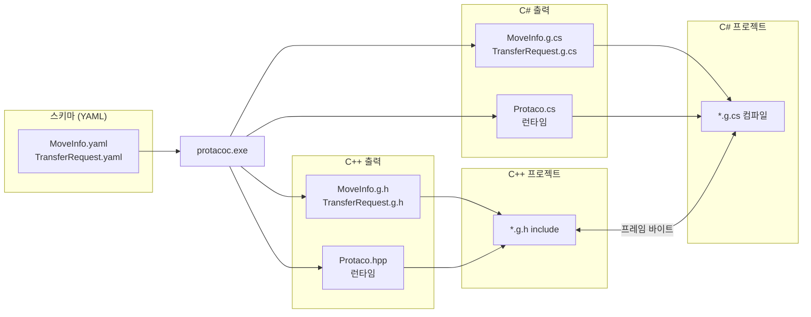
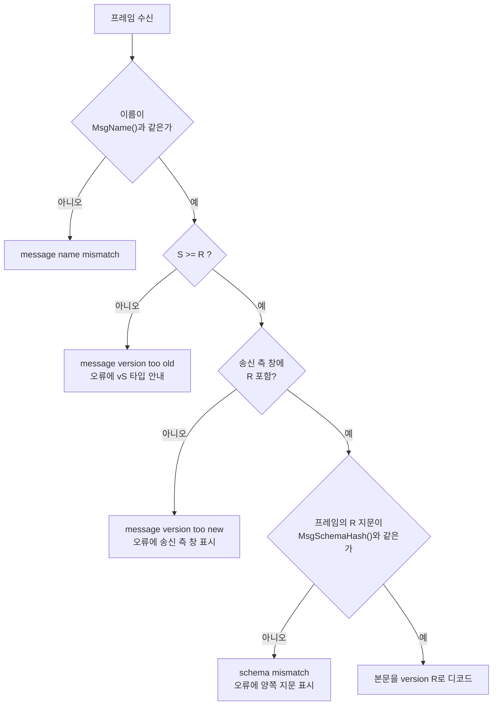
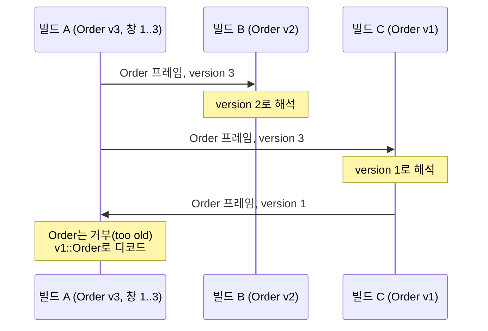

# 🌮 Protaco


Protaco는 C++·C#용 IDL(Interface Definition Language)이자 코드 생성기입니다.
메시지는 YAML로 선언합니다. 생성기 `protacoc`가 메시지마다 C++ 클래스와 C# 클래스를 만들고, 두 클래스는 같은 바이트로 직렬화됩니다.

범용 IDL 도구보다 직렬화 구조가 가볍습니다. C++ 런타임은 헤더 1개, C# 런타임은 소스 파일 1개이며 링크할 라이브러리가 없습니다. 고정 길이 필드는 setter가 프레임 버퍼에 직접 기록하므로, 고정 필드만 있는 메시지는 인코딩 단계가 필요 없습니다.

스키마 파일이 곧 인터페이스 문서입니다. YAML 주석은 docstring이 되고, 사용 중인 모든 version이 필드 단위로 한 파일에 기록됩니다. 프레임마다 스키마 version의 지문이 실려 있어서 수신 측은 자신이 모르는 배치를 읽지 않습니다.

이 문서는 protacoc 0.4.0과 직렬화 형식 v3를 기준으로 합니다.

[English README](README.md) · [예제 설명](examples/README.ko.md)

```yaml
# TransferRequest.yaml
message: TransferRequest
version: 2
namespace: demo
fields:
  - {key: tm,     type: string,         required: true, desc: 로봇 id}
  - {key: moves,  type: list<MoveInfo>, required: true, desc: 이동 목록(순서대로 수행)}
  - {key: reason, type: string, default: "",            desc: 계획 사유}
```

```cpp
#include "TransferRequest.g.h"

demo::TransferRequest request;
request.set_tm("R1");
request.get_mutable_moves().push_back(move);

const std::vector<uint8_t>& bytes = request.Serialize();
demo::TransferRequest back = protaco::ToObject<demo::TransferRequest>(bytes);
```

```csharp
var request = new demo.TransferRequest { Tm = "R1" };
byte[] bytes = request.Serialize();                                   // C++과 같은 바이트
var back = Protaco.Codec.ToObject<demo.TransferRequest>(bytes);
```

## 목차

1. [개요](#1-개요)
2. [동작 구조](#2-동작-구조)
3. [시작하기](#3-시작하기)
4. [스키마 언어](#4-스키마-언어)
5. [버전 관리 문서로서의 스키마](#5-버전-관리-문서로서의-스키마)
6. [생성 API](#6-생성-api)
7. [성능](#7-성능)
8. [버전 창](#8-버전-창)
9. [확장 데이터](#9-확장-데이터)
10. [텍스트 출력](#10-텍스트-출력)
11. [직렬화 형식 v3](#11-직렬화-형식-v3)
12. [스키마 지문](#12-스키마-지문)
13. [명령행](#13-명령행)
14. [진단](#14-진단)
15. [빌드와 시험](#15-빌드와-시험)
16. [제약 사항](#16-제약-사항)
17. [라이선스](#17-라이선스)

## 1. 개요

### 1.1 기능

- YAML 기반 IDL. 파일 하나에 메시지 하나. 메시지 간 참조는 이름으로, 순서 무관.
- 출력: C++(`*.g.h`, 헤더 온리, C++14 이상), C#(`*.g.cs`, C# 7.3, .NET Framework 4.6.1 이상).
- 경량 런타임. C++은 헤더 1개(표준 라이브러리만 사용), C#은 소스 파일 1개(패키지 없음).
- 생성기와 런타임 버전 항상 일치. protacoc가 실행할 때마다 생성 코드 옆에 런타임 기록.
- 고정 필드 고속 처리. setter가 최종 프레임 바이트에 기록. 고정 필드만 있는 메시지의 `Serialize()`는 복사 없이 버퍼 반환.
- 엄격한 수신 검사. 메시지 이름, version, 32비트 스키마 지문이 모두 일치할 때만 프레임 수락.
- 버전 창. YAML 파일 하나에 배포 중인 모든 version 기술(`min_version`, `added`, `removed`). 옛 version마다 클래스 생성.
- 경계 검사 디코드. 잘리거나 손상된 입력은 오류 반환, 크래시 없음.
- 확장 데이터. 스키마 밖의 키-값 항목. 수신 측이 보관 후 그대로 전달. `allow_extension: false`로 차단.
- 로그 문자열. `ToString()`이 중첩 메시지와 목록까지 모든 필드 출력. C++과 C#의 출력 동일.
- 빌드 연동. MSBuild 형식 오류, 내용이 바뀐 파일만 기록, CI용 `--check` 모드.

### 1.2 Protocol Buffers와 비교

| 항목 | Protaco | Protocol Buffers (C++) |
|---|---|---|
| 런타임 | 헤더 1개, 링크 불필요 | libprotobuf 또는 libprotobuf-lite 링크 |
| 생성기·런타임 버전 | protacoc가 생성 코드 옆에 런타임 기록 | 생성 코드와 설치된 런타임 버전 일치 필요 |
| 고정 길이 필드 | setter가 프레임 버퍼에 기록 | 직렬화 시점에 인코딩 |
| 수신 시 스키마 식별 | 이름·version·지문 검사, 불일치 시 거부 | 데이터에 미포함. 모르는 필드는 보관, 없는 필드는 기본값 |
| 버전 이력 | 파일 하나에 배포 중인 모든 version, 옛 version별 클래스 | 필드 번호, 메시지당 클래스 1개 |
| 스키마 문법 | docstring을 지원하는 엄격한 YAML 부분집합 | `.proto` 언어 |

Protaco 프레임이 크기 면에서 가장 작은 형식은 아닙니다. 자세한 내용은 [제약 사항](#16-제약-사항)에 있습니다.

## 2. 동작 구조

protacoc는 YAML 스키마를 읽어 두 종류의 파일을 생성합니다. C++ 프로젝트는 생성 헤더를 include하고, C# 프로젝트는 생성 소스를 컴파일합니다. 양쪽은 전송 수단과 관계없이 같은 프레임 바이트로 통신합니다.



- `*.g.h` / `*.g.cs` 하나에 메시지 클래스 하나. 중첩 메시지 타입은 이름으로 include.
- `Protaco.hpp`, `Protaco.cs`는 생성기 버전에 맞는 런타임 사본. 다른 출력 폴더에 이미 있으면 `--no_runtime`으로 생략.
- 생성 파일은 직접 수정 금지. `--check`가 수정과 오래된 파일 검출.
- protacoc는 보통 Pre-Build Event로 실행. 바뀌지 않은 파일은 다시 기록하지 않아 타임스탬프 유지, 스키마 변경이 없으면 재컴파일 없음.

## 3. 시작하기

### 3.1 요구 사항

- Windows.
- Visual Studio 2017 이상, v141 도구 집합(MSBuild 15).
- .NET Framework 4.6.1 targeting pack(protacoc와 C# 런타임).
- C++ 시험 전용: googletest(`include\`, `lib\gtest.lib`, `lib\gtest_main.lib`, `/MD` 빌드).

### 3.2 protacoc 빌드

```
build.cmd
```

출력: `build\bin\protacoc.exe`.

`build.cmd`는 예제 재생성, 시험, 예제 실행까지 함께 수행합니다([15. 빌드와 시험](#15-빌드와-시험)). `protaco.sln`을 열면 같은 프로젝트를 Visual Studio에서 다룰 수 있습니다.

### 3.3 스키마 작성

`schemas/MoveInfo.yaml`:

```yaml
# 로봇 이동 1회. 집기 후 놓기.
message: MoveInfo
version: 1
namespace: demo
fields:
  - {key: from, type: string(32), desc: 출발 위치}
  - {key: to,   type: string(32), desc: 도착 위치}
  - {key: slot, type: int, default: 1, desc: 출발 슬롯 번호}
```

### 3.4 코드 생성

```
protacoc -I schemas --cpp_out gen\cpp --cs_out gen\cs
```

출력: `gen\cpp\MoveInfo.g.h`, `gen\cpp\Protaco.hpp`, `gen\cs\MoveInfo.g.cs`, `gen\cs\Protaco.cs`.

### 3.5 C++ 프로젝트에서 사용

출력 폴더를 include 경로에 추가하고, 빌드 전에 protacoc를 실행합니다.

```xml
<ClCompile>
  <AdditionalIncludeDirectories>$(ProjectDir)gen\cpp;%(AdditionalIncludeDirectories)</AdditionalIncludeDirectories>
</ClCompile>
<PreBuildEvent>
  <Command>"$(ProjectDir)tools\protacoc.exe" -I "$(ProjectDir)schemas" --cpp_out "$(ProjectDir)gen\cpp"</Command>
</PreBuildEvent>
```

라이브러리나 전처리기 정의는 필요 없습니다.

### 3.6 C# 프로젝트에서 사용

생성 파일을 `Protaco.cs`와 함께 컴파일합니다.

```xml
<ItemGroup>
  <Compile Include="gen\cs\*.cs" />
</ItemGroup>
```

전체 프로젝트 구성은 [examples/README.ko.md](examples/README.ko.md)에서 설명합니다.

## 4. 스키마 언어

### 4.1 파일 규칙

- 파일 하나에 메시지 하나. 파일 이름은 메시지 이름과 동일(`MoveInfo.yaml`에 `message: MoveInfo`).
- protacoc 1회 실행의 모든 파일은 같은 namespace. namespace가 다르면 실행과 출력 폴더 분리.
- 파일 맨 위 주석 블록은 클래스 docstring으로 변환. 필드 바로 위 주석과 같은 줄 끝 주석은 필드 docstring으로 변환.

### 4.2 메시지 키

```yaml
# 피자 주문. 머리 주석은 클래스 docstring으로 변환.
message: PizzaOrder          # 파일 이름과 동일
version: 2                   # 현재 version, 1..65535
min_version: 1               # 아직 지원하는 가장 오래된 version (기본값: version)
namespace: shop.orders       # C++ shop::orders, C# shop.orders
allow_extension: true        # false: ext API 미생성, 모르는 키 거부 (기본값: true)
owner: shop                  # 문서용
desc: a pizza order          # 문서용
eq: [NAPOLI, CHICAGO]        # 변형 태그, 문서용
fields:
  - {key: orderId, type: string(32), desc: 주문 번호}
  - {key: toppings, type: list<Topping>, required: true}
  - {key: deepDishCm, type: int, default: 0, eq: [CHICAGO]}
  - {key: giftNote, type: string, added: 2}
```

| 키 | 필수 | 의미 |
|---|---|---|
| `message` | 예 | 메시지 이름, 파일 이름과 동일 |
| `version` | 예 | 현재 version |
| `namespace` | 예 | 점으로 구분한 namespace |
| `fields` | 예 | 필드 목록, 한 줄에 필드 하나 |
| `min_version` | 아니오 | 버전 창의 시작 version([8. 버전 창](#8-버전-창)) |
| `allow_extension` | 아니오 | 확장 데이터 허용 여부([9. 확장 데이터](#9-확장-데이터)) |
| `owner`, `desc`, `eq` | 아니오 | 문서용, docstring에 기록 |

### 4.3 필드 속성

| 속성 | 의미 | 규칙 |
|---|---|---|
| `key` | 필드 이름이자 접근자 이름 | 영문·숫자·`_`. `_`·`get_`·`set_`·`mutable_`로 시작 불가. C++·C# 예약어 불가 |
| `type` | 필드 타입([4.4](#44-타입)) | |
| `required` | 없으면 디코드 실패 | 가변 길이 필드만 |
| `default` | 없을 때의 값 | 타입과 일치. 문자열은 ASCII만. 목록·메시지 불가 |
| `added` | 필드가 처음 존재하는 version | 기본값 1, `version` 이하 |
| `removed` | 필드가 처음 없어지는 version | `added`보다 크고 `version` 이하 |
| `desc` | 설명 | docstring에 기록 |
| `eq` | 변형 태그(예: `[NAPOLI]`) | 문서용, 대문자 이름 |

### 4.4 타입

| 타입 | 인코딩 | C++ / C# 타입 |
|---|---|---|
| `bool` | 고정, 1바이트 | `bool` / `bool` |
| `int` | 고정, 4바이트 | `int32_t` / `int` |
| `int64` | 고정, 8바이트 | `int64_t` / `long` |
| `double` | 고정, 8바이트 IEEE 754 | `double` / `double` |
| `string(N)` | 고정, N바이트(1..4096), 남는 부분 0 | `std::string` / `string` |
| `string` | 가변 | `std::string` / `string` |
| `bytes` | 가변, 바이너리 원본 | `std::vector<uint8_t>` / `byte[]` |
| `list<T>` | 가변. T는 `int`, `int64`, `double`, `string`, `bytes`, 메시지 | `std::vector<T>` / `List<T>` |
| 메시지 이름 | 가변, 중첩 본문 | 생성 클래스 |

- `string(N)`은 최대 길이가 정해진 식별자에 적합. 더 긴 값은 setter가 거부.
- `bytes`는 0과 0xFF를 두 언어에서 그대로 전달.

### 4.5 YAML 부분집합

- 필드 하나는 `{key: value, ...}` 한 줄. 여러 줄 mapping, anchor, alias, 탭은 거부.
- 값은 텍스트로 읽고 protacoc가 타입 결정. YAML 암묵 타입 변환(`no`를 false로 해석) 미적용.
- `,`나 `: `가 들어간 값은 따옴표로 감쌈. 따옴표 누락은 protacoc가 보고.

## 5. 버전 관리 문서로서의 스키마

YAML 파일 하나가 계약이면서 그 계약의 문서입니다. 문서에 해당하는 정보는 아래와 같이 생성 코드와 프레임까지 이어집니다.

- docstring. 주석과 `desc`를 생성 클래스에 기록. IDE가 생성 접근자에서 표시.
- 주석 속성. `owner`, `desc`, `eq`로 담당과 변형을 기술. 바이트에는 영향 없음.
- 버전 이력. `added`, `removed`로 필드별 추가·제거 version 기록. `min_version`으로 아직 지원하는 가장 오래된 version 기록. 배포 중인 모든 version을 한 파일에서 관리.
- 추적성. 생성 파일마다 생성기 버전과 원본 파일 해시 기록.
- 바이트와의 연결. version마다 지문 보유([12. 스키마 지문](#12-스키마-지문)). 다른 개정판 문서로 만든 프레임은 런타임에 거부.

`TransferRequest.g.h`의 생성 머리:

```cpp
// TransferRequest.g.h. protacoc 0.4.0, source TransferRequest.yaml (sha1 54437178ff1e). Do not edit.

/// Robot transfer request.
/// [version 2; schema 0xCE8A25DA; owner planner; source TransferRequest.yaml]
class TransferRequest
{
public:
    /// robot id
    /// [type string; required, decoding fails if missing]
    const std::string& get_tm() const
```

버전 창이 있는 메시지(version 3의 `Order`)의 필드 docstring:

```cpp
/// [type double; default 0.5; added in 2]
/// [type int; default 1; removed in 3]
```

## 6. 생성 API

### 6.1 C++ 클래스

클래스는 YAML의 namespace 안에 생성됩니다. 아래는 `PizzaOrder.g.h`의 예입니다.

- `PizzaOrder()`: 모든 필드 기본값. 고정 필드는 이미 프레임 버퍼 안에 존재.
- `get_orderId()` / `bool set_orderId(const std::string&)`: 고정 문자열. 길이 초과 시 `set_`이 `false` 반환, 기존 값 유지.
- `get_size()` / `set_size(int32_t)`: 고정 스칼라, 버퍼에 직접 기록.
- `get_customer()` / `set_customer(...)`: 가변 문자열.
- `get_toppings()` / `get_mutable_toppings()` / `set_toppings(...)`: 목록, bytes, 중첩 메시지.
- `get_ext()` / `get_mutable_ext()`: 확장 데이터. `allow_extension: true`일 때만 생성.
- `SetEnvelope(env)` / `GetEnvelope()`: 프레임 머리의 요청 id, 상관 id, 시각.
- `const std::vector<uint8_t>& Serialize() const`: 프레임 바이트. 객체 수정 전까지 참조 유효.
- `std::string ToString(const protaco::TextStyle& = {}) const`: 로그 문자열([10. 텍스트 출력](#10-텍스트-출력)).
- 정적 `MsgName()`, `MsgVersion()`, `MsgMinVersion()`, `MsgSchemaHash()`: 분기와 진단용.
- `v1::PizzaOrder` 등: 버전 창의 옛 version마다 클래스 1개, 필드는 해당 version 기준.

버퍼와 보조 함수는 `private`이며, 공개 멤버는 위 목록이 전부입니다.

### 6.2 C++ 런타임

`Protaco.hpp`, namespace `protaco`:

- `ToObject<T>(bytes)`: 디코드. 실패 시 `protaco::CParseError` 예외.
- `TryToObject<T>(data, size, &out, &error)`: 예외 없음. 실패 시 `out` 유지, `error.path`에 위치(`"delivery.doorCode"`, `"moves[2].from"`).
- `PeekHeader(data, size, &header)`: 본문 디코드 없이 이름, version, 창 시작, 지문, 봉투 조회. 메시지 분기용.
- `CExt`: 확장 데이터(`SetInt`, `SetString`, `GetInt`, `GetString` 등 타입별).
- `TextStyle`: `ToString()` 형식.

`CParseError`는 예외를 던진 모듈 안에서 처리해야 합니다. DLL 경계를 넘기지 않습니다.

### 6.3 C#

`PizzaOrder.g.cs`:

- PascalCase 속성(`order.OrderId`, `order.Toppings`). 고정 문자열 setter는 N바이트 초과 값에 `ArgumentException`.
- `Ext`(`allow_extension: true`일 때), `Serialize()`, `Serialize(Envelope)`, `ToString()`, `ToString(TextStyle)`.
- 상수 `MsgName`, `MsgVersion`, `MsgMinVersion`, `MsgSchemaHash`.
- 옛 version은 `v1.PizzaOrder`.
- 런타임: `Protaco.Codec.ToObject<T>()`, `TryToObject<T>()`, `PeekHeader()`. 실패 시 `Protaco.ProtacoException`.

런타임 내부 멤버는 명시적 인터페이스 구현 뒤에 감춰져 있습니다.

## 7. 성능

### 7.1 크기

| 구성 요소 | 크기 | 의존성 |
|---|---|---|
| `Protaco.hpp` (C++ 런타임) | 1,360줄 | C++14 표준 라이브러리 |
| `Protaco.cs` (C# 런타임) | 1,221줄 | .NET Framework 4.6.1 |
| `protacoc.exe` (생성기) | 150 KB, 단일 파일 | .NET Framework 4.6.1 |

생성 클래스는 컴파일 시점에 정해진 필드 목록을 사용합니다. C++ 코드에는 reflection, descriptor 표, 가상 함수가 없습니다.

### 7.2 고정 필드 직접 기록

생성 객체는 각자 프레임 버퍼를 가집니다. 고정 길이 필드는 버퍼 안에 자리가 정해져 있어서 setter가 최종 바이트에 바로 기록합니다.

```cpp
demo::Heartbeat beat;                  // 모든 필드 고정, allow_extension: false
beat.set_uptimeSec(10);
const auto& bytes = beat.Serialize();  // 버퍼 자체 반환. 복사·인코딩 없음
beat.set_uptimeSec(11);                // bytes에 11 반영
```

- 고정 필드는 본문 앞쪽에 모아서 배치. 순서는 추가된 version, 다음 선언 순. YAML에서 가변 필드 사이 어디에 선언해도 결과 동일.
- `Serialize()`는 가변 필드 크기를 먼저 계산하고 할당 1회로 추가.
- 고정 필드만 있고 확장 데이터가 꺼진 메시지는 추가 작업 없음. 전송 빈도가 높은 메시지에 권장.

### 7.3 측정값

측정 조건은 Release x64, v141, Intel Core i9-13900H입니다. 값은 시험 `ContractCheckCostIsNegligible`의 출력이며, 5회 중 최솟값입니다.

| 메시지 | 디코드 | version·지문 검사 |
|---|---|---|
| `Heartbeat`, 98바이트, 전부 고정 | 94.6 ns | 1.19 ns (1.26%) |
| `PizzaOrder`, 434바이트, 중첩 목록 | 1,090.9 ns | 1.11 ns (0.10%) |

Release에서 검사 비용이 디코드의 10%를 넘으면 시험이 실패합니다. 수치는 장비마다 다르며, `build.cmd`를 실행하면 `[ PERF ]` 줄로 출력됩니다.

## 8. 버전 창

배포된 빌드는 한꺼번에 갱신되지 않습니다. 새 빌드도 옛 빌드와 계속 통신해야 하므로, YAML 파일 하나에 사용 중인 모든 version을 기술합니다.

### 8.1 version 선언

```yaml
message: Order
version: 3          # 현재 version
min_version: 1      # 아직 지원하는 가장 오래된 version (기본값: version)
namespace: shop
fields:
  - {key: id,     type: string(8)}
  - {key: weight, type: double, default: 0.5, added: 2}
  - {key: qty,    type: int, default: 1, removed: 3}     # 고정: 바이트 유지, 기본값으로 기록
  - {key: note,   type: string, removed: 3}              # 가변: version 3부터 미전송
  - {key: color,  type: string, required: true}
  - {key: tags,   type: list<string>, added: 2}
  - {key: label,  type: string, added: 3}
  - {key: rush,   type: bool, added: 3}
```

필드는 `added <= k < removed`를 만족하는 version k에 존재합니다.

### 8.2 생성 클래스

- `shop::Order`: 현재 version(3).
- `shop::v1::Order`, `shop::v2::Order`: 버전 창의 옛 version마다 클래스 1개, 필드는 해당 version 기준. C#: `shop.v1.Order`.

### 8.3 수신

version R인 수신 측은 version S 프레임을 아래 순서로 검사합니다.



- 새 version 프레임은 version R로 해석: 고정 영역 중 R의 앞부분, R의 가변 필드.
- R보다 새로운 가변 필드는 확장 데이터로 보관(열린 메시지) 또는 버림(닫힌 메시지).
- 옛 version 프레임은 옛 클래스로 디코드. `PeekHeader()`의 `version`으로 분기 후 `v1::Order`로 디코드.

### 8.4 송신

- 클래스는 항상 자기 version으로 송신. `min_version`부터 자기 version까지 창 안 모든 version의 지문 포함.
- 옛 배치가 필요한 상대에게는 옛 클래스(`v1::Order`)에 값을 채워 직렬화.

### 8.5 혼합 배포

빌드 세 개가 서로 다른 version으로 같은 메시지를 주고받는 경우입니다.



### 8.6 배치 규칙

- 고정 필드 배치: 추가된 version 순, 다음 선언 순. 새 version은 고정 영역 끝에만 추가하므로 version k의 고정 영역은 이후 모든 version의 앞부분.
- 제거된 고정 필드는 바이트 영구 유지, 기본값으로 기록. YAML의 해당 줄 유지.
- 제거된 가변 필드는 미전송. `min_version`이 `removed`에 도달하면 해당 줄 삭제(PC313). `required`였다면 옛 수신 측이 새 프레임을 `missing required (frame version 3 read as 1)`로 거부. 이런 상대에게는 옛 클래스로 송신.
- 필드 타입으로 쓰는 메시지는 버전 창 불가(PC407). 중첩 본문에는 version 미포함. 변경이 필요하면 새 메시지 추가.

### 8.7 배포된 스키마 변경

- version 배포 전: 자유롭게 수정, `version` 유지.
- 배포된 version은 동결. 허용 변경(각각 `version` 증가): 필드 추가(`added`), 필드 제거(`removed`), `min_version` 상향. 메시지 추가는 항상 허용.
- 필드의 타입·`required`·`default` 변경, 이름 변경, 순서 변경, 제거된 키 재사용, `allow_extension` 변경은 배포된 version과 호환 불가. 기존 필드를 제거하고 새 필드 추가. 이런 프레임은 지문 검사에서 런타임 거부.
- 주석, `desc`, `owner`, `eq`, `namespace`는 바이트에 영향 없음.
- `min_version`, `added`, `removed`가 없으면 버전 창은 version 1개. 다른 version 프레임은 거부.

## 9. 확장 데이터

확장 데이터는 스키마에 없는 키-값 항목입니다.

```cpp
order.get_mutable_ext().SetString("channel", "web");
order.get_mutable_ext().SetInt("priority", 2);
order.get_mutable_ext().SetBytes("receipt", scan);   // std::vector<uint8_t>
```

- 스키마 키와 `_`로 시작하는 키는 거부(`Set*`가 `false` 반환).
- 수신 측은 자기 스키마에 없는 키를 확장 데이터에 보관하고, 메시지를 다시 직렬화할 때 그대로 전달.
- `allow_extension: false`로 메시지를 닫으면 확장 API 미생성. 같은 version 프레임에 모르는 키가 있으면 `unknown key (allow_extension false)`로 실패. 새 version 필드는 버림.

## 10. 텍스트 출력

```cpp
request.ToString();
// TransferRequest{tm="R1", moves=[MoveInfo{from="SHELF1", to="TABLE3", slot=1}], reason="", ext{priority=5}}

request.ToString(protaco::TextStyle::Pretty());   // 한 줄에 필드 하나, 단계당 공백 2칸
```

- 필드는 YAML 순서, 확장 항목은 그 뒤 `ext{...}` 안에 출력.
- 문자열은 따옴표와 escape 적용. `maxText`(64)보다 긴 문자열은 절단: `"abcd"...(+12)`.
- bytes는 크기와 앞 8바이트 출력: `<11 bytes: FF D8 00 10 4A 46 49 46 ...>`.
- `TextStyle`로 `separator`, `open`, `close`, `indent`, `maxText` 지정.
- C#에도 같은 타입(`Protaco.TextStyle`) 존재, ASCII 값이면 출력 동일. C#은 문자 수, C++은 바이트 수 기준.

## 11. 직렬화 형식 v3

모든 정수는 little-endian입니다. 문자열은 NUL 종료 없이 원본 바이트로 기록합니다.

```
Frame
  'P' 'C'          magic
  FrameVer u8      = 3
  NameLen  u8
  Name             메시지 이름
  MsgVer   u16     메시지 version
  MinVer   u16     송신 측 창의 가장 낮은 version
  Id       u32 ┐
  Corr     u32 │   봉투
  Ts       i64 ┘
  BodyLen  u32     잘림과 뒤에 붙은 바이트 검출
  Schema   u32 × (MsgVer - MinVer + 1)   version MinVer..MsgVer의 지문
  Body

Body (중첩 메시지도 같은 모양)
  FixedLen u32     수신 측 고정 영역 크기와 같음(같은 version) 또는 더 큼(새 version)
  Fixed            고정 필드, 직렬화 순서, padding 없음
  Var*             가변 필드 TLV, 직렬화 순서
  Ext*             확장 항목 TLV, 추가 순서

TLV
  KeyLen u8 | Key | Type u8 | Len u32 | Value

TacoType
  1 bool    1바이트 (0 또는 1)
  2 int     4바이트
  3 int64   8바이트
  4 double  8바이트 IEEE 754
  5 string  바이트
  6 message Body
  7 list    ElemType u8 | Count u32 | (Len u32 | Value) × Count
  8 bytes   원본 바이트
```

한도:

- 프레임 크기: 최대 1,048,575바이트.
- 중첩 깊이: 8, protacoc와 디코드 시점 모두 검사.
- 창당 version 수: 255.
- 본문당 가변 필드 수: 1,024.
- 목록 원소 수: 최대 (남은 바이트 / 4).

## 12. 스키마 지문

지문은 version 하나의 정규 텍스트(UTF-8 바이트)에 대한 32비트 FNV-1a 해시입니다(offset basis 2166136261, prime 16777619). 정규 텍스트의 형식은 다음과 같습니다.

```
protaco-schema-1|<name>|<version>|<allow_extension 1 or 0>|<field>;<field>;...

fields  added <= version인 모든 필드, 직렬화 순서(added, 다음 선언 순)
field   <key>:<type>[!][=<default>]
        !          required
        =<default> YAML에 적힌 기본값, 따옴표 제외
        ~<key>:<type>   이 version 이하에서 제거된 고정 필드(바이트 유지)
        이 version 이하에서 제거된 가변 필드는 제외
type    bool int int64 double string string(N) bytes list<T>
        메시지: <Name>@<그 메시지 지문, 소문자 16진수 8자리>
```

예: `protaco-schema-1|Topping|1|1|name:string(24);grams:int=30;`.

- `added`, `removed` 자체는 텍스트에 미포함. version을 추가해도 옛 version의 지문 유지.
- 중첩 메시지는 `@` 부분으로 반영. 안쪽 메시지가 바뀌면 그 메시지를 포함하는 모든 메시지의 지문도 변경.
- 생성 코드는 `MsgSchemaHash()`로 값 제공. protacoc가 클래스 docstring에도 기록.

## 13. 명령행

```
protacoc -I <dir> [-I <dir>...] --cpp_out <dir> [--cs_out <dir>]
         [--no_runtime] [--check] [Message ...]
```

| 옵션 | 의미 |
|---|---|
| `-I <dir>` | 스키마 폴더. 여러 번 지정 가능. 모든 파일의 namespace 동일 |
| `--cpp_out <dir>` | C++ 출력 폴더 |
| `--cs_out <dir>` | C# 출력 폴더 |
| `--no_runtime` | `Protaco.hpp` / `Protaco.cs` 미기록 |
| `--check` | 아무것도 기록하지 않음. 디스크 파일과 다르면 종료 코드 3 |
| `Message ...` | 지정한 메시지만 생성(이름 또는 YAML 경로) |

## 14. 진단

### 14.1 오류 코드

protacoc는 오류를 `file(line,col): error CODE: message` 형식으로 출력합니다. Visual Studio 출력 창에서 해당 YAML 줄로 바로 이동할 수 있습니다.

YAML 문법:

- PC101 지원하지 않는 YAML 구문
- PC102 flow 문법(`{}`, `[]`, `,`, 따옴표)

메시지 키와 속성:

- PC201 알 수 없는 최상위 키
- PC202 필수 키 누락(`message`, `version`, `namespace`, `fields`)
- PC203 알 수 없는 필드 속성
- PC204 잘못된 값
- PC205 중복 속성
- PC206 잘못된 namespace

필드와 version:

- PC301 메시지 이름과 파일 이름 불일치
- PC302 필드 키 중복
- PC303 예약어 또는 키워드 키
- PC304 잘못된 타입
- PC305 고정 필드에 `required`
- PC308 잘못된 기본값
- PC310 `string(N)`의 잘못된 `N`
- PC311 C# 이름 충돌
- PC312 `min_version`, `added`, `removed` 범위 초과
- PC313 `min_version` 이하에서 제거된 가변 필드(해당 줄 삭제)
- PC314 메시지 이름 `v<N>`(version namespace 예약)

메시지와 참조:

- PC401 메시지 중복
- PC402 알 수 없는 메시지 참조
- PC403 참조 순환, 전체 경로 표시(`NodeA -> NodeB -> NodeA`)
- PC404 목록 원소로 쓸 수 없는 타입
- PC405 한 실행에 namespace 2개
- PC406 중첩 깊이 8 초과
- PC407 필드 타입으로 쓰는 메시지에 버전 창

환경:

- PC501 파일 입출력
- PC502 명령행

### 14.2 종료 코드

| 코드 | 의미 |
|---|---|
| 0 | 성공 |
| 1 | 사용법 오류 |
| 2 | 스키마 오류 |
| 3 | `--check`에서 오래된 파일 검출 |

### 14.3 디코드 오류

`protaco::Error::what`(C++)과 `ProtacoException.What`(C#)에는 기대값과 받은 값이 함께 표시됩니다.

- `message name mismatch`
- `message version too old`, 사용할 타입 안내
- `message version too new`, 송신 측 창 표시
- `schema mismatch`, 양쪽 지문 표시
- `fixed block size mismatch`, 양쪽 크기 표시
- `missing required`
- `type mismatch`, 양쪽 타입 표시
- `unknown key (allow_extension false)`
- `bad version range`
- `nesting too deep`
- 잘림 오류

새 version 프레임 안에서 실패하면 끝에 `(frame version N read as M)`이 붙습니다.

## 15. 빌드와 시험

```
set GTEST_ROOT=<googletest 폴더>
build.cmd
```

`build.cmd` 단계:

1. protacoc 빌드.
2. `examples/gen`, `tests/gen` 재생성.
3. C++ 시험 빌드(`GTEST_ROOT`가 없으면 생략).
4. 골든 파일 기준 C++ 시험 수행.
5. C++ 예제 빌드와 실행.
6. C# 시험 빌드와 수행.

`MSBUILD` 환경 변수로 MSBuild 경로를 바꿀 수 있습니다(기본값: Visual Studio 2017 Professional).

저장소 구성:

- `src/protacoc/`: 생성기.
- `runtime/cpp/`, `runtime/cs/`: protacoc가 복사하는 런타임 원본.
- `examples/`: 예제 스키마, 생성 코드, C++ 프로그램([examples/README.ko.md](examples/README.ko.md)).
- `tests/schemas/`: 버전 창, 중첩, 순환, 오류 코드별 스키마.
- `tests/golden/`: 기준 프레임. C++이 기록하고 C#이 같은 바이트를 생성해야 통과.
- `tests/cpp/`: googletest 시험, C++14로 컴파일하는 번역 단위 포함.
- `tests/cs/`: 생성기와 C# 런타임 시험 실행기.

C++ 시험(30개):

- 왕복, 고정 필드 직접 기록, 기본값.
- version·지문 거부.
- 버전 창: 옛 지문 유지, 새 프레임을 수신 측 version으로 해석, 옛 프레임은 옛 클래스로 디코드, 송신 측 창이 수신 측보다 높은 경우, 닫힌 메시지의 새 필드 버림.
- 닫힌 메시지, 중첩 8단계, 필수 필드 누락, 중첩 오류 경로, 확장 데이터 규칙.
- `ToString` 문자열.
- 계약 검사 비용([7.3](#73-측정값)).
- 모든 길이에서의 잘림, 무작위 비트 반전 5,000회.
- 골든 바이트, C++14 번역 단위.

C# 시험(27개):

- 오류 코드별 잘못된 YAML 파일, 순환, namespace 혼용, 중첩 깊이, 중첩 메시지의 버전 창.
- 커밋된 출력과 직접 수정에 대한 `--check`, 입력 순서 무관.
- 정규 텍스트 대비 지문.
- 왕복, 버전 창, 닫힌 메시지, 잘림.
- C++ 골든 파일과 바이트 단위 일치, C++과 같은 `ToString` 문자열.

## 16. 제약 사항

- Windows 전용: MSBuild 프로젝트, .NET Framework 생성기.
- 재귀 메시지, 목록의 목록 미지원.
- `enum`, 고정 길이 배열 미지원.
- little-endian 전용.
- 프레임 머리(28바이트, 이름, 창 version당 4바이트)와 고정 문자열 padding 때문에 varint 기반 형식보다 프레임이 큼.
- 문자열은 원본 바이트. C#은 시스템 ANSI 코드 페이지(`Encoding.Default`)로 인코딩. 비 ASCII 문자열은 코드 페이지가 같은 장비 사이에서만 언어 간 호환. 바이너리 데이터는 `bytes` 사용.
- 진단과 생성 코드 고정 문구는 영어. docstring은 YAML 주석의 언어 그대로.

## 17. 라이선스

[MIT](LICENSE). Copyright (c) 2026 Soo-Hwan Cho (Splendidz).
