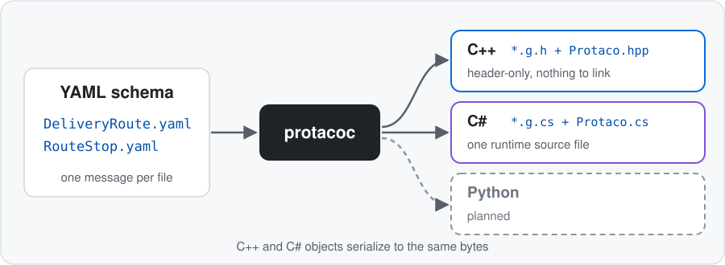
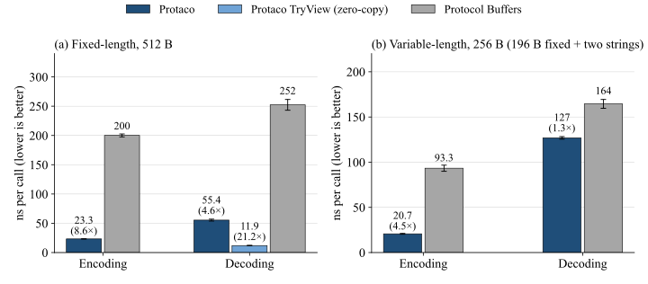
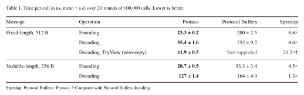
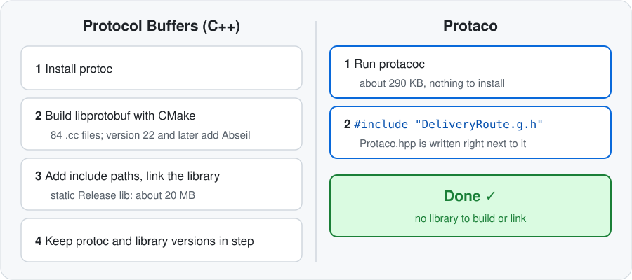
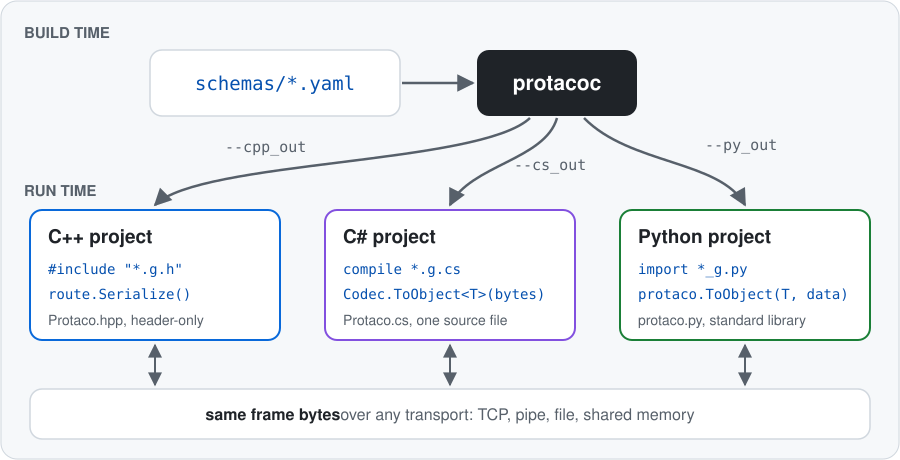
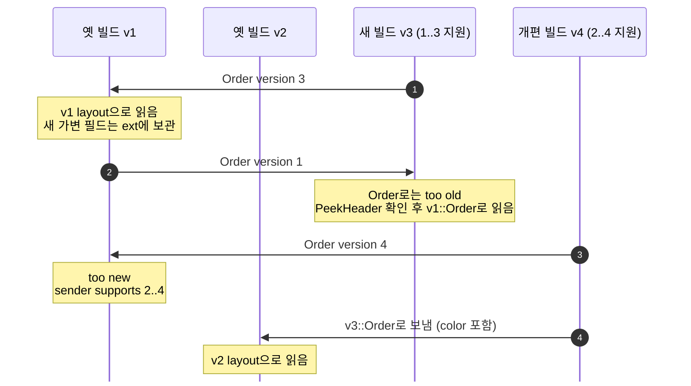

# 🌮 Protaco


[English](README.md) · [예제](examples/README.ko.md) · [상세 참조](docs/reference.ko.md) · [벤치마크](docs/benchmark/README.ko.md)

Protaco는 C++, C#, Python 프로그램이 같은 데이터를 주고받게 해 주는 가벼운 직렬화 도구입니다. 구조체를 선언하듯 YAML에 메시지를 적으면 생성기 `protacoc`가 세 언어의 클래스를 만들어 줍니다. 이 문서는 protacoc 0.6.0과 직렬화 형식 v4를 기준으로 합니다.

### 직렬화가 필요한 순간

- 다른 프로그램, 다른 언어끼리 통신할 때: C++ 게임 서버와 C# 클라이언트, C++ 엔진과 Python 시험 스크립트
- 파일로 저장했다가 다시 읽을 때: 세이브 데이터, 녹화한 입력, 작업 결과
- 다른 PC나 장치와 데이터를 주고받을 때: TCP, UDP, 파이프, 공유 메모리

### Protaco의 방식

C++에서 구조체를 선언하듯 YAML 파일에 메시지를 적습니다. `protacoc`가 그 파일로 C++, C#, Python 클래스를 만들고, 프로그램은 `Serialize()`로 보내고 `ToObject`로 받습니다. 세 언어의 객체가 같은 직렬화 형식을 쓰므로 어느 언어로 보내든 다른 언어에서 받을 수 있습니다. Windows와 Linux에서 같은 바이트를 만듭니다.



### 누구를 위한 도구인가

Protaco는 간단하면서 빠른 것을 원하는 사람을 위해 만들었습니다.

- 게임: 클라이언트와 서버 사이 패킷, 세이브 데이터, 게임과 에디터 사이 데이터
- 툴, 에디터, 시뮬레이터: C++ 코어, C# UI, Python 자동화가 한 데이터를 나눠 쓰는 구성
- PC와 장치 사이, 사내 서비스 사이 메시지: 정해진 필드를 자주, 빠르게 주고받는 곳

이런 곳은 프로그램을 자주 고치고 자주 배포합니다. 새 빌드와 옛 빌드가 섞여 도는 기간이 늘 있으므로, 어떤 version끼리 통신할 수 있는지를 규약으로 관리하면 얻는 것이 큽니다. 반면 Protocol Buffers가 가진 많은 기능까지는 필요 없고, 명시적인 데이터를 빠르게 주고받으면 충분합니다. Protaco는 그 범위에 맞췄습니다.

### zero-copy라서 빠릅니다

Protaco가 빠른 이유는 **zero-copy**입니다. C++에서 고정 길이 필드의 setter는 보낼 프레임 버퍼의 제자리에 바로 씁니다. 그래서 `Serialize()`는 그 버퍼를 복사도 인코딩도 없이 그대로 돌려줍니다. 받는 쪽은 `TryView`로 받은 바이트를 복사하지 않고 제자리에서 읽습니다. 아래는 같은 PC에서 Protocol Buffers와 같은 메시지를 Encoding·Decoding한 호출당 시간입니다.





- 고정 길이 512 B Encoding 8.6배: **zero-copy** Encoding. 걸리는 시간은 거의 setter 호출뿐
- **zero-copy** `TryView` 21.2배: 프레임만 검사하고 객체를 만들지 않고 제자리에서 읽음. Protocol Buffers에는 없는 방식
- 가변 길이 256 B Encoding 4.5배: 고정 필드는 zero-copy, 문자열은 전체 크기를 먼저 계산해 한 번에 기록. 정수는 varint 변환 없이 고정 폭

측정 조건과 해석은 [8.4](#84-측정-조건과-해석)에, 측정 코드와 재현 방법은 [벤치마크 문서](docs/benchmark/README.ko.md)에 있습니다.

### 가볍습니다

C++ 런타임은 헤더 하나, C# 런타임은 소스 파일 하나, Python 런타임은 모듈 하나입니다. 복잡한 CMake 설정도, 패키지 설치도, lib/dll 링크도 없습니다. `protacoc`를 실행하면 생성 코드 옆에 같은 버전의 런타임이 함께 나오고, 생성 헤더를 include하면 끝입니다.



### 옛 빌드와 섞여도 통신합니다

메시지의 version을 올려도 아직 지원하는 옛 version의 클래스가 namespace로 나뉘어 같은 생성 파일에 함께 나옵니다. 새 빌드는 상대가 읽을 수 있는 layout의 클래스를 골라 보내고, 옛 빌드가 보낸 프레임도 그 version의 클래스로 그대로 읽습니다. 그래서 모든 프로그램과 장비를 한 번에 갱신하지 않아도 됩니다. 배포가 섞이는 기간에도 통신이 끊기지 않습니다.

```cpp
shop::Order order;          // 현재 version 3
shop::v1::Order legacy;     // 같은 헤더에 생성된 version 1 클래스. 아직 v1인 상대와 주고받을 때
```

어떤 version끼리 통신할지는 YAML의 `min_version`과 필드별 `added`·`removed`로 정합니다. 지원이 끝난 상대는 잘못 읽는 대신 이유가 적힌 오류를 받습니다([7. 버전 관리](#7-버전-관리)).

### 안정적이고 강건합니다

프레임마다 메시지 이름, version, 스키마 fingerprint가 실립니다. 받는 쪽은 셋을 모두 확인하고, 다른 메시지나 맞지 않는 layout을 조용히 읽는 대신 이유가 적힌 오류를 돌려줍니다. `Try*` 함수는 예외를 던지지 않고 성공 여부와 오류 문자열을 돌려줍니다. YAML 주석은 docstring이 되고, 필드마다 추가·제거된 version이 같은 YAML 파일에 남습니다.

구조가 평평할 필요도 없습니다. 필드 타입으로 다른 YAML의 메시지를 쓰고, 목록, map, enum, 자기 자신을 가리키는 재귀 메시지까지 선언할 수 있습니다.

### 첫 예제

배달 앱을 예로 들어 보겠습니다. 라이더 한 명의 배달 경로를 다른 프로그램에 보내려고 합니다. 경유지 하나를 `RouteStop` 메시지로, 경유지 목록을 담은 경로 전체를 `DeliveryRoute` 메시지로 선언합니다.

[RouteStop.yaml](examples/schemas/RouteStop.yaml)은 경유지 하나입니다. 주문 번호, 주소, 도착까지 남은 시간이 있습니다.

```yaml
message: RouteStop
version: 1
namespace: demo
fields:
  - {key: orderId, type: string(16), desc: order number}
  - {key: address, type: string(48), desc: street address}
  - {key: etaMin, type: int, default: 15, desc: minutes until arrival}
```

[DeliveryRoute.yaml](examples/schemas/DeliveryRoute.yaml)은 라이더와 경유지 목록입니다. `list<RouteStop>`처럼 다른 YAML의 메시지를 타입으로 씁니다.

```yaml
message: DeliveryRoute
version: 1
namespace: demo
fields:
  - {key: rider, type: string, required: true, desc: rider id}
  - {key: stops, type: list<RouteStop>, required: true, desc: stops}
  - {key: note, type: string, default: "", desc: why this route}
```

두 YAML로 코드를 생성하면([3.4](#34-코드-생성)) 아래처럼 생성된 클래스로 보내고 받습니다.

**C++**

```cpp
#include "DeliveryRoute.g.h"   // DeliveryRoute.yaml에서 생성된 헤더

demo::RouteStop stop;
stop.set_orderId("A-100");
stop.set_address("1 Pizza St");

demo::DeliveryRoute route;
route.set_rider("rider-7");
route.mutable_stops().push_back(stop);

const std::vector<uint8_t>& bytes = route.Serialize();   // 보낼 바이트

demo::DeliveryRoute back;                                  // 받는 쪽
std::string error;
if (!protaco::TryToObject(bytes, &back, &error))           // 예외 없음
    std::printf("decode failed: %s\n", error.c_str());
```

<details>
<summary>C#</summary>

```csharp
var route = new demo.DeliveryRoute { Rider = "rider-7" };
route.Stops.Add(new demo.RouteStop { OrderId = "A-100", Address = "1 Pizza St" });
byte[] bytes = route.Serialize();   // C++과 같은 직렬화 형식

demo.DeliveryRoute back;
string error;
if (!Protaco.Codec.TryToObject(bytes, out back, out error))
    Console.WriteLine("decode failed: " + error);
```

</details>

<details>
<summary>Python</summary>

```python
import protaco
from demo.DeliveryRoute_g import DeliveryRoute
from demo.RouteStop_g import RouteStop

route = DeliveryRoute(rider="rider-7")
route.stops.append(RouteStop(orderId="A-100", address="1 Pizza St"))
data = route.Serialize()   # C++, C#과 같은 직렬화 형식

ok, back, error = protaco.TryToObject(DeliveryRoute, data)
if not ok:
    print("decode failed: " + error)
```

</details>

## 목차

1. [개요](#1-개요)
2. [동작 구조](#2-동작-구조)
3. [시작하기](#3-시작하기)
4. [스키마 언어](#4-스키마-언어)
5. [확장 데이터](#5-확장-데이터)
6. [생성 API](#6-생성-api)
7. [버전 관리](#7-버전-관리)
8. [성능](#8-성능)
9. [텍스트 출력](#9-텍스트-출력)
10. [직렬화 형식 v4](#10-직렬화-형식-v4)
11. [제약 사항](#11-제약-사항)
12. [라이선스](#12-라이선스)

## 1. 개요

### 1.1 기능

- 📄 YAML이 곧 IDL입니다. 구조체를 선언하듯 필드를 적고, 다른 메시지, enum, 목록, map, 자기 자신까지 타입으로 씁니다. 메시지끼리는 이름으로 참조하므로 파일 순서는 신경 쓰지 않아도 됩니다.
- C++은 header-only `*.g.h`, C#은 `*.g.cs`, Python은 `*_g.py`로 출력합니다. 따로 빌드하거나 링크할 lib/dll이 없습니다. 생성 파일을 프로젝트에 넣으면 끝입니다!
- 생성할 때마다 코드 옆에 같은 버전의 런타임을 씁니다. 생성기와 런타임 버전이 어긋날 일이 없습니다.
- ⚡ C++에서는 고정 필드의 setter가 최종 바이트를 바로 기록하고, 바뀐 것이 없으면 `Serialize()`가 마지막 바이트를 그대로 돌려줍니다. 받는 쪽은 `TryView`로 복사 없이 읽습니다(C++, C#).
- 🛡️ 받을 때 이름, version, 스키마 fingerprint를 모두 확인합니다. 깨진 데이터가 조용히 읽히는 일이 없습니다.
- 버전 관리가 필드 단위입니다. 필드마다 `added`와 `removed`로 이력을 남기고, 아직 지원하는 옛 version의 클래스도 `v1::Order`처럼 namespace로 나눠 함께 생성합니다.
- 스키마에 없는 키-값도 확장 데이터(ext)로 실어 보낼 수 있습니다. 필요 없으면 `allow_extension: false`로 끕니다.
- 예외 없는 API가 기본입니다. `Try*` 함수는 성공 여부를 돌려주고 실패 이유를 `경로: 이유` 형태의 문자열로 알려 줍니다.
- 메시지마다 Envelope(id, correlation id, 마이크로초 시각)가 있습니다. 객체를 만들면 1씩 늘어나는 id와 현재 시각이 자동으로 찍히고, 응답에는 요청의 id를 correlation id로 담습니다.
- 📝 `ToString()` 한 줄로 필드, enum 이름, 확장 데이터를 로그에 남깁니다.
- 🐧 Windows와 Linux를 정식으로 지원합니다. 문자열은 어디서나 UTF-8입니다.

### 1.2 Protocol Buffers와 비교

Protaco는 Protocol Buffers보다 좁은 범위를 다룹니다. 지원 언어와 기능은 적지만, 도입하는 수고와 실행 비용이 작습니다. 크기 비교는 protobuf 3.21.12를 v141 x64 Release로 빌드한 값입니다.

| 항목 | Protaco | Protocol Buffers (C++) |
|---|---|---|
| 런타임 | 헤더 하나, 약 69 KB, 링크 불필요 | libprotobuf CMake 대상 .cc 84개, 정적 라이브러리 약 20 MB |
| 의존성 | C++ 표준 라이브러리 | 런타임 라이브러리 링크, 버전 22부터 Abseil 추가 |
| 생성기와 런타임 | 생성 코드 옆에 같은 버전의 런타임 출력 | 설치한 런타임과 생성 코드 버전이 맞아야 함, 다르면 생성 헤더에서 컴파일 오류 |
| Encoding | 고정 필드는 setter가 프레임에 직접 기록(zero-copy) | 직렬화할 때 필드마다 인코딩, 정수는 varint |
| Decoding | 고정 필드 메시지는 `TryView`로 복사 없이 읽음(zero-copy) | 메시지 객체로 파싱 |
| 메시지 식별 | 이름, version, 스키마 fingerprint 검사 | 데이터에 이름과 스키마가 없음, 없는 필드는 기본값 |
| 버전 관리 | YAML 하나에 필드별 이력, 옛 version 클래스를 namespace로 함께 생성 | 필드 번호로 관리, 메시지당 클래스 하나 |
| 스키마 문법 | YAML, 구조체를 선언하듯 | `.proto` 언어 |
| 언어 | C++, C#, Python(Windows, Linux) | 다수 |

측정 비교는 [zero-copy라서 빠릅니다](#zero-copy라서-빠릅니다)에 있습니다.

## 2. 동작 구조

`protacoc`는 빌드 시점에 YAML을 읽어 메시지 클래스와 런타임을 씁니다. C++ 프로젝트는 헤더를 include하고, C# 프로젝트는 소스를 함께 컴파일하고, Python은 생성 패키지를 import합니다. 실행 중에는 생성 코드와 런타임만 쓰고 protacoc는 필요 없습니다. 세 언어의 메시지가 같은 직렬화 형식을 쓰므로 TCP, 파이프, 파일, 공유 메모리 등 어떤 전송 수단에도 실을 수 있습니다.



메시지 하나에서 언어마다 파일 하나가 나오고, 아직 지원하는 옛 version 클래스도 그 파일에 함께 들어갑니다. enum은 `<Name>.enum.h`, `<Name>.enum.cs`, `<Name>_enum.py`로, const 파일은 `<Name>.const.h`, `<Name>.const.cs`, `<Name>_const.py`로 나옵니다.

## 3. 시작하기

### 3.1 요구 사항

Windows:

- Visual Studio 2017 이상(MSBuild 15, v141 도구 집합)
- .NET Framework 4.6.1(protacoc, C# 시험)
- Python 3.8 이상(Python 시험과 예제)

Linux:

- .NET SDK 8 이상
- g++(C++17)
- python3 3.8 이상

생성 코드를 쓰는 프로젝트:

- C++: C++14 컴파일러, 표준 라이브러리만
- C#: C# 7.3, .NET Framework 4.6.1 또는 .NET 8
- Python: Python 3.8 이상, 표준 라이브러리만

시험용 googletest는 저장소(`protaco_compiler/tests/googletest`)에 들어 있어 따로 설치하지 않습니다. 빌드와 시험은 Windows와 Linux(WSL Ubuntu 22.04)에서 확인했습니다. macOS는 확인하지 않았습니다.

### 3.2 protacoc 빌드

저장소 루트에서 실행합니다.

**Windows**

```bat
build.cmd
```

**Linux**

```sh
sh build.sh
# dotnet을 ~/.dotnet에 설치했다면
DOTNET=~/.dotnet/dotnet sh build.sh
```

생성기는 Windows에서 `bin\Release\protacoc.exe`, Linux에서 `bin/Release/net8.0/protacoc`로 나옵니다. 두 스크립트는 같은 6단계를 실행합니다: protacoc 빌드, 시험·예제 코드 재생성, C++ 시험, C# 시험, Python 시험, 예제 빌드와 실행. 환경 변수와 저장소 구성은 [빌드와 시험](docs/reference.ko.md#7-빌드와-시험)에 있습니다. Visual Studio에서는 [protaco.sln](protaco.sln)(생성기와 시험)이나 [examples/examples.sln](examples/examples.sln)(예제)을 엽니다.

### 3.3 스키마 작성

앞의 `RouteStop.yaml`, `DeliveryRoute.yaml`을 `schemas` 폴더에 저장합니다. 파일 이름은 정의 이름과 같아야 하고(`RouteStop` → `RouteStop.yaml`), 한 번에 생성하는 파일은 같은 namespace를 씁니다. 문법은 [4. 스키마 언어](#4-스키마-언어)에, 예제 원본은 [examples/schemas](examples/schemas)에 있습니다.

### 3.4 코드 생성

**Windows**

```bat
bin\Release\protacoc.exe -I schemas --cpp_out gen\cpp --cs_out gen\cs --py_out gen\py
```

**Linux**

```sh
bin/Release/net8.0/protacoc -I schemas --cpp_out gen/cpp --cs_out gen/cs --py_out gen/py
```

필요한 언어만 골라도 됩니다. 언어별 출력과 프로젝트에 넣는 방법입니다.

- C++: `gen/cpp`에 `RouteStop.g.h`, `DeliveryRoute.g.h`, 런타임 `Protaco.hpp`. include 경로에 `gen/cpp`를 넣고 `DeliveryRoute.g.h`를 include. 링크할 것 없음
- C#: `gen/cs`에 `RouteStop.g.cs`, `DeliveryRoute.g.cs`, 런타임 `Protaco.cs`. 세 파일을 프로젝트에 넣어 함께 컴파일
- Python: `gen/py/demo/RouteStop_g.py`, `gen/py/demo/DeliveryRoute_g.py`, 런타임 `gen/py/protaco.py`. namespace `demo`가 패키지 폴더. `gen/py`를 `sys.path`에 넣고 `from demo.DeliveryRoute_g import DeliveryRoute`

생성 파일은 UTF-8(BOM)과 CRLF로 쓰므로 어느 OS에서 생성해도 같은 바이트입니다. 생성 파일은 손으로 고치지 않고, YAML을 고친 뒤 다시 생성합니다. 프로젝트 설정 예는 [예제 설명](examples/README.ko.md#2-빌드와-실행)에 있습니다.

### 3.5 명령행 옵션

| 옵션 | 용도 |
|---|---|
| `-I <dir>` | YAML 폴더, 여러 번 지정 가능 |
| `--cpp_out <dir>` | C++ 헤더와 런타임 출력 |
| `--cs_out <dir>` | C# 소스와 런타임 출력 |
| `--py_out <dir>` | Python 패키지와 런타임 출력 |
| `--no_runtime` | 런타임 파일을 쓰지 않음 |
| `--check` | 파일을 쓰지 않고 생성 결과가 최신인지 검사, 다르면 종료 코드 3 |
| `이름...` | 지정한 메시지·enum·const만 생성, 기본은 전부 |

출력 언어는 하나 이상 고릅니다. 종료 코드와 전체 사용법은 [명령행](docs/reference.ko.md#2-명령행)에 있습니다.

## 4. 스키마 언어

### 4.1 파일 규칙

- 파일 하나에 정의 하나. 메시지는 `<Name>.yaml`(맨 위 `message: <Name>`), enum은 `<Name>.enum.yaml`(맨 위 `enum: <Name>`), const 파일은 `<Name>.const.yaml`(맨 위 `const: <Name>`)
- 파일 이름과 정의 이름이 다르면 PC301, 정의 종류와 파일 접미사가 맞지 않으면 PC208
- 파일 이름에 `.bak`(대소문자 무관)가 들어 있으면 읽지 않음. `Menu.bak.yaml` 같은 백업 사본을 폴더에 둬도 됨
- 참조는 이름으로 해결. 입력 파일 순서는 상관없음
- 한 번의 protacoc 실행에 넣는 파일은 모두 같은 namespace(PC405). namespace가 다르면 실행과 출력 폴더를 나눔
- 파일 맨 위 주석은 클래스 docstring. 항목 바로 위 주석, 같은 줄 끝 주석, `desc`는 항목 docstring
- 최상위 `key: value`와 `fields:`·`values:` 아래 `- {k: v, ...}` 항목(한 줄에 하나)만 사용. 일반 YAML 전체를 받지는 않음. flow list `[a, b]`는 PC102
- `{...}` 안의 `,`는 값을 끝냄. 그래서 map 타입은 따옴표로 감쌈: `{key: prices, type: "map<string, double>"}`

### 4.2 메시지 키

```yaml
message: PizzaOrder
version: 2
min_version: 1
namespace: shop
allow_extension: true
desc: a pizza order
fields:
  - {key: orderId, type: string(32), desc: order number}
  - {key: giftNote, type: string, added: 2}
```

| 키 | 필수 | 의미 |
|---|---|---|
| `message` | 예 | 파일 이름과 같은 메시지 이름 |
| `version` | 예 | 현재 version, 1..65535 |
| `namespace` | 예 | `shop` 또는 `shop.orders`처럼 점으로 나눈 이름 |
| `fields` | 예 | 필드 목록 |
| `min_version` | 아니오 | 아직 지원하는 가장 오래된 version, 기본값은 `version`. [버전 관리](#7-버전-관리) 참고 |
| `allow_extension` | 아니오 | 확장 데이터 허용 여부, 기본값 `true` |
| `auto_envelope` | 아니오 | 새 객체에 id와 현재 시각을 찍을지 여부, 기본값 `true`. [Envelope](#65-envelope) 참고 |
| `desc` | 아니오 | docstring에 들어가는 설명 |

namespace `shop.orders`는 C++에서 `shop::orders`, C#에서 `shop.orders`, Python에서 패키지 폴더 `shop/orders/`가 됩니다.

`allow_extension`은 메시지의 수신 규칙을 정합니다. `false`이면 확장 API를 생성하지 않고, 같은 version 프레임에 모르는 키가 있으면 거부합니다. 배포 전에 [확장 데이터](#5-확장-데이터) 정책을 정합니다.

### 4.3 필드 속성

| 속성 | 의미 | 규칙 |
|---|---|---|
| `key` | 필드와 접근자 이름 | 영문으로 시작, 영문·숫자·`_` |
| `type` | 필드 타입 | [4.4 타입](#44-타입) 참고 |
| `required` | 수신할 때 항목이 꼭 있어야 함 | 가변 필드만, 기본값 `false` |
| `default` | 초기값 | 생성 시점에 타입과 표기 검사 |
| `added` | 처음 추가된 version | 기본값 1, 현재 `version` 이하 |
| `removed` | 처음 제거된 version | `added`보다 크고 현재 `version` 이하 |
| `desc` | 필드 설명 | docstring에 기록 |

키는 `_`, `get_`, `set_`, `mutable_`, `has_`, `clear_`로 시작할 수 없습니다. C++·C# 예약어와 생성 멤버 이름(`ext`, `serialize`, `tostring`, `view` 등)도 PC303입니다. C# 속성 이름은 첫 글자를 대문자로 바꾼 키라서, 바꾼 이름끼리 겹치면 PC311입니다. 키가 Python 예약어이면 Python 속성 이름 끝에 `_`를 붙입니다(`from` → `from_`).

`required`는 `string`, `bytes`, `list<T>`, `map<K, V>`, 메시지 필드에 씁니다. 항목이 없으면 `missing required`로 디코딩이 실패합니다. 고정 필드는 고정 영역에 항상 바이트가 있어서 빠질 수 없으므로 `required`를 붙이면 PC305입니다. 값이 맞는지는 받는 코드가 검사합니다. 자기 메시지 타입을 쓰는 재귀 필드도 `required`가 될 수 없습니다(PC306).

`default`는 protacoc가 생성 시점에 검사하고, 잘못된 값은 PC308로 거부합니다.

- `bool`: 따옴표 없는 `true` 또는 `false`
- 정수: 따옴표, `+`, 앞자리 0 없이 타입 범위 안의 값. `uint`, `uint64`는 음수 불가. `int64` 최솟값은 기본값으로 쓸 수 없음
- `double`: 따옴표 없는 십진·지수 표기. NaN, 무한대, 무한대로 넘치는 값은 불가
- 문자열: ASCII만, `string(N)`이면 N바이트 이하
- enum: 따옴표 없는 값 이름. 생략하면 첫 값
- `bytes`, 목록, map, 메시지: 기본값 없음, 빈 값으로 시작

### 4.4 타입

고정 길이 타입은 본문 앞 고정 영역에 들어갑니다.

| 타입 | 크기와 표현 | C++ / C# / Python |
|---|---|---|
| `bool` | 1바이트 | `bool` / `bool` / `bool` |
| `int` | 4바이트, 부호 있음 | `int32_t` / `int` / `int` |
| `int64` | 8바이트, 부호 있음 | `int64_t` / `long` / `int` |
| `uint` | 4바이트, 음수 없음 | `uint32_t` / `uint` / `int` |
| `uint64` | 8바이트, 음수 없음 | `uint64_t` / `ulong` / `int` |
| `double` | 8바이트, IEEE 754 | `double` / `double` / `float` |
| `string(N)` | N바이트 UTF-8, N은 1..4096, 남는 부분은 0 | `std::string` / `string` / `str` |
| enum 이름 | 4바이트(int32) | `enum class` / `enum` / `enum.IntEnum` |

`string(N)`에 N바이트보다 긴 값을 넣으면 C++ setter는 `false`를 돌려주고 기존 값을 유지합니다. C# setter는 `ArgumentException`을 던집니다. Python은 `Serialize()`에서 `protaco.ProtacoError`를 냅니다. Python의 `int`는 크기 제한이 없으므로 타입 범위를 넘는 정수도 `Serialize()`에서 같은 오류가 됩니다.

가변 길이 타입은 키와 길이가 붙은 항목(TLV)으로 실립니다.

| 타입 | 표현 | C++ / C# / Python |
|---|---|---|
| `string` | 길이가 바뀌는 UTF-8 문자열 | `std::string` / `string` / `str` |
| `bytes` | 바이너리, 0과 0xFF도 그대로 | `std::vector<uint8_t>` / `byte[]` / `bytes` |
| `list<T>` | 원소 목록 | `std::vector<T>` / `List<T>` / `list` |
| `map<K, V>` | 순서 없는 키-값 묶음 | `std::unordered_map<K, V>` / `Dictionary<K, V>` / `dict` |
| Protaco 메시지 | 다른 YAML 메시지 이름을 타입으로 씀, 그 메시지 본문이 중첩되어 실림 | 그 메시지의 생성 클래스 |

- 목록 원소: `int`, `int64`, `uint`, `uint64`, `double`, `string`, `bytes`, enum, 메시지. `list<bool>`, `list<string(N)>`, 목록의 목록, 목록의 map은 PC404
- 중첩: 자기 참조를 빼고 100단계까지(PC406). 두 메시지가 서로 참조하면 PC403
- 고정 필드는 YAML에서 가변 필드 사이에 선언해도 본문 앞 고정 영역에 모임. layout 순서는 추가된 version, 그다음 선언 순

### 4.5 enum

enum은 메시지와 같은 모양의 YAML로 따로 선언합니다. 파일 이름은 반드시 `<Name>.enum.yaml`입니다. [PizzaSize.enum.yaml](examples/schemas/PizzaSize.enum.yaml):

```yaml
# Pizza size. Values are int32 in the serialized data; ToString prints Large(3).
enum: PizzaSize
version: 1
namespace: demo
values:
  - {key: Small, value: 1, desc: 10 inch}
  - {key: Medium, value: 2, desc: 12 inch}
  - {key: Large, value: 3, desc: 14 inch}
```

메시지 필드에서는 enum 이름을 타입으로 씁니다: `{key: defaultSize, type: PizzaSize, default: Large}`.

- 최상위 키: `enum`, `version`, `min_version`, `namespace`, `desc`, `values`. 값 속성: `key`, `value`(int32), `added`, `removed`, `desc`
- 값 번호는 한 번 쓰면 다시 쓰지 않음(PC318). 값을 빼려면 줄을 지우지 않고 `removed: N`을 붙임. 번호를 계속 점유하고, 옛 프레임을 출력할 때 이름이 나옴
- 직렬화 데이터에는 int32 번호가 실림. 받는 쪽이 모르는 번호도 버리지 않고 그대로 보관
- 스키마 fingerprint에는 enum 이름만 들어감. 값을 추가해도 이 enum을 쓰는 메시지의 fingerprint는 그대로
- `ToString()`은 `이름(번호)`로 출력: `defaultSize=Large(3)`. 모르는 번호는 `?(9)`

언어별 생성 결과입니다.

- C++ `PizzaSize.enum.h`: `enum class PizzaSize : int32_t`, `const char* EnumName(PizzaSize)`, `bool TryParseEnum(const std::string& name, PizzaSize* out, std::string* error = nullptr)`
- C# `PizzaSize.enum.cs`: `enum PizzaSize : int`, `PizzaSizeNames.Name(value)`, `PizzaSizeNames.TryParse(name, out value)`
- Python `PizzaSize_enum.py`: `class PizzaSize(enum.IntEnum)`, `PizzaSizeNames.Name(value)`, `PizzaSizeNames.TryParse(name)`

**C++**

```cpp
#include "Menu.g.h"

demo::Menu menu;
menu.set_defaultSize(demo::PizzaSize::Medium);
std::printf("%s\n", demo::EnumName(menu.get_defaultSize()));   // 출력: Medium

demo::PizzaSize size;
std::string error;
if (!demo::TryParseEnum("Kids", &size, &error))
    std::printf("%s\n", error.c_str());   // 오류: unknown PizzaSize name: Kids
```

<details>
<summary>C#</summary>

```csharp
var menu = new demo.Menu { DefaultSize = demo.PizzaSize.Medium };
Console.WriteLine(demo.PizzaSizeNames.Name(menu.DefaultSize));   // 출력: Medium

demo.PizzaSize size;
if (!demo.PizzaSizeNames.TryParse("Kids", out size))
    Console.WriteLine("unknown size");
```

</details>

<details>
<summary>Python</summary>

```python
from demo.Menu_g import Menu
from demo.PizzaSize_enum import PizzaSize, PizzaSizeNames

menu = Menu(defaultSize=PizzaSize.Medium)
print(PizzaSizeNames.Name(menu.defaultSize))   # 출력: Medium

size = PizzaSizeNames.TryParse("Kids")
if not size:
    print(size.error)   # 오류: unknown PizzaSize name: Kids
```

</details>

### 4.6 map

`map<K, V>`는 타입이 정해진 키-값 묶음입니다. [Menu.yaml](examples/schemas/Menu.yaml)은 요리 이름별 가격을 map으로 둡니다.

```yaml
  # Map types contain ',', so they are quoted inside {...}.
  - {key: prices, type: "map<string, double>", desc: price by dish name}
```

- 키: `int`, `int64`, `uint`, `uint64`, `string`, enum
- 값: `string(N)`을 뺀 모든 타입. 메시지, enum, bytes, 목록, map 중첩도 가능(예: `map<string, list<string>>`, `map<int64, map<string, int>>`). 목록 값은 목록 원소 규칙을 따름
- map을 목록 원소로 쓸 수는 없음(`list<map<...>>`는 PC404)
- YAML의 `{...}` 안에서는 따옴표로 감쌈. 따옴표가 없으면 PC102와 함께 안내 문구가 나옴
- 바이트에 실리는 항목 순서는 컨테이너 순회 순서. 같은 내용이라도 언어와 구현에 따라 바이트가 다를 수 있고, 디코딩한 내용은 같음
- 디코딩할 때 같은 키가 두 번 나오면 `duplicate map key`로 실패
- `ToString()`은 키를 정렬해서 출력: `prices={"margherita": 9.5, "marinara": 8}`

확장 데이터(ext)도 키-값을 싣지만 스키마 밖의 데이터라서 키와 타입을 읽는 쪽이 확인해야 합니다. map은 키 타입과 값 타입이 스키마에 정해져 있고 수신할 때 검사합니다. 계약에 들어가는 키-값 묶음은 map으로 선언합니다.

**C++**

```cpp
demo::Menu menu;
menu.mutable_prices()["margherita"] = 9.5;
menu.mutable_prices()["marinara"] = 8.0;
double price = menu.get_prices().at("margherita");
```

<details>
<summary>C#</summary>

```csharp
var menu = new demo.Menu();
menu.Prices["margherita"] = 9.5;
menu.Prices["marinara"] = 8.0;
double price = menu.Prices["margherita"];
```

</details>

<details>
<summary>Python</summary>

```python
menu = Menu(prices={"margherita": 9.5, "marinara": 8.0})
price = menu.prices["margherita"]
```

</details>

### 4.7 재귀 메시지

메시지는 자기 자신을 필드 타입으로 쓸 수 있습니다. 트리, 연결 목록, 중첩 메뉴처럼 깊이가 정해지지 않은 구조에 씁니다. 두 가지 모양만 허용합니다.

- `list<Self>`: 자식 목록
- 단일 `Self` 필드: 선택 필드. 값을 넣기 전까지 없고, 없으면 직렬화 데이터에 아무것도 실리지 않음

[Category.yaml](examples/schemas/Category.yaml)은 메뉴 섹션입니다. 섹션 안에 하위 섹션이 있습니다.

```yaml
message: Category
version: 1
namespace: demo
fields:
  - {key: name, type: string, desc: section name}
  - {key: dishes, type: list<string>, desc: dish names}
  - {key: subsections, type: list<Category>, desc: sections inside this one}
```

단일 `Self` 필드는 시험 스키마 [Node.yaml](protaco_compiler/tests/schemas/recursive/Node.yaml)에 있습니다.

```yaml
  - {key: children, type: list<Node>}
  # Absent until set. Nothing in the serialized data while absent.
  - {key: next, type: Node}
```

단일 `Self` 필드의 접근자입니다.

- C++: `has_next()`, `get_next()`(없으면 빈 Node), `mutable_next()`(없으면 만듦), `set_next(node)`, `clear_next()`. 복사는 깊은 복사
- C#: 속성 `Next`, 없으면 `null`
- Python: 속성 `next`, 없으면 `None`

규칙입니다.

- 재귀 필드(`list<Self>`, 단일 `Self`)는 `required` 불가(PC306)
- map 값으로 자기 자신을 쓸 수 없음(PC403). libstdc++의 `std::unordered_map`이 완전한 타입을 요구하기 때문
- 두 메시지가 서로 참조하는 순환(A → B → A)은 PC403
- 재귀 메시지는 자기 필드의 타입으로 쓰이므로 version 기능(`min_version`, `added`, `removed`)을 쓸 수 없음(PC407, [7.9](#79-layout-규칙))
- 디코딩할 때 실제 중첩이 100단계를 넘으면 `nesting too deep`

**C++**

```cpp
demo::Category pizza;
pizza.set_name("pizza");
demo::Category white;
white.set_name("white");
white.mutable_dishes().push_back("bianca");
pizza.mutable_subsections().push_back(white);
```

<details>
<summary>C#</summary>

```csharp
var pizza = new demo.Category { Name = "pizza" };
var white = new demo.Category { Name = "white" };
white.Dishes.Add("bianca");
pizza.Subsections.Add(white);
```

</details>

<details>
<summary>Python</summary>

```python
from demo.Category_g import Category

pizza = Category(name="pizza")
pizza.subsections.append(Category(name="white", dishes=["bianca"]))
```

</details>

### 4.8 const

여러 언어의 코드가 함께 쓰는 이름 붙은 정수는 `<Name>.const.yaml` 파일에 둡니다. 예를 들어 `Limits.const.yaml`:

```yaml
# Limits shared by the C++ core and the C# UI.
const: Limits
namespace: demo
values:
  - {key: MaxStops, value: 16, desc: stops per route}
  - {key: MaxRiders, value: 64}
```

- 최상위 키: `const`, `namespace`, `desc`, `values`. 값 속성: `key`, `value`(int32), `desc`
- const는 직렬화되지 않으므로 const 파일에는 `version`이 없음
- const 이름은 필드 타입이 아님(PC304)

언어별 생성 결과입니다.

- C++ `Limits.const.h`: `namespace Limits { constexpr int32_t MaxStops = 16; ... }`. namespace 범위 `constexpr`라서 C++14에서도 클래스 밖 정의가 필요 없음
- C# `Limits.const.cs`: `public static class Limits { public const int MaxStops = 16; ... }`
- Python `Limits_const.py`: int 클래스 속성을 가진 `class Limits`(Python 키워드인 key는 끝에 `_`가 붙음)

## 5. 확장 데이터

### 5.1 언제 사용하는가

확장 데이터는 YAML에 없는 키-값 항목입니다. YAML과 version을 바꾸지 않고 일부 송신자만 배달 채널, 우선순위, 영수증 같은 부가 정보를 붙일 때 씁니다. 받는 쪽은 모르는 항목도 보관하므로 중계 프로그램을 먼저 갱신하지 않아도 데이터가 전달됩니다.

계약의 일부가 될 데이터는 `added`를 붙인 정식 필드로 선언합니다. 타입이 정해진 키-값 묶음은 [map](#46-map)으로 선언합니다. 실험, 선택적 부가 정보, 중계용 정보에는 확장 데이터를 씁니다. 자주 보내는 고정 필드 메시지는 `allow_extension: false`로 닫으면 의도가 분명해집니다.

### 5.2 쓰기와 읽기

**C++**

```cpp
protaco::CExt& ext = route.GetMutableExt();
ext.SetValue("channel", "web");
ext.SetValue("priority", 2);
ext.SetValue("receipt", std::vector<uint8_t>{0, 0xFF});

std::string channel;
std::string error;
if (!route.GetExt().TryGetValue("channel", &channel, &error))
    std::printf("%s\n", error.c_str());   // 예: ext key not found: channel
```

<details>
<summary>C#</summary>

```csharp
route.Ext.SetValue("channel", "web");
route.Ext.SetValue("priority", 2);
route.Ext.SetValue("receipt", new byte[] { 0, 0xFF });

string channel;
string error;
if (!route.Ext.TryGetValue("channel", out channel, out error))
    Console.WriteLine(error);
```

</details>

<details>
<summary>Python</summary>

```python
route.ext.SetValue("channel", "web")
route.ext.SetValue("priority", 2, protaco.INT)   # 정수는 종류를 밝힘
route.ext.SetValue("receipt", b"\x00\xff")

channel = route.ext.TryGetValue("channel", protaco.STRING)
if not channel:
    print(channel.error)
```

</details>

- `SetValue`: 성공 여부를 돌려줌. 실패 이유는 마지막 인자로 받음(C++ `std::string*`, nullptr 가능, C# `out string`). Python은 `Result`
- `TryGetValue`: 키가 없거나 저장된 타입이 다르면 실패. 출력 값은 C++에서 그대로, C#에서 `default(T)`. 예: `ext key channel holds string, not int`
- 값 타입: `bool`, int32, int64, uint32, uint64, `double`, 문자열, bytes. C++에서 위 타입과 정확히 같지 않은 타입(`float`, `char`, Windows의 `long`, Linux의 `long long` 등)은 컴파일 오류이므로 캐스트해서 넣음
- Python 정수는 크기가 정해져 있지 않으므로 `protaco.INT`, `INT64`, `UINT`, `UINT64` 중 하나를 kind로 줌
- 존재 확인 `Has`, 삭제 `Remove`, 항목 수 `Count`, 키 목록 `Keys`. C++은 `Count()`·`Keys()` 함수, C#은 `Count`·`Keys` 속성, Python은 `Count` 속성과 `Keys()` 함수

다음 키는 `SetValue`가 거부합니다.

- 스키마의 어느 version에든 있는 필드 키(`ext key is a field of the message: rider`)
- `_`로 시작하는 키
- 빈 키, 255바이트를 넘는 키

### 5.3 전달과 타입

받는 쪽은 자기 스키마에 없는 키를 ext에 보관합니다. 다시 직렬화하면 그 항목을 그대로 실으므로, 중계 노드가 값을 몰라도 다음 수신자에게 전달됩니다. 더 새 version의 가변 필드도 옛 수신 측에서는 ext로 보관됩니다.

정식 필드처럼 스키마 검사를 하지 않으므로 읽는 코드가 키와 타입을 확인합니다. 항목마다 키 길이 1바이트, 키, 타입 1바이트, 값 길이 4바이트, 값으로 된 TLV가 붙습니다. `ToString()`에서는 `ext{...}`로 볼 수 있습니다.

### 5.4 닫힌 메시지

`allow_extension: false`이면 확장 API가 생성되지 않습니다(Python은 `ext` 속성이 남아 있지만 `SetValue`가 `ext is off for this message (allow_extension false)`로 실패). 같은 version 프레임에 모르는 키가 있으면 `unknown key (allow_extension false)`로 실패합니다. 더 새 version의 프레임은 수신 측 version의 fingerprint를 확인한 뒤 새 필드를 버립니다.

이 설정도 스키마 fingerprint에 들어갑니다. 배포한 계약에서 값을 바꾸면 호환되지 않으므로 처음부터 메시지의 확장 정책을 정합니다.

## 6. 생성 API

여기서는 자주 쓰는 API를 요약합니다. 전체 시그니처와 예는 상세 참조의 [C++ API](docs/reference.ko.md#4-c-api), [C# API](docs/reference.ko.md#5-c-api), [Python API](docs/reference.ko.md#6-python-api)에 있습니다.

### 6.1 C++ 클래스

클래스는 `<ns>::<Name>`으로 생성됩니다. `<k>`는 YAML의 필드 키, `T`는 그 필드의 C++ 타입입니다.

| 항목 | API | 동작 |
|---|---|---|
| 생성자 | `<Name>()` | 모든 필드를 기본값으로 초기화, Envelope에 새 id와 현재 시각 기록 |
| 고정 필드 | `T get_<k>() const`, `void set_<k>(T)` | 프레임 버퍼에 직접 읽고 쓰기 |
| 고정 문자열 | `bool set_<k>(const std::string&, std::string* error = nullptr)` | 길이를 넘으면 `false`, 기존 값 유지 |
| 가변 필드 | `const T& get_<k>() const`, `void set_<k>(const T&)` | 읽기와 대입 |
| 가변 값 수정 | `T& mutable_<k>()` | 목록, map, bytes, 메시지를 제자리에서 수정. `string`에는 없음 |
| 선택 필드 | `has_<k>()`, `clear_<k>()` | 단일 자기 참조 필드, [4.7](#47-재귀-메시지) |
| 확장 데이터 | `GetExt()`, `GetMutableExt()` | 열린 메시지만 |
| Envelope | `GetId()`, `SetCorr()`, `SetTimestampAsNow()` 등 | [6.5](#65-envelope) |
| 직렬화 | `const std::vector<uint8_t>& Serialize() const` | 객체의 프레임 버퍼 참조 |
| 로그 | `std::string ToString(const protaco::TextStyle& = protaco::TextStyle()) const` | [9. 텍스트 출력](#9-텍스트-출력) |
| 정적 정보 | `MsgName()`, `MsgVersion()`, `MsgMinVersion()`, `MsgSchemaHash()` | 분기와 진단 |
| 읽기 view | `class View` | 고정 필드만 있는 메시지, [6.6](#66-zero-copy) |

`get_`, `set_`, `mutable_`, `has_`, `clear_`는 필드 접근자에만 쓰고, 나머지 공개 함수는 PascalCase입니다. `mutable_<k>()`는 값을 고치려고 참조를 받는 함수라서 `get_`을 붙이지 않습니다.

`Serialize()`가 돌려준 참조는 객체를 바꾸기 전까지 쓸 수 있습니다. 바이트를 계속 보관하려면 복사합니다. 재사용 조건은 [8.3](#83-serialize-재사용)에 있습니다. 옛 version은 `<ns>::v<N>::<Name>`으로 생성되며 그 version의 필드를 가집니다. 버퍼, 필드 목록, 내부 상수는 private이고 런타임이 friend로 접근합니다.

### 6.2 C++ 런타임

런타임은 `Protaco.hpp`, namespace는 `protaco`입니다.

- `TryToObject`: 바이트를 객체로. 예외 없음, 실패하면 출력 객체는 그대로

  **C++**

  ```cpp
  demo::DeliveryRoute back;
  std::string error;
  bool ok = protaco::TryToObject(bytes.data(), bytes.size(), &back, &error);
  ```

- `ToObject<T>`: 실패하면 `protaco::CParseError`를 던짐. `what()`은 `경로: 이유`

  **C++**

  ```cpp
  try { auto back = protaco::ToObject<demo::DeliveryRoute>(bytes); }
  catch (const protaco::CParseError& e) { std::printf("%s\n", e.what()); }
  ```

- `PeekHeader`: 본문을 디코딩하지 않고 헤더만 읽음. `Header{name, version, minVersion, schemaHash, env, bodySize}`

  **C++**

  ```cpp
  protaco::Header header;
  if (protaco::PeekHeader(bytes.data(), bytes.size(), &header))
      std::printf("%s version %u\n", header.name.c_str(), unsigned(header.version));
  ```

- `TextStyle`: 구분자, 괄호, 들여쓰기, 문자열 길이

  **C++**

  ```cpp
  protaco::TextStyle style = protaco::TextStyle::Pretty();
  style.maxText = 32;
  std::string log = route.ToString(style);
  ```

- `TryView<T>`: [6.6 zero-copy](#66-zero-copy). `CExt`: [5.2](#52-쓰기와-읽기). `NextId()`, `NowUs()`, `SetClock()`, `DisableAutoEnvelope()`, `TryGetTime()`: [6.5 Envelope](#65-envelope)

`CParseError`는 던진 모듈 안에서 잡고 DLL 경계를 넘기지 않습니다. DLL 경계에서는 `TryToObject`를 씁니다.

### 6.3 C#

클래스는 `<ns>.<Name>`, 런타임은 `Protaco.cs`의 `Protaco` namespace입니다.

<details>
<summary>C#</summary>

```csharp
var route = new demo.DeliveryRoute { Rider = "rider-7" };
route.Stops.Add(new demo.RouteStop { OrderId = "A-100", Address = "1 Pizza St" });
byte[] bytes = route.Serialize();   // 호출마다 새 배열

demo.DeliveryRoute back;
string error;
bool ok = Protaco.Codec.TryToObject(bytes, out back, out error);   // 예외 없음
var again = Protaco.Codec.ToObject<demo.DeliveryRoute>(bytes);     // 실패하면 ProtacoException

Protaco.Header header;
Protaco.Codec.PeekHeader(bytes, out header);
string pretty = route.ToString(Protaco.TextStyle.Pretty());
```

</details>

- 필드는 키의 첫 글자만 대문자로 바꾼 속성(`orderId` → `OrderId`). 고정 문자열은 길이를 넘기면 `ArgumentException`
- 열린 메시지는 `Ext` 속성. API는 [5.2](#52-쓰기와-읽기)
- Envelope는 C++과 같은 이름의 메서드(`GetId()`, `SetCorr()`, `SetTimestampAsNow()` 등)
- `MsgName`, `MsgVersion`, `MsgMinVersion`, `MsgSchemaHash`는 상수: `demo.DeliveryRoute.MsgName`
- 옛 version은 `shop.v1.Order`처럼 별도 namespace
- `ProtacoException`의 `Path`, `What`으로 위치와 이유 확인. `Message`는 `경로: 이유`
- 런타임용 내부 멤버는 명시적 인터페이스 구현 뒤에 숨김. 문자열은 UTF-8

### 6.4 Python

`--py_out` 폴더를 `sys.path`에 넣고 생성 모듈을 import합니다. 런타임은 `protaco` 모듈입니다.

<details>
<summary>Python</summary>

```python
import protaco
from demo.DeliveryRoute_g import DeliveryRoute
from demo.RouteStop_g import RouteStop

route = DeliveryRoute(rider="rider-7")   # 키워드 인자, 모르는 키는 TypeError
route.stops.append(RouteStop(orderId="A-100", address="1 Pizza St"))
data = route.Serialize()                 # bytes 반환

ok, back, error = protaco.TryToObject(DeliveryRoute, data)   # 예외 없음
back = protaco.ToObject(DeliveryRoute, data)                 # 실패하면 protaco.ProtacoError
header = protaco.PeekHeader(data).value
print(route.ToString(protaco.TextStyle.Pretty()))
```

</details>

- 속성 이름은 YAML 키 그대로. Python 예약어는 끝에 `_`(`from` → `from_`)
- `Result`: 실패면 거짓. `.ok`, `.value`, `.error`, `ok, value, error = ...`로 풀기
- 범위를 넘는 값은 `Serialize()`에서 `protaco.ProtacoError`(예: `orderId: 17 bytes, longer than string(16)`)
- 옛 version은 같은 모듈의 `v<N>` 아래: `from shop.Order_g import Order, v1` → `v1.Order`
- 표준 모듈과 같은 이름의 namespace(예: `types`)는 그 표준 모듈을 가리므로 피함
- 고정 영역은 `struct.Struct` 한 번으로 묶고 풀므로 View가 따로 없음

### 6.5 Envelope

프레임 헤더에는 Envelope 값 세 개가 실립니다. 객체를 만들 때 id와 시각이 자동으로 찍히고, corr는 사용자가 씁니다.

- id(u32): 메시지마다 새 번호. 모듈 전역 카운터라서 여러 메시지 종류가 섞인 로그에서도 id 하나로 메시지를 찾음. 1부터 시작, 0은 건너뜀, 스레드 안전
- corr(u32): 응답이 가리키는 요청의 id
- ts(i64): 1970-01-01 기준 UTC 마이크로초
- 디코딩한 객체는 새 id를 쓰지 않고 받은 Envelope를 그대로 가짐. 생성 코드가 만드는 중첩 필드 객체도 id를 쓰지 않음(중첩 본문에는 Envelope가 없음)
- Envelope를 직접 채우려면 그 메시지의 YAML 헤더에 `auto_envelope: false`, 모듈의 모든 메시지에 적용하려면 `protaco::DisableAutoEnvelope()`(C# `Protaco.Envelopes.DisableAutoEnvelope`, Python `protaco.DisableAutoEnvelope`). 이때 새 객체는 id 0, ts 0으로 시작. `EnableAutoEnvelope()`는 기본 동작 복원

**C++**

```cpp
demo::DeliveryRoute request;              // 새 id와 현재 시각
demo::DeliveryRoute reply;
reply.SetCorr(request.GetId());           // 응답이 가리키는 요청

std::string date;
std::string time;
if (reply.TryGetTimeFromTimestamp(&date, &time))
    std::printf("%s %s\n", date.c_str(), time.c_str());   // 예: 2026-10-20 03:07:13.941056

reply.SetTimestampAsNow();                // 보내기 직전 시각으로 다시 기록
```

<details>
<summary>C#</summary>

```csharp
var request = new demo.DeliveryRoute();
var reply = new demo.DeliveryRoute();
reply.SetCorr(request.GetId());

string date;
string time;
if (reply.TryGetTimeFromTimestamp(out date, out time))
    Console.WriteLine(date + " " + time);

reply.SetTimestampAsNow();
```

</details>

<details>
<summary>Python</summary>

```python
request = DeliveryRoute()
reply = DeliveryRoute()
reply.SetCorr(request.GetId())

when = reply.TryGetTimeFromTimestamp()
if when:
    date, time_text = when.value

reply.SetTimestampAsNow()
```

</details>

- 개별 접근: `GetId()`, `SetId()`, `GetCorr()`, `SetCorr()`, `GetTimestamp()`, `SetTimestamp()`. 한 번에: `GetEnvelope()`, `SetEnvelope()`
- `TryGetTimeFromTimestamp`: 로컬 시각을 날짜·시각 문자열로, 또는 연·월·일·시·분·초·밀리초·마이크로초로 받음(Python은 `TryGetTimeFromTimestampParts()`)
- 2000-01-01부터 9999-12-31(UTC) 밖의 ts는 시각으로 보지 않음. `TryGetTimeFromTimestamp`는 실패하고 `ToString`은 정수 그대로 출력
- `protaco::SetClock(fn)`: 시계 교체(시험, 시뮬레이션 시간). nullptr이면 시스템 시계. 메시지를 만들기 전에 설정(C# `Protaco.Envelopes.SetClock`, Python `protaco.SetClock`)
- 모듈 함수: `protaco::NextId()`(다음 id), `protaco::NowUs()`(현재 UTC 마이크로초), `protaco::TryGetTime(ts, &date, &time, &error)`(ts를 로컬 날짜·시각 문자열로). C# `Protaco.Envelopes`, Python `protaco` 모듈에도 같은 이름

### 6.6 zero-copy

고정 필드만 있는 메시지는 `TryView`로 받은 바이트를 복사 없이 읽습니다. `TryToObject`와 같은 프레임 검사(이름, version, fingerprint, 길이)를 하고, 통과하면 view가 바이트를 가리킵니다.

**C++**

```cpp
const std::vector<uint8_t>& received = Receive();   // 받은 바이트
demo::Heartbeat::View view;                         // received가 살아 있고 바뀌지 않는 동안 유효
std::string error;
if (protaco::TryView<demo::Heartbeat>(received, &view, &error))
    std::printf("node=%s uptime=%d\n", view.get_node().c_str(), view.get_uptimeSec());
```

<details>
<summary>C#</summary>

```csharp
demo.Heartbeat.View view;   // received가 바뀌지 않는 동안 유효
if (demo.Heartbeat.TryView(received, out view))
    Console.WriteLine("node=" + view.Node + " uptime=" + view.UptimeSec);
```

</details>

- `View`는 그 version에 가변 필드가 없는 메시지에만 생성됨. 필드 getter와 Envelope getter만 있음
- `TryView`는 받은 바이트를 복사하지 않음. C++은 고정 영역 뒤 항목(확장 데이터, 새 version 필드)이 16개 이하이면 할당도 없고, C#은 프레임 검사용 객체를 만듦. view는 바이트를 가리킬 뿐이라 바이트가 살아 있고 바뀌지 않는 동안만 유효. 고정 문자열 getter는 읽을 때 `std::string`(C# `string`)을 새로 만듦
- C++에 임시 vector(`std::vector&&`)를 넘기면 컴파일 오류. 바로 사라질 바이트를 가리키지 않게 막는 장치
- 확장 데이터(ext)는 view로 볼 수 없음
- Python에는 View가 없음([6.4](#64-python))

C++에서는 받은 버퍼를 객체에 넘겨줄 수도 있습니다. `ToObject`나 `TryToObject`에 `std::move`로 vector를 주면, 프레임이 그 클래스의 version layout과 정확히 같을 때(같은 지원 version 범위와 fingerprint) 그 버퍼가 그대로 객체의 프레임 버퍼가 됩니다. 이후 `Serialize()`는 가변 필드나 ext를 바꾸기 전까지 그 버퍼를 돌려줍니다. 더 새 version 등 다른 프레임은 보통처럼 복사합니다.

**C++**

```cpp
std::vector<uint8_t> bytes = Receive();
demo::DeliveryRoute route = protaco::ToObject<demo::DeliveryRoute>(std::move(bytes));   // 버퍼를 넘겨받음
```

### 6.7 오류 처리

디코딩에서 예외를 던지는 함수는 `ToObject` 셋뿐입니다: C++ `protaco::ToObject`(`CParseError`), C# `Protaco.Codec.ToObject`(`ProtacoException`), Python `protaco.ToObject`(`ProtacoError`). 나머지 `Try*` 함수는 성공 여부를 돌려주고(Python은 `Result`), 실패 이유를 선택 인자로 알려 줍니다.

- C++: 마지막 인자 `std::string* error = nullptr`. nullptr이면 이유를 받지 않음. 실패하면 출력 인자는 그대로
- C#: `out string error`가 있는 오버로드와 없는 오버로드
- Python: `Result.error`
- 오류 문자열은 `경로: 이유`. 예: `delivery.doorCode: list element type mismatch`, `sections[0].name: type mismatch: expected string, got int`. 경로가 없으면 이유만: `message name mismatch: expected DeliveryRoute, got Heartbeat`
- 세 언어가 같은 문구. 전체 목록은 [디코딩 오류](docs/reference.ko.md#32-디코딩-오류)

값을 넣을 때의 검사는 언어마다 다릅니다. C++ `string(N)` setter, `CExt::SetValue`, `TryParseEnum`, `TryGetTime`은 `bool`과 오류 문자열을 돌려줍니다. C# 고정 문자열 setter는 `ArgumentException`을 던지고, Python은 범위를 넘는 값에 `Serialize()`에서 `protaco.ProtacoError`를 냅니다([4.4](#44-타입)).

## 7. 버전 관리

### 7.1 왜 필요한가

프로그램은 한꺼번에 갱신되지 않습니다. 새 빌드와 옛 빌드가 함께 통신하는 동안 어떤 메시지를 읽을 수 있고 언제 거부해야 하는지가 분명해야 합니다. Protaco는 YAML 하나에 지원하는 version의 이력을 기록하고, 수신 실패를 이름, version, fingerprint별 오류로 알려 줍니다.

| 변경 | YAML에서 할 일 | 옛 빌드에서 일어나는 일 |
|---|---|---|
| 작은 변경(필드 추가·제거) | `version` 올림, 필드에 `added`/`removed` | 계속 통신 |
| 개편 수준 변경 | `version` 올림, `min_version` 올림 | 잘못 읽지 않고 이유가 적힌 오류 |

### 7.2 작은 변경

필드를 추가하거나 제거할 때는 `version`을 올리고 그 필드에 `added`나 `removed`를 붙입니다. `min_version`은 그대로 둡니다. 옛 layout의 fingerprint가 유지되므로 새 빌드와 옛 빌드가 계속 통신합니다. 옛 수신 측이 필수로 요구하는 가변 필드를 제거했다면 [layout 규칙](#79-layout-규칙)에 따라 옛 클래스로 보냅니다.

### 7.3 개편 수준 변경

더 지원할 수 없는 옛 version은 `min_version`을 올려 끊습니다. 예를 들어 version 3에서 `min_version: 3`으로 바꾸면 옛 수신 측은 다음 오류를 받습니다.

```text
message version too new: Order reads version 1, sender supports 3..3
```

새 빌드도 너무 오래된 프레임을 `message version too old`로 거부합니다. 서로 다른 layout을 잘못 읽는 일은 생기지 않습니다. 크게 바뀌는 필드는 기존 필드를 `removed`로 남기고 새 키의 필드를 `added`로 추가합니다.

### 7.4 version 선언

```yaml
message: Order
version: 3          # 현재 version
min_version: 1      # 가장 오래된 지원 version, 생략하면 version과 같음
namespace: shop
fields:
  - {key: id,     type: string(8)}
  - {key: weight, type: double, default: 0.5, added: 2}
  - {key: qty,    type: int, default: 1, removed: 3}  # 고정 바이트 유지, 기본값으로 채움
  - {key: note,   type: string, removed: 3}           # version 3부터 보내지 않음
  - {key: color,  type: string, required: true}
  - {key: tags,   type: list<string>, added: 2}
  - {key: label,  type: string, added: 3}
  - {key: rush,   type: bool, added: 3}
```

필드는 `added`에 적힌 version에서 처음 생기고, `removed`에 적힌 version부터 없습니다. `added`의 기본값은 1입니다.

`version`은 현재 version, `min_version`은 아직 지원하는 가장 오래된 version입니다. 생략하면 현재 version 하나만 지원합니다. 지원하는 version은 메시지당 최대 255개입니다.

### 7.5 생성 클래스

- C++: `shop::Order`(현재 version 3), `shop::v1::Order`, `shop::v2::Order`
- C#: `shop.Order`, `shop.v1.Order`, `shop.v2.Order`
- Python: `Order_g.py` 안의 `Order`, `v1.Order`, `v2.Order`

옛 version 클래스는 지원하는 version마다 하나씩, 그 version의 필드로 생성됩니다. 프레임 헤더에는 송신 측 `version`, `min_version`, 지원하는 version마다 4바이트 스키마 fingerprint가 실립니다. 새 version을 추가해도 옛 version의 fingerprint는 그대로입니다. fingerprint 계산 방법은 [스키마 fingerprint](docs/reference.ko.md#1-스키마-fingerprint)에 있습니다.

### 7.6 수신 판정

version 3인 `Order` 클래스가 프레임을 받으면 다음 순서로 검사합니다. `TryView`도 같습니다.

```text
if 프레임의 메시지 이름 != "Order"
    거부: message name mismatch: expected Order, got Heartbeat
if 프레임의 version < 3
    거부: message version too old: Order reads version 3 or newer, got 1. Use the v1 type
if 송신 측 min_version > 3
    거부: message version too new: Order reads version 3, sender supports 4..5
if 프레임에 실린 version 3 fingerprint != Order::MsgSchemaHash()
    거부: schema mismatch: Order version 3 expected 0x..., got 0x...
version 3 layout으로 디코딩
    더 새 version의 가변 필드는 열린 메시지면 ext에 보관, 닫힌 메시지면 버림
```

`Use the v1 type`은 그 version의 옛 클래스가 생성되어 있을 때만 붙습니다. 이때는 `PeekHeader()`로 version을 확인하고 `v1::Order`로 읽습니다.

### 7.7 송신

클래스는 항상 자기 version으로 보냅니다. `min_version`부터 자기 version까지의 fingerprint를 프레임에 넣습니다. 옛 layout이 필요한 상대에게는 `v1::Order` 같은 옛 클래스에 값을 채워 직렬화합니다.

### 7.8 배포 경우별 그림

네 빌드가 `Order`를 주고받는 경우를 한 그림에 모았습니다. 개편 빌드는 version 4에서 필수 필드 `color`를 제거하고 `min_version`을 2로 올린 빌드입니다.



### 7.9 layout 규칙

- 고정 필드는 추가된 version, 그다음 선언 순으로 놓음. 새 version의 고정 필드는 기존 고정 영역 끝에 붙음
- 제거된 고정 필드의 바이트는 계속 남고 기본값으로 채움. YAML의 그 줄도 남김
- 제거된 가변 필드는 보내지 않음. `min_version`이 그 필드의 `removed`에 도달하면 YAML의 그 줄을 지움(PC313)
- 제거된 가변 필드가 옛 version에서 `required`였다면 새 프레임은 `missing required (frame version 4 read as 2)`로 거부될 수 있음. 이런 상대에게는 그 필드가 남아 있는 옛 클래스로 보냄
- 필드 타입으로 쓰이는 메시지는 `min_version`, `added`, `removed`를 쓸 수 없음(PC407). 중첩 본문에는 version이 실리지 않기 때문. 중첩 구조를 바꿔야 하면 새 메시지를 추가. 재귀 메시지도 자기 필드의 타입이므로 같은 규칙
- enum 값의 추가·제거는 enum의 `version`을 올리고 값에 `added`·`removed`를 붙임. fingerprint에는 enum 이름만 들어가므로 메시지 호환성에는 영향 없음. 받는 쪽은 모르는 번호도 보관

### 7.10 배포된 스키마 바꾸기

배포 전에는 version을 유지한 채 자유롭게 고칩니다. 배포한 version의 계약은 동결합니다.

- 필드 추가(`added`), 필드 제거(`removed`), `min_version` 상향은 각각 `version`을 올려 반영. 새 메시지 추가는 언제나 가능
- 기존 필드의 타입, `required`, `default`, 이름, 순서를 바꾸거나 제거한 키를 다시 쓰면 옛 계약과 호환되지 않음. 기존 필드를 제거하고 새 키의 필드를 추가
- 메시지 이름과 `allow_extension` 변경도 기존 계약과 호환되지 않음. 새 메시지로 분리하거나 옛 version 지원을 끝냄
- 호환되지 않는 스키마로 만든 프레임은 이름이나 fingerprint 검사에서 거부됨
- 주석, `desc`, `namespace`는 직렬화 바이트에 영향 없음

실제 개정 파일과 빌드 사이 교환은 [버전 관리 예제](examples/README.ko.md#6-버전-관리-예제)에 있습니다.

## 8. 성능

### 8.1 크기

| 구성 요소 | 크기 | 실행 조건 |
|---|---|---|
| `Protaco.hpp` | 2,397줄, 약 69 KB | C++14, 표준 라이브러리만 |
| `Protaco.cs` | 2,031줄 | C# 7.3, .NET Framework 4.6.1 또는 .NET 8, 패키지 없음 |
| `protaco.py` | 1,118줄 | Python 3.8 이상, 표준 라이브러리만 |
| `protacoc.exe` | 약 290 KB, 단일 파일 | .NET Framework 4.6.1. Linux는 .NET 8의 `protacoc`와 `protacoc.dll` |

생성 C++ 클래스에는 reflection, descriptor 표, 가상 함수가 없습니다.

### 8.2 고정 필드 직접 기록

C++에서 고정 필드는 프레임 버퍼 안에 자리가 정해져 있습니다. setter가 최종 바이트를 바로 기록하므로, 고정 필드만 있고 ext가 비어 있으면 `Serialize()`에서 더할 일이 없습니다. C#과 Python은 필드를 객체에 두고 `Serialize()`할 때 바이트를 만듭니다.

**C++**

```cpp
demo::Heartbeat beat;                    // 모든 필드 고정, allow_extension: false
beat.set_uptimeSec(10);                  // 프레임 버퍼에 바로 기록
const auto& bytes = beat.Serialize();    // 버퍼 그 자체, 복사·인코딩 없음
beat.set_uptimeSec(11);                  // bytes에도 바로 11이 보임
```

고정 필드는 본문 앞에 모입니다. 가변 필드를 붙일 때는 전체 크기를 먼저 계산하고 한 번에 할당합니다.

### 8.3 Serialize 재사용

C++은 마지막 `Serialize()` 이후 가변 필드와 ext가 바뀌지 않았다면 가변 블록을 다시 만들지 않습니다. 이때 `Serialize()`는 크기 계산, 할당, 복사, 인코딩을 하나도 하지 않고 지난번 바이트를 그대로 돌려줍니다. 같은 메시지를 여러 상대에게 보내거나 다시 보낼 때 직렬화 비용이 사실상 없습니다.

경유지 2개인 `DeliveryRoute`(258 B)에서 다시 `Serialize()`는 호출당 약 1.3 ns입니다. `set_note` 뒤 가변 블록을 다시 만들면 약 22 ns로, 재사용이 약 17배 빠릅니다. 측정 PC와 컴파일러는 [8.4](#84-측정-조건과-해석)와 같고, 값은 C++ 시험 `SerializeReuseCostsLittle`의 5라운드 중 최솟값입니다.

- 가변 필드의 `set_` 호출, ext의 변경, 복사 디코딩 뒤 다시 만듦. 이동 버퍼를 그대로 넘겨받은 경우는 [6.6](#66-zero-copy)의 재사용 조건 적용
- `mutable_<k>()`를 한 번이라도 부른 객체는 그 참조를 통한 수정을 추적할 수 없으므로 매번 가변 블록을 다시 만듦
- 재사용 이득이 필요하면 목록, map, bytes, 메시지도 `set_`으로 넣음
- 복사한 객체는 첫 직렬화 때 다시 만듦
- C#은 호출마다 새 `byte[]`를, Python은 새 `bytes`를 만들며 이 재사용을 하지 않음

**C++**

```cpp
route.set_stops(std::vector<demo::RouteStop>{stop});
const auto& first = route.Serialize();
const auto& again = route.Serialize();   // 가변 필드와 ext가 그대로면 재사용
```

위 예는 `mutable_stops()`를 부르지 않은 객체를 전제로 합니다. 디코더는 본문당 가변 필드가 16개 이하면 필드 목록을 스택에 두어 힙 할당을 줄입니다.

### 8.4 측정 조건과 해석

[zero-copy라서 빠릅니다](#zero-copy라서-빠릅니다)의 그림과 표는 아래 조건에서 측정했습니다.

- PC: Intel Core i9-13900H, Windows 11
- 컴파일러: MSVC 14.16(v141) x64, `/O2 /MD`
- 대상: protaco 0.6.0, protobuf 3.21.12 정적 라이브러리(같은 도구 집합으로 빌드)
- 반복: 10,000회 warm-up 후 100,000회 호출 × 20라운드. 라운드별 호출당 시간의 평균과 표준편차. 세 번 실행해 사례마다 중앙값인 실행을 씀
- 객체는 호출 사이에 재사용(두 라이브러리의 권장 방식)
- Encoding: 모든 필드 setter와 직렬화. protobuf는 재사용 버퍼에 `SerializeToArray`
- Decoding: 바이트를 객체로 바꾼 뒤 필드 하나 읽기. protaco `TryToObject`, protobuf는 재사용 메시지에 `ParseFromArray`
- `TryView`: 같은 프레임 검사 후 제자리에서 필드 하나 읽기. 배율은 protobuf Decoding과 비교

메시지입니다. 스키마 이름은 `Fixed512`, `Mixed256`입니다.

- 고정 길이 512 B: 고정 필드만, 고정 영역 512바이트(고정 문자열 2개, int64 4개, int 32개, double 32개, bool 8개). 프레임 protaco 556 B, protobuf 571 B
- 가변 길이 256 B: 고정 영역 196바이트와 가변 문자열 2개(24, 16바이트), 키 포함 256바이트. 프레임 protaco 300 B, protobuf 268 B

결과 해석입니다. zero-copy로 빨라지는 이유는 [zero-copy라서 빠릅니다](#zero-copy라서-빠릅니다)에 있습니다.

- 문자열이 있는 Decoding은 차이가 작음. protaco는 새 객체로 디코딩해서 15바이트(MSVC의 짧은 문자열 limit)를 넘는 문자열마다 할당이 생기고, protobuf는 재사용 메시지의 문자열 버퍼를 다시 씀
- 정수는 고정 폭이고 헤더에 이름, version, fingerprint가 실리므로 작은 정수가 많은 데이터는 varint 형식보다 클 수 있음(가변 길이 256 B: 300 B 대 268 B)
- 수치는 이 메시지와 이 PC의 결과. 데이터 구성과 하드웨어에 따라 달라짐

스키마, 측정 코드, 재현 방법은 [docs/benchmark/README.ko.md](docs/benchmark/README.ko.md)에 있습니다.

## 9. 텍스트 출력

`ToString()`은 필드를 YAML 순서로 출력하고, 확장 항목을 끝의 `ext{...}`에 표시합니다.

**C++**

```cpp
std::string line = route.ToString();
std::string pretty = route.ToString(protaco::TextStyle::Pretty());
```

<details>
<summary>C#</summary>

```csharp
string line = route.ToString();
string pretty = route.ToString(Protaco.TextStyle.Pretty());
```

</details>

<details>
<summary>Python</summary>

```python
line = str(route)
pretty = route.ToString(protaco.TextStyle.Pretty())
```

</details>

C++ 예제 프로그램의 실제 출력입니다(Envelope 시각은 실행마다 다르고, C#·Python 예제는 다른 Envelope id를 출력).

```text
DeliveryRoute{rider="rider-7", stops=[RouteStop{orderId="A-100", address="1 Pizza St", etaMin=15}], note="", ext{priority=5}}
DeliveryRoute{
  envelope{id=8, corr=0, ts=2026-10-20 03:07:13.940328},
  rider="rider-7",
  stops=[
    RouteStop{
      orderId="A-100",
      address="1 Pizza St",
      etaMin=15
    }
  ],
  note="",
  ext{
    priority=5
  }
}
Menu{store="NAPOLI-1", defaultSize=Large(3), prices={"margherita": 9.5, "marinara": 8}, sections=[Category{name="pizza", dishes=["margherita", "marinara"], subsections=[Category{name="white", dishes=["bianca"], subsections=[]}]}]}
```

- 문자열: 따옴표와 escape(`\"`, `\\`, `\n`, `\r`, `\t`, 제어 문자 `\xHH`). `maxText`보다 길면 `"abcd"...(+12)`처럼 생략한 길이 표시
- bytes: 크기와 앞 8바이트. 예: `<11 bytes: FF D8 00 10 4A 46 49 46 ...>`
- double: 유효 숫자 15자리(`%.15g`), `nan`, `inf`, `-inf`
- enum: `Large(3)`, 모르는 번호는 `?(9)`
- map: 키를 정렬해서 출력
- 값이 없는 선택 필드: `null`
- `TextStyle` 기본값: `separator = ", "`, `open = "{"`, `close = "}"`, `indent = 0`(한 줄), `maxText = 64`, `envelope = false`
- `TextStyle::Pretty(indentWidth = 2)`: 한 항목 한 줄, 들여쓰기, 맨 앞에 Envelope. ts가 시각 범위 밖이면 정수 그대로(`ts=1000`)
- ASCII 값은 세 언어가 같은 결과. 길이 제한은 C++은 바이트 수, C#과 Python은 문자 수 기준

전체 흐름은 [예제 프로그램](examples/README.ko.md#45-텍스트-출력)에서 볼 수 있습니다.

## 10. 직렬화 형식 v4

모든 정수는 little-endian입니다. 문자열은 NUL 종료 없이 UTF-8 바이트로 기록합니다.

```text
Frame
  'P' 'C'          magic
  FrameVer u8      = 4
  NameLen  u8
  Name             메시지 이름 (UTF-8)
  MsgVer   u16     메시지 version
  MinVer   u16     송신 측이 지원하는 가장 오래된 version
  Id       u32 ┐
  Corr     u32 │   Envelope
  Ts       i64 ┘
  BodyLen  u32     본문 크기, 잘림과 뒤에 붙은 바이트 검출
  Schema   u32 × (MsgVer - MinVer + 1)   version MinVer..MsgVer의 fingerprint
  Body

Body (중첩 메시지도 같은 모양)
  FixedLen u32     같은 version이면 수신 측 고정 영역과 같고, 새 version이면 같거나 더 큼
  Fixed            고정 필드, 직렬화 순서, padding 없음
  Var*             가변 필드 TLV, 직렬화 순서
  Ext*             확장 항목 TLV, 추가 순서

TLV
  KeyLen u8 | Key | Type u8 | Len u32 | Value

TacoType
   1 bool    1바이트 (0 또는 1)
   2 int     4바이트
   3 int64   8바이트
   4 double  8바이트 IEEE 754
   5 string  UTF-8 바이트
   6 message Body
   7 list    ElemType u8 | Count u32 | (Len u32 | Value) × Count
   8 bytes   원본 바이트
   9 uint    4바이트
  10 uint64  8바이트
  11 map     KeyType u8 | ValueType u8 | Count u32 | (KeyLen u32 | Key | ValueLen u32 | Value) × Count
```

enum은 Type 2(int)로 실립니다. 헤더 크기는 28바이트 + 이름 + 지원 version당 4바이트입니다. 모르는 Type 번호도 길이가 있으므로 건너뛰거나 ext로 보관할 수 있습니다.

limit은 다음과 같습니다.

- 프레임: 4 GiB - 1(모든 길이 u32). C#은 배열 limit으로 약 2 GiB
- 중첩: 100단계. protacoc와 디코더가 모두 검사
- 지원 version: 메시지당 255개
- 가변 필드: 본문당 1,024개
- 목록 원소 수: 남은 바이트를 4로 나눈 값 이하. map 항목 수: 남은 바이트를 8로 나눈 값 이하
- 키: 255바이트

fingerprint 계산과 오류 목록은 [상세 참조](docs/reference.ko.md)에 있습니다.

## 11. 제약 사항

- little-endian 플랫폼만 지원
- 고정 길이 배열 없음. `list<T>`를 씀
- 목록의 목록, 목록의 map 없음. 원소를 메시지로 감싸거나 map 값에 목록을 둠
- 재귀는 `list<Self>`와 단일 `Self` 필드만. map 값의 자기 참조와 서로 참조하는 메시지는 없음
- 프레임마다 헤더 28바이트, 이름, 지원 version당 4바이트 fingerprint가 붙고 고정 문자열은 padding을 채움. 작은 정수가 많은 데이터는 varint 형식보다 클 수 있음
- map의 바이트 순서는 컨테이너 순회 순서. 같은 내용의 map이라도 바이트가 같다는 보장이 없으므로 바이트 비교로 같음을 판정하지 않음
- C#이 읽고 쓰는 프레임은 약 2 GiB까지
- 진단과 생성 코드의 고정 문구는 영어. docstring은 YAML 주석의 언어를 그대로 씀

## 12. 라이선스

[MIT](LICENSE). Copyright (c) 2026 Soo-Hwan Cho (Splendidz).
