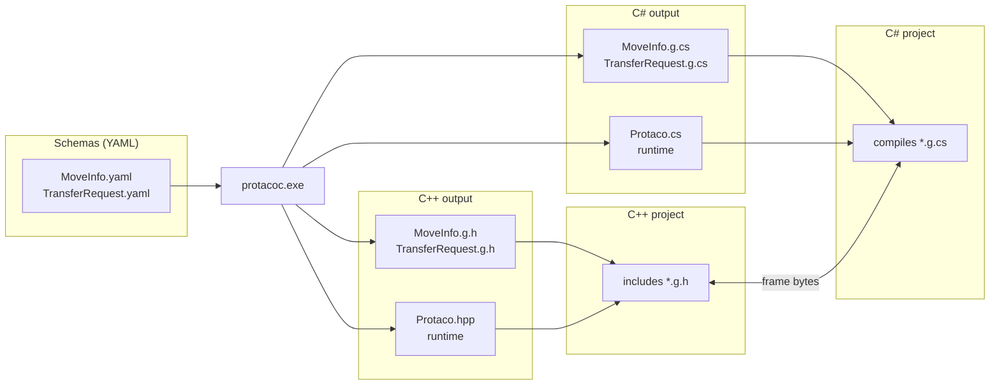
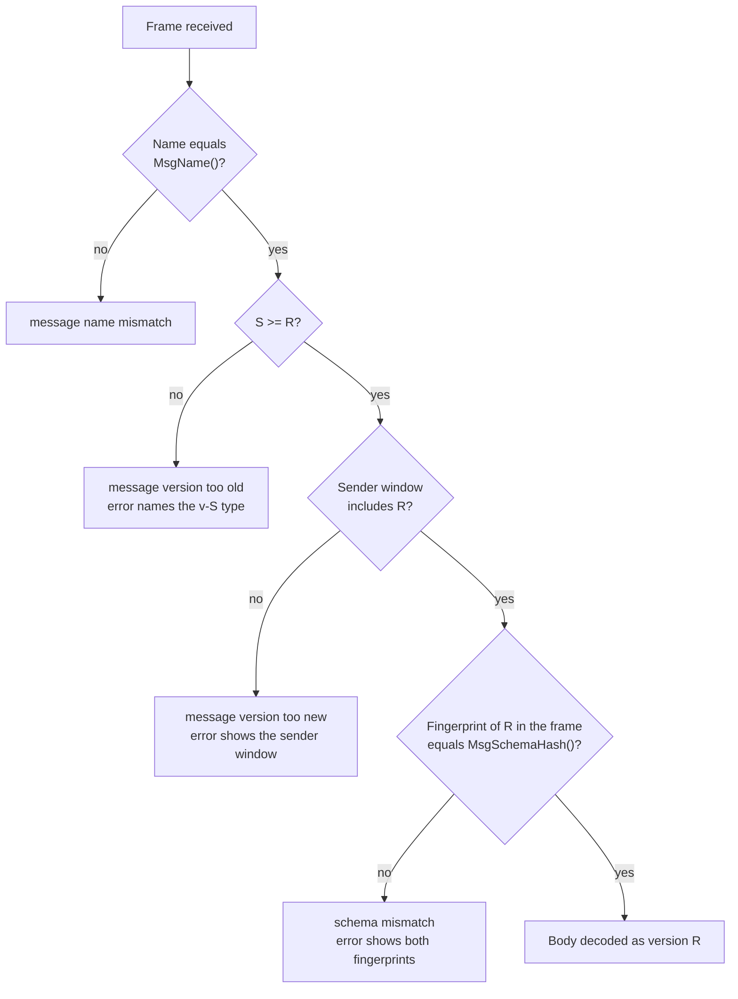
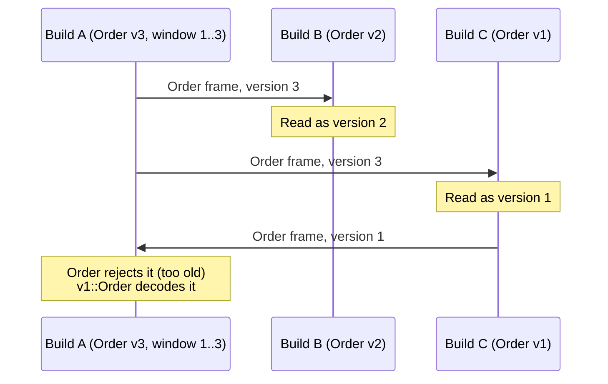

# 🌮 Protaco


Protaco is an interface definition language (IDL) and code generator for C++ and C#.
Messages are declared in YAML. The generator `protacoc` writes a C++ class and a C# class per message, and both produce the same bytes.

Compared with general-purpose IDL toolchains, Protaco keeps serialization light. The C++ runtime is one header, the C# runtime is one source file, and there is no library to link. Fixed-size fields are written straight into the frame buffer by their setters, so a message made only of fixed fields needs no encoding step.

The schema file is also the interface document. YAML comments become docstrings, and one file records every version still in use, field by field. Each frame carries a fingerprint of its schema version, so a receiver never reads a layout it does not know.

This manual describes protacoc 0.4.0 and serialization format v3.

[한국어 README](README.ko.md) · [Examples](examples/README.md)

```yaml
# TransferRequest.yaml
message: TransferRequest
version: 2
namespace: demo
fields:
  - {key: tm,     type: string,         required: true, desc: robot id}
  - {key: moves,  type: list<MoveInfo>, required: true, desc: moves in order}
  - {key: reason, type: string, default: "",            desc: reason for the plan}
```

```cpp
#include "TransferRequest.g.h"

demo::TransferRequest request;
request.set_tm("R1");
request.get_mutable_moves().push_back(move);

const std::vector<uint8_t>& bytes = request.Serialize();
demo::TransferRequest back = protaco::ToObject<demo::TransferRequest>(bytes);
```

```csharp
var request = new demo.TransferRequest { Tm = "R1" };
byte[] bytes = request.Serialize();                                   // same bytes as C++
var back = Protaco.Codec.ToObject<demo.TransferRequest>(bytes);
```

## Contents

1. [Overview](#1-overview)
2. [How it works](#2-how-it-works)
3. [Getting started](#3-getting-started)
4. [Schema language](#4-schema-language)
5. [Schema as a versioned document](#5-schema-as-a-versioned-document)
6. [Generated API](#6-generated-api)
7. [Performance](#7-performance)
8. [Version window](#8-version-window)
9. [Extension data](#9-extension-data)
10. [Text output](#10-text-output)
11. [Serialization format v3](#11-serialization-format-v3)
12. [Schema fingerprint](#12-schema-fingerprint)
13. [Command line](#13-command-line)
14. [Diagnostics](#14-diagnostics)
15. [Build and test](#15-build-and-test)
16. [Limitations](#16-limitations)
17. [License](#17-license)

## 1. Overview

### 1.1 Features

- IDL in YAML. One file per message. Messages reference each other by name, in any order.
- Output: C++ (`*.g.h`, header-only, C++14 or later) and C# (`*.g.cs`, C# 7.3, .NET Framework 4.6.1 or later).
- Lightweight runtime. C++: one header, standard library only. C#: one source file, no packages.
- Generator and runtime always match. protacoc writes the runtime next to the generated code on every run.
- Fast fixed fields. Setters write into the final frame bytes. `Serialize()` of an all-fixed message returns the buffer without copying.
- Strict receive checks. A receiver accepts a frame only when the message name, the version and a 32-bit schema fingerprint match its own.
- Version window. One YAML file describes every version still deployed (`min_version`, `added`, `removed`). A class is generated for each older version.
- Bounds-checked decoding. Truncated or corrupted input returns an error and never crashes.
- Extension data. Key-value entries outside the schema, kept and forwarded by receivers. Closed with `allow_extension: false`.
- Log text. `ToString()` prints every field, nested messages and lists included. C++ and C# print the same text.
- Build integration. Errors in MSBuild format, files rewritten only when their content changes, `--check` mode for CI.

### 1.2 Comparison with Protocol Buffers

| Aspect | Protaco | Protocol Buffers (C++) |
|---|---|---|
| Runtime | One header, nothing to link | libprotobuf or libprotobuf-lite linked |
| Generator and runtime versions | Runtime written by protacoc next to the generated code | Generated code must match the installed runtime |
| Fixed-size fields | Stored in the frame buffer by the setter | Encoded at serialize time |
| Schema identity on receive | Name, version and fingerprint checked; mismatch rejected | Not carried; unknown fields kept, missing fields read as defaults |
| Version history | One file lists every deployed version; a class per older version | Field numbers; one class per message |
| Schema syntax | Strict YAML subset with docstrings | `.proto` language |

Protaco frames are not the most compact choice. See [Limitations](#16-limitations).

## 2. How it works

protacoc reads the YAML schemas and writes two sets of files. A C++ project includes the generated headers. A C# project compiles the generated sources. Both sides exchange the same frame bytes over any transport.



- Each `*.g.h` / `*.g.cs` holds one message class. Nested message types are included by name.
- `Protaco.hpp` and `Protaco.cs` are copies of the runtime matching the generator version. `--no_runtime` skips them when another output folder already has them.
- Generated files are never edited by hand. `--check` detects edits and stale files.
- protacoc normally runs as a Pre-Build Event. Unchanged files are not rewritten and keep their timestamps, so a build without schema changes triggers no recompilation.

## 3. Getting started

### 3.1 Requirements

- Windows.
- Visual Studio 2017 or later with the v141 toolset (MSBuild 15).
- .NET Framework 4.6.1 targeting pack (protacoc and the C# runtime).
- C++ tests only: googletest with `include\`, `lib\gtest.lib` and `lib\gtest_main.lib`, built with `/MD`.

### 3.2 Build protacoc

```
build.cmd
```

Output: `build\bin\protacoc.exe`. `build.cmd` also regenerates the examples, runs the tests and runs the example ([15. Build and test](#15-build-and-test)). `protaco.sln` opens the same projects in Visual Studio.

### 3.3 Write a schema

`schemas/MoveInfo.yaml`:

```yaml
# One robot move. A pick followed by a place.
message: MoveInfo
version: 1
namespace: demo
fields:
  - {key: from, type: string(32), desc: source location}
  - {key: to,   type: string(32), desc: target location}
  - {key: slot, type: int, default: 1, desc: source slot number}
```

### 3.4 Generate code

```
protacoc -I schemas --cpp_out gen\cpp --cs_out gen\cs
```

Output: `gen\cpp\MoveInfo.g.h`, `gen\cpp\Protaco.hpp`, `gen\cs\MoveInfo.g.cs`, `gen\cs\Protaco.cs`.

### 3.5 Use in a C++ project

Add the output folder to the include path and run protacoc before each build:

```xml
<ClCompile>
  <AdditionalIncludeDirectories>$(ProjectDir)gen\cpp;%(AdditionalIncludeDirectories)</AdditionalIncludeDirectories>
</ClCompile>
<PreBuildEvent>
  <Command>"$(ProjectDir)tools\protacoc.exe" -I "$(ProjectDir)schemas" --cpp_out "$(ProjectDir)gen\cpp"</Command>
</PreBuildEvent>
```

No library or preprocessor definition is needed.

### 3.6 Use in a C# project

Compile the generated files together with `Protaco.cs`:

```xml
<ItemGroup>
  <Compile Include="gen\cs\*.cs" />
</ItemGroup>
```

[examples/README.md](examples/README.md) walks through a complete project.

## 4. Schema language

### 4.1 File rules

- One file holds one message. The file name equals the message name (`MoveInfo.yaml` holds `message: MoveInfo`).
- All files of one protacoc run declare the same namespace. Different namespaces use separate runs and output folders.
- A comment block at the top becomes the class docstring. A comment directly above a field, or at the end of its line, becomes the field docstring.

### 4.2 Message keys

```yaml
# Pizza order. Header comments become the class docstring.
message: PizzaOrder          # equals the file name
version: 2                   # current version, 1..65535
min_version: 1               # oldest version still served (default: version)
namespace: shop.orders       # C++ shop::orders, C# shop.orders
allow_extension: true        # false: no ext API, unknown keys rejected (default: true)
owner: shop                  # documentation only
desc: a pizza order          # documentation only
eq: [NAPOLI, CHICAGO]        # variant tags, documentation only
fields:
  - {key: orderId, type: string(32), desc: order number}
  - {key: toppings, type: list<Topping>, required: true}
  - {key: deepDishCm, type: int, default: 0, eq: [CHICAGO]}
  - {key: giftNote, type: string, added: 2}
```

| Key | Required | Meaning |
|---|---|---|
| `message` | yes | Message name, equals the file name |
| `version` | yes | Current version |
| `namespace` | yes | Dot-separated namespace |
| `fields` | yes | Field list, one field per line |
| `min_version` | no | Oldest version of the window ([8. Version window](#8-version-window)) |
| `allow_extension` | no | Extension data on or off ([9. Extension data](#9-extension-data)) |
| `owner`, `desc`, `eq` | no | Documentation only, copied into the docstring |

### 4.3 Field attributes

| Attribute | Meaning | Rules |
|---|---|---|
| `key` | Field name and accessor name | Letters, digits, `_`. Not starting with `_`, `get_`, `set_`, `mutable_`. No C++ or C# keywords |
| `type` | Field type ([4.4](#44-types)) | |
| `required` | Decoding fails when missing | Variable-size fields only |
| `default` | Value when missing | Matches the type. ASCII strings only. Not for lists or messages |
| `added` | First version with the field | Default 1, at most `version` |
| `removed` | First version without the field | Greater than `added`, at most `version` |
| `desc` | Description | Copied into the docstring |
| `eq` | Variant tags, for example `[NAPOLI]` | Documentation only, upper-case names |

### 4.4 Types

| Type | Encoding | C++ / C# type |
|---|---|---|
| `bool` | fixed, 1 byte | `bool` / `bool` |
| `int` | fixed, 4 bytes | `int32_t` / `int` |
| `int64` | fixed, 8 bytes | `int64_t` / `long` |
| `double` | fixed, 8 bytes IEEE 754 | `double` / `double` |
| `string(N)` | fixed, N bytes (1..4096), zero-padded | `std::string` / `string` |
| `string` | variable | `std::string` / `string` |
| `bytes` | variable, raw binary | `std::vector<uint8_t>` / `byte[]` |
| `list<T>` | variable; T is `int`, `int64`, `double`, `string`, `bytes` or a message | `std::vector<T>` / `List<T>` |
| message name | variable, nested body | generated class |

- `string(N)` suits identifiers with a known maximum length. A longer value is rejected by the setter.
- `bytes` carries zeros and 0xFF unchanged in both languages.

### 4.5 YAML subset

- Each field is one line of `{key: value, ...}`. Multi-line mappings, anchors, aliases and tabs are rejected.
- Values are read as text and typed by protacoc. YAML implicit typing (`no` read as false) does not apply.
- A value containing `,` or `: ` is quoted. protacoc reports a missing quote.

## 5. Schema as a versioned document

The YAML file is the single source for the contract and for its documentation.

- Docstrings. Comments and `desc` are copied into the generated classes. IDEs show them on the generated accessors.
- Annotations. `owner`, `desc` and `eq` describe ownership and variants without affecting the bytes.
- Version history. `added` and `removed` record when each field appeared and disappeared. `min_version` records the oldest version still served. The file keeps every deployed version readable in one place.
- Traceability. Each generated file names the generator version and a hash of its source file.
- Binding to the bytes. Each version has a fingerprint ([12. Schema fingerprint](#12-schema-fingerprint)). A frame built from another revision of the document is rejected at runtime.

Generated header of `TransferRequest.g.h`:

```cpp
// TransferRequest.g.h. protacoc 0.4.0, source TransferRequest.yaml (sha1 54437178ff1e). Do not edit.

/// Robot transfer request.
/// [version 2; schema 0xCE8A25DA; owner planner; source TransferRequest.yaml]
class TransferRequest
{
public:
    /// robot id
    /// [type string; required, decoding fails if missing]
    const std::string& get_tm() const
```

Field docstrings of a version window, from `Order` at version 3:

```cpp
/// [type double; default 0.5; added in 2]
/// [type int; default 1; removed in 3]
```

## 6. Generated API

### 6.1 C++ class

Generated in the YAML namespace. Example: `PizzaOrder.g.h`.

- `PizzaOrder()`: all fields at their defaults. Fixed fields already live in the frame buffer.
- `get_orderId()` / `bool set_orderId(const std::string&)`: fixed string. `set_` returns `false` and keeps the old value when the value does not fit.
- `get_size()` / `set_size(int32_t)`: fixed scalar, written in place.
- `get_customer()` / `set_customer(...)`: variable string.
- `get_toppings()` / `get_mutable_toppings()` / `set_toppings(...)`: lists, bytes and nested messages.
- `get_ext()` / `get_mutable_ext()`: extension data. Generated only with `allow_extension: true`.
- `SetEnvelope(env)` / `GetEnvelope()`: request id, correlation id and timestamp in the frame header.
- `const std::vector<uint8_t>& Serialize() const`: frame bytes. The reference stays valid until the object is modified.
- `std::string ToString(const protaco::TextStyle& = {}) const`: log text ([10. Text output](#10-text-output)).
- static `MsgName()`, `MsgVersion()`, `MsgMinVersion()`, `MsgSchemaHash()`: dispatch and diagnostics.
- `v1::PizzaOrder` and so on: one class per older version of the window, with that version's fields.

Buffers and helpers are `private`. Only the members above are public.

### 6.2 C++ runtime

`Protaco.hpp`, namespace `protaco`:

- `ToObject<T>(bytes)`: decodes or throws `protaco::CParseError`.
- `TryToObject<T>(data, size, &out, &error)`: no exceptions. On failure `out` is unchanged and `error.path` names the location (`"delivery.doorCode"`, `"moves[2].from"`).
- `PeekHeader(data, size, &header)`: reads name, version, window start, fingerprint and envelope without decoding the body. Used for dispatch.
- `CExt`: extension data (`SetInt`, `SetString`, `GetInt`, `GetString` and the other types).
- `TextStyle`: `ToString()` format.

`CParseError` is caught in the module that threw it. It is not meant to cross a DLL boundary.

### 6.3 C#

`PizzaOrder.g.cs`:

- Properties in PascalCase (`order.OrderId`, `order.Toppings`). A fixed string setter throws `ArgumentException` for a value longer than N bytes.
- `Ext` (with `allow_extension: true`), `Serialize()`, `Serialize(Envelope)`, `ToString()`, `ToString(TextStyle)`.
- Constants `MsgName`, `MsgVersion`, `MsgMinVersion`, `MsgSchemaHash`.
- Older versions as `v1.PizzaOrder`.
- Runtime: `Protaco.Codec.ToObject<T>()`, `TryToObject<T>()`, `PeekHeader()`. Failures raise `Protaco.ProtacoException`.

Runtime plumbing is hidden behind explicit interface implementations.

## 7. Performance

### 7.1 Footprint

| Component | Size | Dependencies |
|---|---|---|
| `Protaco.hpp` (C++ runtime) | 1,360 lines | C++14 standard library |
| `Protaco.cs` (C# runtime) | 1,221 lines | .NET Framework 4.6.1 |
| `protacoc.exe` (generator) | 150 KB, single file | .NET Framework 4.6.1 |

Generated classes use compile-time field lists. The C++ code has no reflection, descriptor tables or virtual functions.

### 7.2 Fixed fields written in place

Each generated object owns its frame buffer. Fixed-size fields have a reserved slot in it, and a setter is a store into the final bytes.

```cpp
demo::Heartbeat beat;                  // all fields fixed, allow_extension: false
beat.set_uptimeSec(10);
const auto& bytes = beat.Serialize();  // the buffer itself: no copy, no encoding
beat.set_uptimeSec(11);                // bytes now holds 11
```

- Fixed fields sit together at the front of the body, ordered by the version that added them and then by declaration. Their position among variable fields in the YAML does not matter.
- `Serialize()` sizes the variable fields first and appends them in a single allocation.
- An all-fixed message with extension data off has nothing to append. Recommended for messages sent at a high rate.

### 7.3 Measured cost

Release x64, v141, Intel Core i9-13900H. Values from the test `ContractCheckCostIsNegligible`, best of 5 rounds.

| Message | Decode | Version and fingerprint check |
|---|---|---|
| `Heartbeat`, 98 bytes, all fixed | 94.6 ns | 1.19 ns (1.26%) |
| `PizzaOrder`, 434 bytes, nested lists | 1,090.9 ns | 1.11 ns (0.10%) |

The test fails in Release when the check exceeds 10% of a decode. Numbers depend on the machine. `build.cmd` prints them as `[ PERF ]` lines.

## 8. Version window

Deployed builds are not updated at the same time. A newer build keeps exchanging messages with older builds, so one YAML file holds every version still in use.

### 8.1 Declaring versions

```yaml
message: Order
version: 3          # current version
min_version: 1      # oldest version still served (default: version)
namespace: shop
fields:
  - {key: id,     type: string(8)}
  - {key: weight, type: double, default: 0.5, added: 2}
  - {key: qty,    type: int, default: 1, removed: 3}     # fixed: keeps its bytes, written with the default
  - {key: note,   type: string, removed: 3}              # variable: not sent from version 3 on
  - {key: color,  type: string, required: true}
  - {key: tags,   type: list<string>, added: 2}
  - {key: label,  type: string, added: 3}
  - {key: rush,   type: bool, added: 3}
```

A field exists in version k when `added <= k < removed`.

### 8.2 Generated classes

- `shop::Order`: the current version (3).
- `shop::v1::Order`, `shop::v2::Order`: one class per older version of the window, with that version's fields. C#: `shop.v1.Order`.

### 8.3 Receiving

A receiver of version R checks a frame of version S in this order:



- A newer frame is read as version R: its own prefix of the fixed block and its own variable fields.
- Variable fields newer than R go to extension data (open message) or are dropped (closed message).
- An older frame is decoded with the older class. The receiver dispatches on `PeekHeader()`'s `version` and decodes with `v1::Order`.

### 8.4 Sending

- A class always sends its own version, with the fingerprints of every window version from `min_version` up.
- To send to a peer that needs an older layout, fill the older class (`v1::Order`) and serialize it.

### 8.5 Mixed deployment

Three builds exchange the same message at different versions.



### 8.6 Layout rules

- Fixed fields are laid out by the version that added them, then by declaration. A newer version only appends to the fixed block, so the block of version k is a prefix of every newer one.
- A removed fixed field keeps its bytes permanently, written with its default. Its line stays in the YAML.
- A removed variable field is no longer sent. Its line is deleted once `min_version` reaches `removed` (PC313). If it was `required`, older readers reject newer frames with `missing required (frame version 3 read as 1)`. Such peers receive the older class instead.
- A message used as a field type has no window (PC407). Nested bodies carry no version. A change to it is made by adding a new message.

### 8.7 Changing a shipped schema

- Before a version ships, the schema is edited freely and `version` stays.
- A shipped version is frozen. Allowed changes, each with a `version` increment: add a field (`added`), remove a field (`removed`), raise `min_version`. Adding a message is always allowed.
- Changing a field's type, `required` or `default`, renaming, reordering, reusing a removed key or changing `allow_extension` breaks shipped versions. Remove the old field and add a new one instead. The fingerprint rejects such frames at runtime.
- Comments, `desc`, `owner`, `eq` and `namespace` do not affect the bytes.
- Without `min_version`, `added` and `removed`, the window is one version, and a frame of another version is rejected.

## 9. Extension data

Key-value entries that are not in the schema:

```cpp
order.get_mutable_ext().SetString("channel", "web");
order.get_mutable_ext().SetInt("priority", 2);
order.get_mutable_ext().SetBytes("receipt", scan);   // std::vector<uint8_t>
```

- Schema keys and keys starting with `_` are refused (`Set*` returns `false`).
- A receiver keeps every key its schema does not know in the extension data and sends it on unchanged when it serializes the message again.
- `allow_extension: false` closes the message. No extension API is generated, and a frame of the same version carrying an unknown key fails with `unknown key (allow_extension false)`. Fields of a newer version are dropped.

## 10. Text output

```cpp
request.ToString();
// TransferRequest{tm="R1", moves=[MoveInfo{from="SHELF1", to="TABLE3", slot=1}], reason="", ext{priority=5}}

request.ToString(protaco::TextStyle::Pretty());   // one field per line, 2 spaces per level
```

- Fields in YAML order, then extension entries under `ext{...}`.
- Strings are quoted and escaped. Strings longer than `maxText` (64) are cut: `"abcd"...(+12)`.
- Bytes show their size and the first 8 bytes: `<11 bytes: FF D8 00 10 4A 46 49 46 ...>`.
- `TextStyle` sets `separator`, `open`, `close`, `indent` and `maxText`.
- C# has the same type (`Protaco.TextStyle`) and prints the same text for ASCII values. C# counts characters where C++ counts bytes.

## 11. Serialization format v3

All integers are little-endian. Strings are raw bytes without a terminating NUL.

```
Frame
  'P' 'C'          magic
  FrameVer u8      = 3
  NameLen  u8
  Name             message name
  MsgVer   u16     message version
  MinVer   u16     lowest version of the sender's window
  Id       u32 ┐
  Corr     u32 │   envelope
  Ts       i64 ┘
  BodyLen  u32     detects truncation and trailing bytes
  Schema   u32 × (MsgVer - MinVer + 1)   fingerprints of versions MinVer..MsgVer
  Body

Body (nested messages use the same shape)
  FixedLen u32     equals the receiver's fixed block size (same version) or larger (newer version)
  Fixed            fixed fields in serialization order, no padding
  Var*             variable fields as TLV, serialization order
  Ext*             extension entries as TLV, insertion order

TLV
  KeyLen u8 | Key | Type u8 | Len u32 | Value

TacoType
  1 bool    1 byte (0 or 1)
  2 int     4 bytes
  3 int64   8 bytes
  4 double  8 bytes IEEE 754
  5 string  bytes
  6 message Body
  7 list    ElemType u8 | Count u32 | (Len u32 | Value) × Count
  8 bytes   raw bytes
```

Limits:

- Frame size: at most 1,048,575 bytes.
- Nesting depth: 8, checked by protacoc and at decode.
- Versions per window: 255.
- Variable fields per body: 1,024.
- List count: at most (remaining bytes / 4).

## 12. Schema fingerprint

A fingerprint is a 32-bit FNV-1a hash (offset basis 2166136261, prime 16777619) over the UTF-8 bytes of the canonical text of one version:

```
protaco-schema-1|<name>|<version>|<allow_extension 1 or 0>|<field>;<field>;...

fields  every field with added <= version, in serialization order (added, then declaration)
field   <key>:<type>[!][=<default>]
        !          required
        =<default> the default as written in the YAML, without quotes
        ~<key>:<type>   a fixed field removed at or before this version (its bytes stay)
        a variable field removed at or before this version is left out
type    bool int int64 double string string(N) bytes list<T>
        a message: <Name>@<its fingerprint as 8 lowercase hex digits>
```

Example: `protaco-schema-1|Topping|1|1|name:string(24);grams:int=30;`.

- `added` and `removed` are not part of the text. Adding a version leaves the fingerprints of older versions unchanged.
- Nested messages are covered by the `@` part. A change deep inside also changes every message that contains it.
- Generated code exposes the value as `MsgSchemaHash()`. protacoc writes it into the class docstring.

## 13. Command line

```
protacoc -I <dir> [-I <dir>...] --cpp_out <dir> [--cs_out <dir>]
         [--no_runtime] [--check] [Message ...]
```

| Option | Meaning |
|---|---|
| `-I <dir>` | Schema folder. Repeatable. All files declare the same namespace |
| `--cpp_out <dir>` | C++ output folder |
| `--cs_out <dir>` | C# output folder |
| `--no_runtime` | `Protaco.hpp` / `Protaco.cs` not written |
| `--check` | Nothing written. Exit code 3 when a file on disk differs |
| `Message ...` | Generate only these messages (names or YAML paths) |

## 14. Diagnostics

### 14.1 Error codes

protacoc prints `file(line,col): error CODE: message`. Visual Studio opens the YAML line from the Output window.

YAML syntax:

- PC101 unsupported YAML construct
- PC102 flow syntax (`{}`, `[]`, `,`, quotes)

Message keys and attributes:

- PC201 unknown top-level key
- PC202 missing required key (`message`, `version`, `namespace`, `fields`)
- PC203 unknown field attribute
- PC204 bad value
- PC205 duplicate attribute
- PC206 bad namespace

Fields and versions:

- PC301 message name differs from the file name
- PC302 duplicate field key
- PC303 reserved or keyword key
- PC304 bad type
- PC305 `required` on a fixed field
- PC308 bad default
- PC310 bad `N` in `string(N)`
- PC311 C# name clash
- PC312 `min_version`, `added` or `removed` out of range
- PC313 variable field removed at or below `min_version` (delete the line)
- PC314 message name `v<N>` (reserved for version namespaces)

Messages and references:

- PC401 duplicate message
- PC402 unknown message reference
- PC403 reference cycle, reported with the full path (`NodeA -> NodeB -> NodeA`)
- PC404 type not allowed as a list element
- PC405 two namespaces in one run
- PC406 nesting deeper than 8
- PC407 a message used as a field type has a version window

Environment:

- PC501 file I/O
- PC502 command line

### 14.2 Exit codes

| Code | Meaning |
|---|---|
| 0 | Success |
| 1 | Usage error |
| 2 | Schema errors |
| 3 | `--check` found stale files |

### 14.3 Decode errors

`protaco::Error::what` (C++) and `ProtacoException.What` (C#) state the expected and the received value:

- `message name mismatch`
- `message version too old`, with the type to use
- `message version too new`, with the sender's window
- `schema mismatch`, with both fingerprints
- `fixed block size mismatch`, with both sizes
- `missing required`
- `type mismatch`, with both types
- `unknown key (allow_extension false)`
- `bad version range`
- `nesting too deep`
- truncation errors

A failure inside a newer frame ends with `(frame version N read as M)`.

## 15. Build and test

```
set GTEST_ROOT=<googletest folder>
build.cmd
```

Steps of `build.cmd`:

1. Build protacoc.
2. Regenerate `examples/gen` and `tests/gen`.
3. Build the C++ tests (skipped without `GTEST_ROOT`).
4. Run the C++ tests against the golden files.
5. Build and run the C++ example.
6. Build and run the C# tests.

`MSBUILD` overrides the MSBuild path (default: Visual Studio 2017 Professional).

Repository layout:

- `src/protacoc/`: generator.
- `runtime/cpp/`, `runtime/cs/`: runtime sources copied by protacoc.
- `examples/`: sample schemas, generated code and a C++ program ([examples/README.md](examples/README.md)).
- `tests/schemas/`: schemas for version windows, nesting, cycles and one file per error code.
- `tests/golden/`: reference frames. C++ writes them, C# must produce the same bytes.
- `tests/cpp/`: googletest suite, plus a translation unit compiled as C++14.
- `tests/cs/`: C# test runner for the generator and the C# runtime.

C++ tests (30):

- Round trips, fixed fields written in place, defaults.
- Version and fingerprint rejection.
- Version window: older fingerprints kept, newer frames read as the receiver's version, older frames through the older class, sender window above the receiver, closed messages dropping newer fields.
- Closed messages, 8-level nesting, missing required fields, nested error paths, extension data rules.
- `ToString` text.
- Contract check cost ([7.3](#73-measured-cost)).
- Truncation at every length, 5,000 random bit flips.
- Golden bytes, C++14 translation unit.

C# tests (27):

- One broken YAML file per error code, cycles, namespace mixing, nesting depth, windows on nested messages.
- `--check` on committed output and on hand edits, input order independence.
- Fingerprint against its canonical text.
- Round trips, version window, closed messages, truncation.
- Byte-for-byte equality with the C++ golden files, same `ToString` text as C++.

## 16. Limitations

- Windows only: MSBuild projects and a .NET Framework generator.
- No recursive messages and no lists of lists.
- No `enum` and no fixed-size arrays.
- Little-endian only.
- Frames carry a header (28 bytes, the name and 4 bytes per window version), and fixed strings are padded. Frames are larger than with varint-based formats.
- Strings are raw bytes. C# encodes them with the system ANSI code page (`Encoding.Default`). Non-ASCII text crosses languages only between machines with the same code page. Binary data uses `bytes`.
- Diagnostics and generated boilerplate are in English. Docstrings keep the language of the YAML comments.

## 17. License

[MIT](LICENSE). Copyright (c) 2026 Soo-Hwan Cho (Splendidz).
