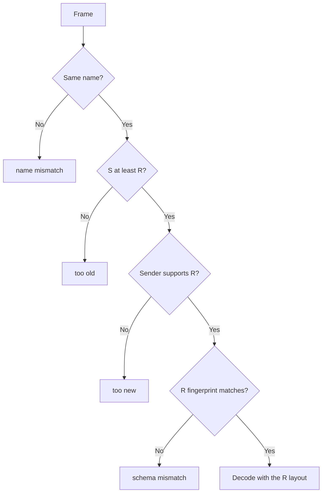
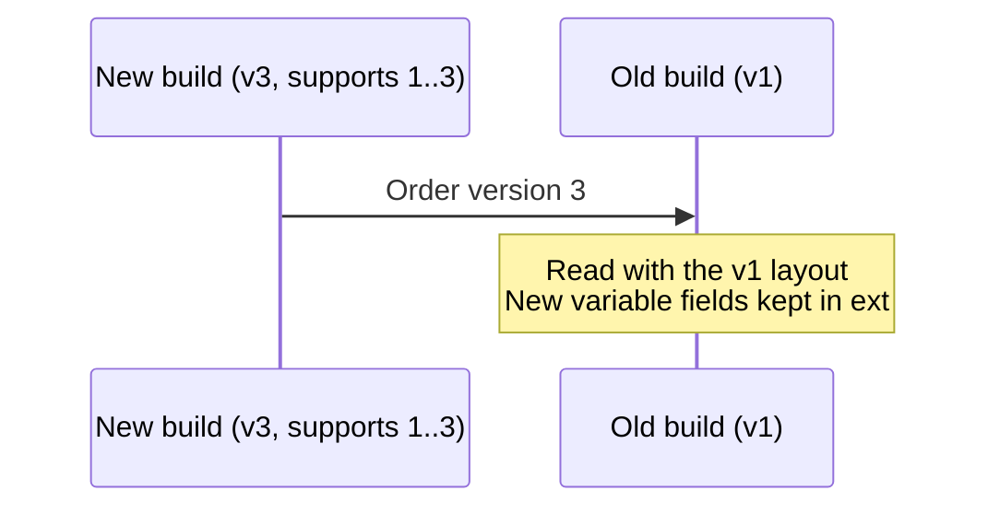
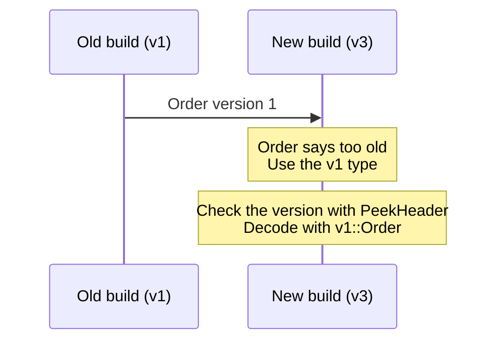
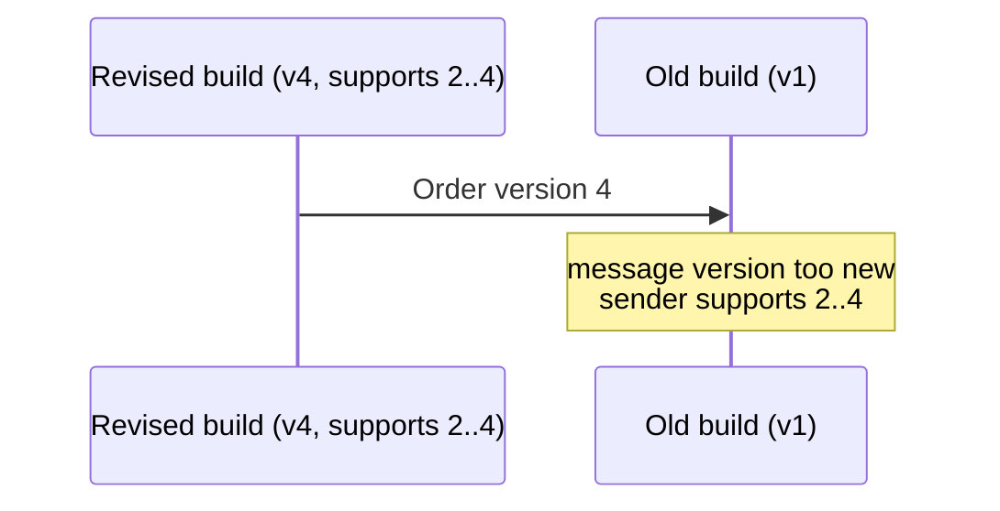
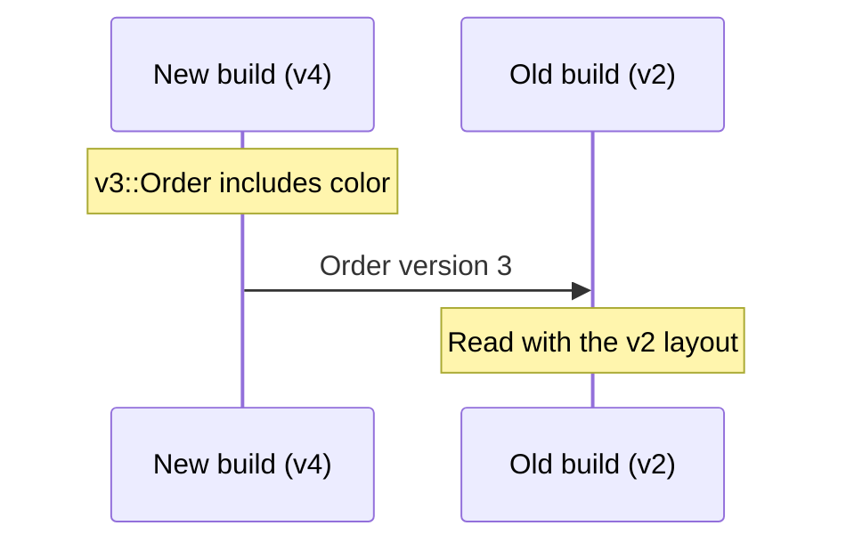

# 🌮 Protaco


[한국어](README.ko.md) · [Examples](examples/README.md) · [Reference](docs/reference.md) · [Benchmark](docs/benchmark/README.md)

Protaco is a light serialization tool that lets C++, C#, and Python programs exchange the same data. You write messages in YAML the way you would declare a struct, and the `protacoc` generator turns them into classes for all three languages. This manual covers protacoc 0.6.0 and serialization format v4.

### When you need serialization

An object only means something inside the memory of the program that holds it. To send it anywhere else, you turn it into bytes in an agreed order, and the receiver turns those bytes back into an object. That is serialization. You need it when:

- different programs or languages talk to each other: a C++ game server and a C# client, a C++ engine and a Python test script
- you save data to a file and load it later: save games, recorded input, work results
- you exchange data with another PC or device: TCP, UDP, pipes, shared memory

Sending a struct with `memcpy` works at first. Then compiler padding, pointer members such as `std::string`, different memory layouts in each language, and a struct updated on only one side break it without a word. A serialization tool fixes the byte layout as a contract and tells you when the two sides disagree.

### The Protaco way

Write a message in a YAML file the way you would declare a struct in C++. `protacoc` turns that file into C++, C#, and Python classes. Your program sends with `Serialize()` and receives with `ToObject`. All three languages share one serialization format, so any of them can read what another sent. Windows and Linux produce the same bytes.


### Who it is for

Protaco is for people who want something simple and fast.

- Games: client and server packets, save data, data between the game and its editor
- Tools, editors, and simulators: a C++ core, a C# UI, and Python automation sharing the same data
- Messages between a PC and a device, or between in-house services: fixed fields sent often and fast

Programs like these change and ship often. New and old builds always run side by side for a while, so it pays to manage which versions can talk to each other as part of the contract. On the other hand, they do not need everything Protocol Buffers offers. Exchanging explicit data quickly is enough. Protaco is built for exactly that scope.

### Light and fast

The C++ runtime is one header, the C# runtime is one source file, and the Python runtime is one module. There is no complicated CMake setup, no package to install, and no lib/dll to link. Run `protacoc`, and the matching runtime lands next to the generated code. Include the generated header and you are done.


The reason it is fast is simple, too. In C++, fixed-length setters write straight into their place in the frame buffer, so a message with only fixed fields and empty extension data has nothing left to do in `Serialize()`. The receiver can read the bytes in place with `TryView`, without copying (zero-copy). In our measurements, encoding a fixed-field message was 8.6 times faster than with Protocol Buffers, and reading it with `TryView` was 21 times faster ([1.2](#12-compared-with-protocol-buffers)).

### Stable and robust

Every frame carries the message name, version, and schema fingerprint. The receiver checks all three. Instead of silently reading a different message or a mismatched layout, it returns an error that says why. The `Try*` functions never throw. They return success or failure plus an error string. YAML comments become docstrings, and the version in which each field was added or removed stays in the same YAML file.

Structures do not have to be flat either. A field can use a message from another YAML file as its type, and you can declare lists, maps, enums, and recursive messages that refer to themselves.

### A first example

Take a delivery app as an example. We want to send one rider's delivery route to another program. We declare one stop as a `RouteStop` message and the whole route, with its list of stops, as a `DeliveryRoute` message.

[RouteStop.yaml](examples/schemas/RouteStop.yaml) is one stop: an order number, an address, and the minutes until arrival.

```yaml
message: RouteStop
version: 1
namespace: demo
fields:
  - {key: orderId, type: string(16), desc: order number}
  - {key: address, type: string(48), desc: street address}
  - {key: etaMin, type: int, default: 15, desc: minutes until arrival}
```

[DeliveryRoute.yaml](examples/schemas/DeliveryRoute.yaml) is the rider and the list of stops. As in `list<RouteStop>`, a message from another YAML file serves as a type.

```yaml
message: DeliveryRoute
version: 1
namespace: demo
fields:
  - {key: rider, type: string, required: true, desc: rider id}
  - {key: stops, type: list<RouteStop>, required: true, desc: stops}
  - {key: note, type: string, default: "", desc: why this route}
```

After generating code from the two files ([3.4](#34-generating-code)), the generated classes send and receive like this.

**C++**

```cpp
#include "DeliveryRoute.g.h"   // generated from DeliveryRoute.yaml

demo::RouteStop stop;
stop.set_orderId("A-100");
stop.set_address("1 Pizza St");

demo::DeliveryRoute route;
route.set_rider("rider-7");
route.mutable_stops().push_back(stop);

const std::vector<uint8_t>& bytes = route.Serialize();   // bytes to send

demo::DeliveryRoute back;                                  // receiver
std::string error;
if (!protaco::TryToObject(bytes, &back, &error))           // never throws
    std::printf("decode failed: %s\n", error.c_str());
```

<details>
<summary>C#</summary>

```csharp
var route = new demo.DeliveryRoute { Rider = "rider-7" };
route.Stops.Add(new demo.RouteStop { OrderId = "A-100", Address = "1 Pizza St" });
byte[] bytes = route.Serialize();   // same serialization format as C++

demo.DeliveryRoute back;
string error;
if (!Protaco.Codec.TryToObject(bytes, out back, out error))
    Console.WriteLine("decode failed: " + error);
```

</details>

<details>
<summary>Python</summary>

```python
import protaco
from demo.DeliveryRoute_g import DeliveryRoute
from demo.RouteStop_g import RouteStop

route = DeliveryRoute(rider="rider-7")
route.stops.append(RouteStop(orderId="A-100", address="1 Pizza St"))
data = route.Serialize()   # same serialization format as C++ and C#

ok, back, error = protaco.TryToObject(DeliveryRoute, data)
if not ok:
    print("decode failed: " + error)
```

</details>

## Contents

1. [Overview](#1-overview)
2. [How it works](#2-how-it-works)
3. [Getting started](#3-getting-started)
4. [Schema language](#4-schema-language)
5. [Extension data](#5-extension-data)
6. [Generated API](#6-generated-api)
7. [Version management](#7-version-management)
8. [Performance](#8-performance)
9. [Text output](#9-text-output)
10. [Serialization format v4](#10-serialization-format-v4)
11. [Limitations](#11-limitations)
12. [License](#12-license)

## 1. Overview

### 1.1 Features

- 📄 YAML is the IDL. You list fields the way you declare a struct, and a type can be another message, an enum, a list, a map, or the message itself. Messages refer to each other by name, so file order never matters.
- C++ output is header-only (`*.g.h`), C# output is `*.g.cs`, and Python output is `*_g.py`. There is no lib/dll to build or link. Drop the generated files into your project and you are done!
- Every run writes the matching runtime next to the generated code, so the generator and runtime versions can never drift apart.
- ⚡ In C++, fixed-field setters write the final bytes directly, and when nothing has changed, `Serialize()` hands back the last bytes as they are. Receivers read them without a copy through `TryView` (C++ and C#).
- 🛡️ Receivers check the name, version, and schema fingerprint. Broken data is never read silently.
- Versioning works per field. Each field records its history with `added` and `removed`, and the generator also produces classes for the older versions you still support.
- Extension data (ext) carries key-value pairs that are not in the schema. Turn it off with `allow_extension: false` when you do not need it.
- The API is exception-free by default. `Try*` functions return success or failure and report the reason as a `path: reason` string.
- Every message has an envelope: an id, a correlation id, and a microsecond timestamp. A new object gets the next id and the current time automatically, and a reply carries the request's id as its correlation id.
- 📝 One `ToString()` call puts fields, enum names, and extension data in your logs.
- 🐧 Windows and Linux are officially supported. Strings are UTF-8 everywhere.

### 1.2 Compared with Protocol Buffers

Protaco covers a narrower scope than Protocol Buffers. It supports fewer languages and features, but it takes less effort to adopt and less time to run. The protobuf footprint below comes from protobuf 3.21.12 built for v141 x64 Release.

| Item | Protaco | Protocol Buffers (C++) |
|---|---|---|
| Runtime | One header, about 69 KB, nothing to link | 84 .cc files in the libprotobuf CMake target, static library about 20 MB |
| Dependencies | C++ standard library | Runtime library to link; version 22 adds Abseil |
| Generator and runtime | Matching runtime written next to the generated code | Installed runtime and generated code must match; a mismatch is a compile error in the generated header |
| Encoding | Fixed-field setters write directly into the frame | Each field encoded at serialization, integers as varints |
| Decoding | Fixed-field messages read in place with `TryView` (zero-copy) | Parsed into a message object |
| Message identity | Name, version, and schema fingerprint checked | No name or schema in the data; absent fields take defaults |
| Versioning | Per-field history in one YAML file, a class per older version | Field numbers, one class per message |
| Schema syntax | YAML, like declaring a struct | The `.proto` language |
| Languages | C++, C#, Python (Windows, Linux) | Many |

Performance was compared as time per call to encode and decode the same messages on the same PC. Bars are means, whiskers are standard deviations, and shorter is better.


- Fixed512 (fixed fields only): encode 23.3 ns vs 200.1 ns (8.6x), decode 55.4 ns vs 252.3 ns (4.6x), `TryView` 11.9 ns (21.2x)
- Mixed256 (fixed fields and two strings): encode 20.7 ns vs 93.3 ns (4.5x), decode 126.9 ns vs 164.5 ns (1.3x)

Measurement conditions and notes are in [8.4](#84-measured-against-protocol-buffers); the benchmark code and how to reproduce it are in the [benchmark guide](docs/benchmark/README.md).

## 2. How it works

At build time, `protacoc` reads the YAML and writes the message classes and the runtime. C++ projects include the headers, C# projects compile the sources along with their own, and Python imports the generated package. At run time only the generated code and the runtime are needed, not protacoc. Messages in all three languages use the same serialization format, so any transport works: TCP, pipes, files, shared memory.


Each message produces one file per language, and the classes for older versions you still support go into the same file. Enums come out as `<Name>.enum.h`, `<Name>.enum.cs`, and `<Name>_enum.py`.

## 3. Getting started

### 3.1 Requirements

Windows:

- Visual Studio 2017 or later (MSBuild 15, v141 toolset)
- .NET Framework 4.6.1 (protacoc, C# tests)
- Python 3.8 or later (Python tests and example)

Linux:

- .NET SDK 8 or later
- g++ (C++17)
- python3 3.8 or later

Projects that use the generated code:

- C++: a C++14 compiler, standard library only
- C#: C# 7.3, .NET Framework 4.6.1 or .NET 8
- Python: Python 3.8 or later, standard library only

googletest for the tests ships in the repository (`protaco_compiler/tests/googletest`), so there is nothing to install. The build and tests have been verified on Windows and Linux (WSL Ubuntu 22.04). macOS has not been checked.

### 3.2 Building protacoc

Run this from the repository root.

**Windows**

```bat
build.cmd
```

**Linux**

```sh
sh build.sh
# with dotnet installed under ~/.dotnet
DOTNET=~/.dotnet/dotnet sh build.sh
```

The generator is `bin\Release\protacoc.exe` on Windows and `bin/Release/net8.0/protacoc` on Linux. Both scripts run the same six steps: build protacoc, regenerate test and example code, C++ tests, C# tests, Python tests, and build and run the examples. Environment variables and the repository layout are in [Build and test](docs/reference.md#7-build-and-test). In Visual Studio, open [protaco.sln](protaco.sln) (generator and tests) or [examples/examples.sln](examples/examples.sln) (examples).

### 3.3 Writing a schema

Save `RouteStop.yaml` and `DeliveryRoute.yaml` from above in a `schemas` folder. A file name must match its definition name (`RouteStop` → `RouteStop.yaml`), and the files you generate in one run share one namespace. The syntax is in [4. Schema language](#4-schema-language), and the example sources are in [examples/schemas](examples/schemas).

### 3.4 Generating code

**Windows**

```bat
bin\Release\protacoc.exe -I schemas --cpp_out gen\cpp --cs_out gen\cs --py_out gen\py
```

**Linux**

```sh
bin/Release/net8.0/protacoc -I schemas --cpp_out gen/cpp --cs_out gen/cs --py_out gen/py
```

Pick only the languages you need. Here is what each one writes and how to add it to a project.

- C++: `RouteStop.g.h`, `DeliveryRoute.g.h`, and the runtime `Protaco.hpp` in `gen/cpp`. Add `gen/cpp` to the include path and include `DeliveryRoute.g.h`. Nothing to link
- C#: `RouteStop.g.cs`, `DeliveryRoute.g.cs`, and the runtime `Protaco.cs` in `gen/cs`. Add all three files to the project
- Python: `gen/py/demo/RouteStop_g.py`, `gen/py/demo/DeliveryRoute_g.py`, and the runtime `gen/py/protaco.py`. The namespace `demo` becomes the package folder. Put `gen/py` on `sys.path` and write `from demo.DeliveryRoute_g import DeliveryRoute`

Generated files are written as UTF-8 (with BOM) and CRLF, so every OS produces the same bytes. Do not edit generated files by hand. Change the YAML and generate again. Project setup examples are in the [examples guide](examples/README.md#2-build-and-run).

### 3.5 Command-line options

| Option | Purpose |
|---|---|
| `-I <dir>` | YAML folder; may be given more than once |
| `--cpp_out <dir>` | C++ headers and runtime |
| `--cs_out <dir>` | C# sources and runtime |
| `--py_out <dir>` | Python packages and runtime |
| `--no_runtime` | Skip the runtime files |
| `--check` | Check that the output is up to date without writing; exit code 3 if anything differs |
| `name...` | Generate only these messages or enums; default is all |

Choose at least one output language. Exit codes and full usage are in [Command line](docs/reference.md#2-command-line).

## 4. Schema language

### 4.1 File rules

- One definition per file. A message is `<Name>.yaml` (top line `message: <Name>`), an enum is `<Name>.enum.yaml` (top line `enum: <Name>`)
- A file name that differs from the definition name is PC301; a definition kind that does not match the file suffix is PC208
- A file name containing `.bak` (any case) is not read, so backup copies such as `Menu.bak.yaml` can stay in the folder
- References resolve by name. Input file order does not matter
- All files in one protacoc run share one namespace (PC405). Different namespaces use separate runs and output folders
- The comment at the top of the file becomes the class docstring. A comment right above an entry, a comment at the end of its line, and `desc` become the entry docstring
- Only top-level `key: value` pairs and `- {k: v, ...}` entries (one per line) under `fields:` or `values:`. This is not full YAML. A flow list `[a, b]` is PC102
- Inside `{...}`, a `,` ends the value, so map types are quoted: `{key: prices, type: "map<string, double>"}`

### 4.2 Message keys

```yaml
message: PizzaOrder
version: 2
min_version: 1
namespace: shop
allow_extension: true
desc: a pizza order
fields:
  - {key: orderId, type: string(32), desc: order number}
  - {key: giftNote, type: string, added: 2}
```

| Key | Required | Meaning |
|---|---|---|
| `message` | Yes | Message name, same as the file name |
| `version` | Yes | Current version, 1..65535 |
| `namespace` | Yes | A name such as `shop`, or dotted like `shop.orders` |
| `fields` | Yes | Field list |
| `min_version` | No | Oldest version still supported; defaults to `version`. See [Version management](#7-version-management) |
| `allow_extension` | No | Whether extension data is allowed; default `true` |
| `desc` | No | Description for the docstring |

The namespace `shop.orders` becomes `shop::orders` in C++, `shop.orders` in C#, and the package folder `shop/orders/` in Python.

`allow_extension` sets the receive rules of the message. With `false`, no extension API is generated, and a frame of the same version with an unknown key is rejected. Decide on the [extension data](#5-extension-data) policy before you ship.

### 4.3 Field attributes

| Attribute | Meaning | Rule |
|---|---|---|
| `key` | Field and accessor name | Starts with a letter; letters, digits, `_` |
| `type` | Field type | See [4.4 Types](#44-types) |
| `required` | The entry must be present on receive | Variable fields only; default `false` |
| `default` | Initial value | Type and notation checked at generation |
| `added` | Version that first has the field | Default 1; at most the current `version` |
| `removed` | First version without the field | Greater than `added`; at most the current `version` |
| `desc` | Field description | Goes into the docstring |

Keys cannot start with `_`, `get_`, `set_`, `mutable_`, `has_`, or `clear_`. C++ and C# keywords and generated member names (`ext`, `serialize`, `tostring`, `view`, and others) are PC303 as well. A C# property name is the key with its first letter capitalized, so two keys that collide after capitalization are PC311. When a key is a Python keyword, the Python attribute name gets a trailing `_` (`from` → `from_`).

`required` applies to `string`, `bytes`, `list<T>`, `map<K, V>`, and message fields. If the entry is missing, decoding fails with `missing required`. A fixed field always has its bytes in the fixed block and can never be missing, so `required` on a fixed field is PC305. Whether its value makes sense is up to the receiving code. A recursive field, whose type is its own message, cannot be `required` either (PC306).

protacoc checks `default` at generation time and rejects bad values with PC308.

- `bool`: unquoted `true` or `false`
- Integers: in range for the type, no quotes, no `+`, no leading zeros. No negative values for `uint` and `uint64`. The `int64` minimum cannot be a default
- `double`: unquoted decimal or exponent notation. No NaN, no infinity, nothing that overflows to infinity
- Strings: ASCII only; for `string(N)`, at most N bytes
- Enums: an unquoted value name. Without a default, the first value
- `bytes`, lists, maps, messages: no default; they start empty

### 4.4 Types

Fixed-length types go into the fixed block at the front of the body.

| Type | Size and encoding | C++ / C# / Python |
|---|---|---|
| `bool` | 1 byte | `bool` / `bool` / `bool` |
| `int` | 4 bytes, signed | `int32_t` / `int` / `int` |
| `int64` | 8 bytes, signed | `int64_t` / `long` / `int` |
| `uint` | 4 bytes, no negative values | `uint32_t` / `uint` / `int` |
| `uint64` | 8 bytes, no negative values | `uint64_t` / `ulong` / `int` |
| `double` | 8 bytes, IEEE 754 | `double` / `double` / `float` |
| `string(N)` | N bytes of UTF-8, N in 1..4096, zero padded | `std::string` / `string` / `str` |
| enum name | 4 bytes (int32) | `enum class` / `enum` / `enum.IntEnum` |

If a value is longer than N bytes, the C++ `string(N)` setter returns `false` and keeps the old value. The C# setter throws `ArgumentException`. Python raises `protaco.ProtacoError` from `Serialize()`. A Python `int` has no size limit, so an integer out of range for its type fails in `Serialize()` the same way.

Variable-length types are carried as entries with a key and a length (TLV).

| Type | Encoding | C++ / C# / Python |
|---|---|---|
| `string` | UTF-8 text of any length | `std::string` / `string` / `str` |
| `bytes` | Binary data, 0 and 0xFF kept as is | `std::vector<uint8_t>` / `byte[]` / `bytes` |
| `list<T>` | List of elements | `std::vector<T>` / `List<T>` / `list` |
| `map<K, V>` | Unordered key-value pairs | `std::unordered_map<K, V>` / `Dictionary<K, V>` / `dict` |
| Protaco message | The name of another YAML message as the type; its body is nested | The generated class of that message |

- List elements: `int`, `int64`, `uint`, `uint64`, `double`, `string`, `bytes`, enums, messages. `list<bool>`, `list<string(N)>`, lists of lists, and lists of maps are PC404
- Nesting: up to 100 levels, not counting self references (PC406). Two messages that refer to each other are PC403
- Fixed fields gather in the fixed block at the front of the body even when declared between variable fields. The order is the version that added them, then declaration order

### 4.5 Enums

An enum is declared in its own YAML file, shaped like a message. The file name must be `<Name>.enum.yaml`. [PizzaSize.enum.yaml](examples/schemas/PizzaSize.enum.yaml):

```yaml
# Pizza size. Values are int32 in the serialized data; ToString prints Large(3).
enum: PizzaSize
version: 1
namespace: demo
values:
  - {key: Small, value: 1, desc: 10 inch}
  - {key: Medium, value: 2, desc: 12 inch}
  - {key: Large, value: 3, desc: 14 inch}
```

A message field uses the enum name as its type: `{key: defaultSize, type: PizzaSize, default: Large}`.

- Top-level keys: `enum`, `version`, `min_version`, `namespace`, `desc`, `values`. Value attributes: `key`, `value` (int32), `added`, `removed`, `desc`
- A value number is never reused (PC318). To drop a value, keep its line and add `removed: N`. The number stays taken, and old frames still print its name
- The serialized data carries the int32 number. A receiver keeps numbers it does not know instead of dropping them
- The schema fingerprint holds only the enum name. Adding values does not change the fingerprint of messages that use the enum
- `ToString()` prints `name(number)`: `defaultSize=Large(3)`. An unknown number prints as `?(9)`

Generated code per language:

- C++ `PizzaSize.enum.h`: `enum class PizzaSize : int32_t`, `const char* EnumName(PizzaSize)`, `bool TryParseEnum(const std::string& name, PizzaSize* out, std::string* error = nullptr)`
- C# `PizzaSize.enum.cs`: `enum PizzaSize : int`, `PizzaSizeNames.Name(value)`, `PizzaSizeNames.TryParse(name, out value)`
- Python `PizzaSize_enum.py`: `class PizzaSize(enum.IntEnum)`, `PizzaSizeNames.Name(value)`, `PizzaSizeNames.TryParse(name)`

**C++**

```cpp
#include "Menu.g.h"

demo::Menu menu;
menu.set_defaultSize(demo::PizzaSize::Medium);
std::printf("%s\n", demo::EnumName(menu.get_defaultSize()));   // Medium

demo::PizzaSize size;
std::string error;
if (!demo::TryParseEnum("Kids", &size, &error))
    std::printf("%s\n", error.c_str());   // unknown PizzaSize name: Kids
```

<details>
<summary>C#</summary>

```csharp
var menu = new demo.Menu { DefaultSize = demo.PizzaSize.Medium };
Console.WriteLine(demo.PizzaSizeNames.Name(menu.DefaultSize));   // Medium

demo.PizzaSize size;
if (!demo.PizzaSizeNames.TryParse("Kids", out size))
    Console.WriteLine("unknown size");
```

</details>

<details>
<summary>Python</summary>

```python
from demo.Menu_g import Menu
from demo.PizzaSize_enum import PizzaSize, PizzaSizeNames

menu = Menu(defaultSize=PizzaSize.Medium)
print(PizzaSizeNames.Name(menu.defaultSize))   # Medium

size = PizzaSizeNames.TryParse("Kids")
if not size:
    print(size.error)   # unknown PizzaSize name: Kids
```

</details>

### 4.6 Maps

`map<K, V>` is a set of key-value pairs with fixed types. [Menu.yaml](examples/schemas/Menu.yaml) keeps a price per dish in a map.

```yaml
  # Map types contain ',', so they are quoted inside {...}.
  - {key: prices, type: "map<string, double>", desc: price by dish name}
```

- Keys: `int`, `int64`, `uint`, `uint64`, `string`, enums
- Values: every type except `string(N)`, including messages, enums, bytes, lists, and nested maps (for example `map<string, list<string>>`, `map<int64, map<string, int>>`). A list value follows the list element rules
- A map cannot be a list element (`list<map<...>>` is PC404)
- Quote the type inside `{...}` in YAML. Without quotes you get PC102 with a hint
- Entries go into the bytes in the container's iteration order. The same contents can produce different bytes in different languages or implementations, and they decode to the same contents
- A key that appears twice fails decoding with `duplicate map key`
- `ToString()` prints keys in sorted order: `prices={"margherita": 9.5, "marinara": 8}`

Extension data (ext) carries key-value pairs too, but it sits outside the schema, so the reader has to check keys and types itself. A map has its key and value types fixed in the schema, and they are checked on receive. Declare key-value data that belongs to the contract as a map.

**C++**

```cpp
demo::Menu menu;
menu.mutable_prices()["margherita"] = 9.5;
menu.mutable_prices()["marinara"] = 8.0;
double price = menu.get_prices().at("margherita");
```

<details>
<summary>C#</summary>

```csharp
var menu = new demo.Menu();
menu.Prices["margherita"] = 9.5;
menu.Prices["marinara"] = 8.0;
double price = menu.Prices["margherita"];
```

</details>

<details>
<summary>Python</summary>

```python
menu = Menu(prices={"margherita": 9.5, "marinara": 8.0})
price = menu.prices["margherita"]
```

</details>

### 4.7 Recursive messages

A message can use itself as a field type. Use this for structures of open-ended depth such as trees, linked lists, and nested menus. Two shapes are allowed.

- `list<Self>`: a list of children
- A single `Self` field: optional. It is absent until set, and nothing goes into the serialized data while it is absent

[Category.yaml](examples/schemas/Category.yaml) is a menu section that holds its subsections.

```yaml
message: Category
version: 1
namespace: demo
fields:
  - {key: name, type: string, desc: section name}
  - {key: dishes, type: list<string>, desc: dish names}
  - {key: subsections, type: list<Category>, desc: sections inside this one}
```

The test schema [Node.yaml](protaco_compiler/tests/schemas/recursive/Node.yaml) has a single `Self` field.

```yaml
  - {key: children, type: list<Node>}
  # Absent until set. Nothing in the serialized data while absent.
  - {key: next, type: Node}
```

Accessors for a single `Self` field:

- C++: `has_next()`, `get_next()` (an empty Node when absent), `mutable_next()` (creates it when absent), `set_next(node)`, `clear_next()`. Copies are deep
- C#: property `Next`, `null` when absent
- Python: attribute `next`, `None` when absent

Rules:

- A recursive field (`list<Self>` or a single `Self`) cannot be `required` (PC306)
- A map value cannot be the message itself (PC403), because libstdc++'s `std::unordered_map` needs a complete type
- Two messages that refer to each other (A → B → A) are PC403
- A recursive message is the type of its own field, so it cannot use version features (`min_version`, `added`, `removed`) (PC407, [7.9](#79-layout-rules))
- Decoding fails with `nesting too deep` when the actual nesting exceeds 100 levels

**C++**

```cpp
demo::Category pizza;
pizza.set_name("pizza");
demo::Category white;
white.set_name("white");
white.mutable_dishes().push_back("bianca");
pizza.mutable_subsections().push_back(white);
```

<details>
<summary>C#</summary>

```csharp
var pizza = new demo.Category { Name = "pizza" };
var white = new demo.Category { Name = "white" };
white.Dishes.Add("bianca");
pizza.Subsections.Add(white);
```

</details>

<details>
<summary>Python</summary>

```python
from demo.Category_g import Category

pizza = Category(name="pizza")
pizza.subsections.append(Category(name="white", dishes=["bianca"]))
```

</details>

## 5. Extension data

### 5.1 When to use it

Extension data holds key-value entries that are not in the YAML. Some senders use it to attach extras such as a delivery channel, a priority, or a receipt without changing the YAML or the version. Receivers keep entries they do not know, so data passes through relay programs even before they are updated.

Data that becomes part of the contract belongs in a proper field with `added`. Key-value data with fixed types belongs in a [map](#46-maps). Use extension data for experiments, optional extras, and relay information. For a fixed-field message sent very often, `allow_extension: false` makes the intent clear.

### 5.2 Writing and reading

**C++**

```cpp
protaco::CExt& ext = route.GetMutableExt();
ext.SetValue("channel", "web");
ext.SetValue("priority", 2);
ext.SetValue("receipt", std::vector<uint8_t>{0, 0xFF});

std::string channel;
std::string error;
if (!route.GetExt().TryGetValue("channel", &channel, &error))
    std::printf("%s\n", error.c_str());   // e.g. ext key not found: channel
```

<details>
<summary>C#</summary>

```csharp
route.Ext.SetValue("channel", "web");
route.Ext.SetValue("priority", 2);
route.Ext.SetValue("receipt", new byte[] { 0, 0xFF });

string channel;
string error;
if (!route.Ext.TryGetValue("channel", out channel, out error))
    Console.WriteLine(error);
```

</details>

<details>
<summary>Python</summary>

```python
route.ext.SetValue("channel", "web")
route.ext.SetValue("priority", 2, protaco.INT)   # an int needs its kind
route.ext.SetValue("receipt", b"\x00\xff")

channel = route.ext.TryGetValue("channel", protaco.STRING)
if not channel:
    print(channel.error)
```

</details>

- `SetValue`: returns success or failure. The reason comes back through the last argument (C++ `std::string*`, may be nullptr; C# `out string`). Python returns a `Result`
- `TryGetValue`: fails when the key is missing or holds another type. C++ leaves the output untouched; C# sets it to `default(T)`. Example: `ext key channel holds string, not int`
- Value types: `bool`, int32, int64, uint32, uint64, `double`, strings, bytes. In C++, a type that is not exactly one of these (`float`, `char`, `long` on Windows, `long long` on Linux, and so on) does not compile; cast it first
- A Python integer has no fixed size, so pass one of `protaco.INT`, `INT64`, `UINT`, `UINT64` as its kind
- `Has` checks a key, `Remove` deletes one, `Count` gives the number of entries, `Keys` lists them. C++ has `Count()` and `Keys()` functions, C# has `Count` and `Keys` properties, Python has a `Count` property and a `Keys()` function

`SetValue` rejects these keys:

- a field key from any version of the schema (`ext key is a field of the message: rider`)
- keys that start with `_`
- empty keys and keys longer than 255 bytes

### 5.3 Forwarding and types

A receiver keeps keys that are not in its schema in ext. Serializing again carries those entries along, so a relay node passes values to the next receiver without knowing them. Variable fields from a newer version also land in ext on an older receiver.

There is no schema check as there is for proper fields, so the reading code checks keys and types. Each entry is a TLV: a 1-byte key length, the key, a 1-byte type, a 4-byte value length, and the value. `ToString()` shows them as `ext{...}`.

### 5.4 Closed messages

With `allow_extension: false`, no extension API is generated (in Python, the `ext` attribute still exists, but `SetValue` fails with `ext is off for this message (allow_extension false)`). A frame of the same version with an unknown key fails with `unknown key (allow_extension false)`. A frame from a newer version passes the fingerprint check for the receiver's version, and its new fields are dropped.

This setting is part of the schema fingerprint. Changing it in a shipped contract breaks compatibility, so decide on the extension policy of each message from the start.

## 6. Generated API

This chapter summarizes the API you use most. Full signatures and examples are in the reference: [C++ API](docs/reference.md#4-c-api), [C# API](docs/reference.md#5-c-api), [Python API](docs/reference.md#6-python-api).

### 6.1 C++ classes

Classes are generated as `<ns>::<Name>`. `<k>` is a field key from the YAML, and `T` is the C++ type of that field.

| Item | API | Behavior |
|---|---|---|
| Constructor | `<Name>()` | All fields at defaults; the envelope gets a new id and the current time |
| Fixed field | `T get_<k>() const`, `void set_<k>(T)` | Reads and writes the frame buffer directly |
| Fixed string | `bool set_<k>(const std::string&, std::string* error = nullptr)` | `false` when too long; old value kept |
| Variable field | `const T& get_<k>() const`, `void set_<k>(const T&)` | Read and assign |
| Edit in place | `T& mutable_<k>()` | Lists, maps, bytes, and messages edited in place. Not for `string` |
| Optional field | `has_<k>()`, `clear_<k>()` | Single self-reference field, [4.7](#47-recursive-messages) |
| Extension data | `GetExt()`, `GetMutableExt()` | Open messages only |
| Envelope | `GetId()`, `SetCorr()`, `SetTimestampAsNow()`, and more | [6.5](#65-envelope) |
| Serialization | `const std::vector<uint8_t>& Serialize() const` | Reference to the object's frame buffer |
| Logging | `std::string ToString(const protaco::TextStyle& = protaco::TextStyle()) const` | [9. Text output](#9-text-output) |
| Static info | `MsgName()`, `MsgVersion()`, `MsgMinVersion()`, `MsgSchemaHash()` | Branching and diagnostics |
| Read view | `class View` | Messages with only fixed fields, [6.6](#66-zero-copy) |

`get_`, `set_`, `mutable_`, `has_`, and `clear_` are only for field accessors; every other public function is PascalCase. `mutable_<k>()` hands out a reference so you can change the value, which is why it does not start with `get_`.

The reference returned by `Serialize()` stays valid until the object changes. Copy the bytes if you need to keep them. The reuse conditions are in [8.3](#83-serialize-reuse). Older versions are generated as `<ns>::v<N>::<Name>` with the fields of that version. The buffer, the field list, and internal constants are private; the runtime reaches them as a friend.

### 6.2 C++ runtime

The runtime is `Protaco.hpp` in namespace `protaco`.

- `TryToObject`: bytes to object. Never throws; on failure the output object is unchanged

  **C++**

  ```cpp
  demo::DeliveryRoute back;
  std::string error;
  bool ok = protaco::TryToObject(bytes.data(), bytes.size(), &back, &error);
  ```

- `ToObject<T>`: throws `protaco::CParseError` on failure. `what()` is `path: reason`

  **C++**

  ```cpp
  try { auto back = protaco::ToObject<demo::DeliveryRoute>(bytes); }
  catch (const protaco::CParseError& e) { std::printf("%s\n", e.what()); }
  ```

- `PeekHeader`: reads only the header, without decoding the body. `Header{name, version, minVersion, schemaHash, env, bodySize}`

  **C++**

  ```cpp
  protaco::Header header;
  if (protaco::PeekHeader(bytes.data(), bytes.size(), &header))
      std::printf("%s version %u\n", header.name.c_str(), unsigned(header.version));
  ```

- `TextStyle`: separator, brackets, indentation, string length

  **C++**

  ```cpp
  protaco::TextStyle style = protaco::TextStyle::Pretty();
  style.maxText = 32;
  std::string log = route.ToString(style);
  ```

- `TryView<T>`: [6.6 Zero-copy](#66-zero-copy). `CExt`: [5.2](#52-writing-and-reading). `NextId()`, `NowUs()`, `SetClock()`, `TryGetTime()`: [6.5 Envelope](#65-envelope)

Catch `CParseError` in the module that throws it and never let it cross a DLL boundary. Use `TryToObject` at DLL boundaries.

### 6.3 C#

Classes are `<ns>.<Name>`, and the runtime is the `Protaco` namespace in `Protaco.cs`.

<details>
<summary>C#</summary>

```csharp
var route = new demo.DeliveryRoute { Rider = "rider-7" };
route.Stops.Add(new demo.RouteStop { OrderId = "A-100", Address = "1 Pizza St" });
byte[] bytes = route.Serialize();   // a new array on every call

demo.DeliveryRoute back;
string error;
bool ok = Protaco.Codec.TryToObject(bytes, out back, out error);   // never throws
var again = Protaco.Codec.ToObject<demo.DeliveryRoute>(bytes);     // throws ProtacoException on failure

Protaco.Header header;
Protaco.Codec.PeekHeader(bytes, out header);
string pretty = route.ToString(Protaco.TextStyle.Pretty());
```

</details>

- Fields are properties named by the key with its first letter capitalized (`orderId` → `OrderId`). A fixed string that is too long throws `ArgumentException`
- Open messages have an `Ext` property. API in [5.2](#52-writing-and-reading)
- Envelope methods have the same names as in C++ (`GetId()`, `SetCorr()`, `SetTimestampAsNow()`, and more)
- `MsgName`, `MsgVersion`, `MsgMinVersion`, and `MsgSchemaHash` are constants: `demo.DeliveryRoute.MsgName`
- Older versions live in their own namespace, such as `shop.v1.Order`
- `ProtacoException` has `Path` and `What`; `Message` is `path: reason`
- Runtime-only members hide behind explicit interface implementations. Strings are UTF-8

### 6.4 Python

Put the `--py_out` folder on `sys.path` and import the generated modules. The runtime is the `protaco` module.

<details>
<summary>Python</summary>

```python
import protaco
from demo.DeliveryRoute_g import DeliveryRoute
from demo.RouteStop_g import RouteStop

route = DeliveryRoute(rider="rider-7")   # keyword arguments; an unknown key is a TypeError
route.stops.append(RouteStop(orderId="A-100", address="1 Pizza St"))
data = route.Serialize()                 # bytes

ok, back, error = protaco.TryToObject(DeliveryRoute, data)   # never raises
back = protaco.ToObject(DeliveryRoute, data)                 # raises protaco.ProtacoError on failure
header = protaco.PeekHeader(data).value
print(route.ToString(protaco.TextStyle.Pretty()))
```

</details>

- Attribute names are the YAML keys. A Python keyword gets a trailing `_` (`from` → `from_`)
- `Result`: false on failure. `.ok`, `.value`, `.error`, or unpack with `ok, value, error = ...`
- A value out of range raises `protaco.ProtacoError` from `Serialize()` (for example `orderId: 17 bytes, longer than string(16)`)
- Older versions sit under `v<N>` in the same module: `from shop.Order_g import Order, v1` → `v1.Order`
- Avoid a namespace with the same name as a standard module (for example `types`); it hides that module
- The fixed block is packed and unpacked with one `struct.Struct`, so there is no separate View

### 6.5 Envelope

The frame header carries three envelope values. Creating an object stamps the id and the time automatically; you set corr yourself.

- id (u32): a new number per message. A module-wide counter, so one id finds a message even in logs that mix many message types. Starts at 1, skips 0, thread-safe
- corr (u32): the id of the request a reply answers
- ts (i64): UTC microseconds since 1970-01-01
- Decoded objects take no new id; they keep the received envelope. Nested field objects made by the generated code take no id either (nested bodies carry no envelope)

**C++**

```cpp
demo::DeliveryRoute request;              // new id and the current time
demo::DeliveryRoute reply;
reply.SetCorr(request.GetId());           // the request this reply answers

std::string date;
std::string time;
if (reply.TryGetTimeFromTimestamp(&date, &time))
    std::printf("%s %s\n", date.c_str(), time.c_str());   // e.g. 2026-10-20 03:07:13.941056

reply.SetTimestampAsNow();                // stamp again right before sending
```

<details>
<summary>C#</summary>

```csharp
var request = new demo.DeliveryRoute();
var reply = new demo.DeliveryRoute();
reply.SetCorr(request.GetId());

string date;
string time;
if (reply.TryGetTimeFromTimestamp(out date, out time))
    Console.WriteLine(date + " " + time);

reply.SetTimestampAsNow();
```

</details>

<details>
<summary>Python</summary>

```python
request = DeliveryRoute()
reply = DeliveryRoute()
reply.SetCorr(request.GetId())

when = reply.TryGetTimeFromTimestamp()
if when:
    date, time_text = when.value

reply.SetTimestampAsNow()
```

</details>

- One value at a time: `GetId()`, `SetId()`, `GetCorr()`, `SetCorr()`, `GetTimestamp()`, `SetTimestamp()`. All at once: `GetEnvelope()`, `SetEnvelope()`
- `TryGetTimeFromTimestamp`: local time as date and time strings, or as year, month, day, hour, minute, second, millisecond, and microsecond (Python: `TryGetTimeFromTimestampParts()`)
- A ts outside 2000-01-01 to 9999-12-31 (UTC) is not treated as a time. `TryGetTimeFromTimestamp` fails, and `ToString` prints the integer as is
- `protaco::SetClock(fn)`: replaces the clock (tests, simulated time). nullptr restores the system clock. Set it before creating messages (C# `Protaco.Envelopes.SetClock`, Python `protaco.SetClock`)
- Module functions: `protaco::NextId()` (next id), `protaco::NowUs()` (current UTC microseconds), `protaco::TryGetTime(ts, &date, &time, &error)` (ts as local date and time strings). C# has the same names in `Protaco.Envelopes`, Python in the `protaco` module

### 6.6 Zero-copy

For a message with only fixed fields, `TryView` reads received bytes without copying them. It runs the same frame checks as `TryToObject` (name, version, fingerprint, length), and on success the view points into the bytes.

**C++**

```cpp
const std::vector<uint8_t>& received = Receive();   // received bytes
demo::Heartbeat::View view;                         // valid while received lives and stays unchanged
std::string error;
if (protaco::TryView<demo::Heartbeat>(received, &view, &error))
    std::printf("node=%s uptime=%d\n", view.get_node().c_str(), view.get_uptimeSec());
```

<details>
<summary>C#</summary>

```csharp
demo.Heartbeat.View view;   // valid while received stays unchanged
if (demo.Heartbeat.TryView(received, out view))
    Console.WriteLine("node=" + view.Node + " uptime=" + view.UptimeSec);
```

</details>

- `View` is generated only for a message whose version has no variable fields. It has field getters and envelope getters only
- `TryView` does not copy the bytes. In C++ it does not allocate either while at most 16 entries (extension data, or fields of a newer version) follow the fixed block; C# creates a small object for the frame check. The view only points at the bytes, so it is valid only while the bytes live and stay unchanged. A fixed-string getter builds a new `std::string` (C# `string`) when called
- In C++, passing a temporary vector (`std::vector&&`) is a compile error. This keeps a view from pointing at bytes that are about to disappear
- Extension data (ext) is not visible through a view
- Python has no View ([6.4](#64-python))

In C++ you can also hand the received buffer to the object. Pass a vector to `ToObject` or `TryToObject` with `std::move`. When the frame matches the layout of the class version exactly (same supported version range and fingerprints), that buffer becomes the object's frame buffer as is. From then on, `Serialize()` returns that buffer until a variable field or ext changes. Other frames, such as ones from a newer version, are copied as usual.

**C++**

```cpp
std::vector<uint8_t> bytes = Receive();
demo::DeliveryRoute route = protaco::ToObject<demo::DeliveryRoute>(std::move(bytes));   // takes the buffer
```

### 6.7 Error handling

In decoding, only the three `ToObject` functions throw: C++ `protaco::ToObject` (`CParseError`), C# `Protaco.Codec.ToObject` (`ProtacoException`), and Python `protaco.ToObject` (`ProtacoError`). Every other `Try*` function returns success or failure (a `Result` in Python) and reports the reason through an optional argument.

- C++: the last argument `std::string* error = nullptr`. With nullptr, no reason is reported. On failure, output arguments are unchanged
- C#: overloads with and without `out string error`
- Python: `Result.error`
- The error string is `path: reason`. Examples: `delivery.doorCode: list element type mismatch`, `sections[0].name: type mismatch: expected string, got int`. Without a path, just the reason: `message name mismatch: expected DeliveryRoute, got Heartbeat`
- All three languages use the same wording. The full list is in [Decode errors](docs/reference.md#32-decode-errors)

Checks on input values differ by language. The C++ `string(N)` setters, `CExt::SetValue`, `TryParseEnum`, and `TryGetTime` return a `bool` and an error string. C# fixed-string setters throw `ArgumentException`, and Python raises `protaco.ProtacoError` from `Serialize()` for an out-of-range value ([4.4](#44-types)).

## 7. Version management

### 7.1 Why it matters

Programs are never all updated at once. While new and old builds talk to each other, it must be clear which messages can be read and when to reject them. Protaco records the history of the supported versions in one YAML file and reports a failed receive as a name, version, or fingerprint error.

| Change | What to do in the YAML | What happens in old builds |
|---|---|---|
| Small change (add or remove a field) | Raise `version`; add `added`/`removed` to the field | They keep talking |
| Breaking change | Raise `version` and `min_version` | No misreads; an error that says why |

### 7.2 Small changes

To add or remove a field, raise `version` and give the field `added` or `removed`. Leave `min_version` alone. The fingerprints of the old layouts stay the same, so new and old builds keep talking. If you removed a variable field that an old receiver requires, send to it with an older class, as described in the [layout rules](#79-layout-rules).

### 7.3 Breaking changes

Drop old versions you can no longer support by raising `min_version`. For example, if version 3 sets `min_version: 3`, an old receiver gets this error:

```text
message version too new: Order reads version 1, sender supports 3..3
```

New builds reject frames that are too old with `message version too old`. Different layouts are never misread. For a field that changes a lot, keep the old field as `removed` and add a field with a new key as `added`.

### 7.4 Declaring versions

```yaml
message: Order
version: 3          # current version
min_version: 1      # oldest supported version; defaults to version
namespace: shop
fields:
  - {key: id,     type: string(8)}
  - {key: weight, type: double, default: 0.5, added: 2}
  - {key: qty,    type: int, default: 1, removed: 3}  # fixed bytes stay, filled with the default
  - {key: note,   type: string, removed: 3}           # no longer sent from version 3
  - {key: color,  type: string, required: true}
  - {key: tags,   type: list<string>, added: 2}
  - {key: label,  type: string, added: 3}
  - {key: rush,   type: bool, added: 3}
```

A field first exists in the version given by `added` and is gone from the version given by `removed`. `added` defaults to 1.

`version` is the current version, and `min_version` is the oldest version still supported. Without it, only the current version is supported. A message supports at most 255 versions.

### 7.5 Generated classes

- C++: `shop::Order` (current version 3), `shop::v1::Order`, `shop::v2::Order`
- C#: `shop.Order`, `shop.v1.Order`, `shop.v2.Order`
- Python: `Order`, `v1.Order`, and `v2.Order` in `Order_g.py`

There is one older class per supported version, with the fields of that version. The frame header carries the sender's `version`, its `min_version`, and a 4-byte schema fingerprint for each supported version. Adding a new version leaves the fingerprints of the old versions unchanged. How fingerprints are computed is in [Schema fingerprint](docs/reference.md#1-schema-fingerprint).

### 7.6 Receive checks

With R as the version of the receiving class and S as the version of the frame, the checks run in this order. `TryView` runs the same checks.



1. A different name: `message name mismatch: expected Order, got Heartbeat`
2. S lower than R: `message version too old: Order reads version 3 or newer, got 1. Use the v1 type`. The type hint appears only when that older class was generated. Check the version with `PeekHeader()` and read with `v1::Order`
3. The sender's `min_version` higher than R: `message version too new: Order reads version 1, sender supports 2..4`
4. The R fingerprint in the frame differs from the receiver's `MsgSchemaHash()`: `schema mismatch: Order version 1 expected 0x..., got 0x...`
5. After these checks, only the fixed block and variable fields of R are read. Newer variable fields go into ext for an open message and are dropped for a closed one

### 7.7 Sending

A class always sends its own version. It puts the fingerprints from `min_version` up to its own version into the frame. For a peer that needs an older layout, fill an older class such as `v1::Order` and serialize that.

### 7.8 Deployment cases

A new build sends to an old build.



An old build sends to a new build.



A peer whose support ended with a breaking change receives a frame.



A new build picks an older layout to send. The peer needs the required field `color`, which version 4 removed, so the new build sends with the version 3 class.



### 7.9 Layout rules

- Fixed fields are laid out by the version that added them, then by declaration order. Fixed fields of a new version go at the end of the existing fixed block
- The bytes of a removed fixed field stay and are filled with the default. Its line stays in the YAML
- A removed variable field is no longer sent. Once `min_version` reaches its `removed`, delete its line from the YAML (PC313)
- If a removed variable field was `required` in an older version, a new frame can be rejected with `missing required (frame version 4 read as 2)`. Send to such peers with an older class that still has the field
- A message used as a field type cannot use `min_version`, `added`, or `removed` (PC407), because a nested body carries no version. To change a nested structure, add a new message. A recursive message is the type of its own field, so the same rule applies
- To add or remove enum values, raise the enum's `version` and give the values `added` and `removed`. The fingerprint holds only the enum name, so message compatibility does not change. Receivers keep numbers they do not know

### 7.10 Changing a deployed schema

Before shipping, change anything and keep the version. Once a version ships, its contract is frozen.

- Adding a field (`added`), removing a field (`removed`), and raising `min_version` each take a `version` bump. You can always add new messages
- Changing an existing field's type, `required`, `default`, name, or order, or reusing a removed key, breaks compatibility with the old contract. Remove the old field and add one with a new key
- Changing the message name or `allow_extension` also breaks the existing contract. Split it into a new message or end support for old versions
- Frames built from an incompatible schema are rejected by the name or fingerprint check
- Comments, `desc`, and `namespace` do not affect the serialized bytes

The [version management walkthrough](examples/README.md#6-version-management-walkthrough) shows real revision files and exchanges between builds.

## 8. Performance

### 8.1 Size

| Component | Size | Requirements |
|---|---|---|
| `Protaco.hpp` | 2,397 lines, about 69 KB | C++14, standard library only |
| `Protaco.cs` | 2,031 lines | C# 7.3, .NET Framework 4.6.1 or .NET 8, no packages |
| `protaco.py` | 1,118 lines | Python 3.8 or later, standard library only |
| `protacoc.exe` | About 290 KB, one file | .NET Framework 4.6.1. On Linux, `protacoc` and `protacoc.dll` on .NET 8 |

Generated C++ classes have no reflection, no descriptor tables, and no virtual functions.

### 8.2 Fixed fields written in place

In C++, each fixed field has its own place in the frame buffer. Setters write the final bytes directly, so with only fixed fields and an empty ext, `Serialize()` has nothing to add. C# and Python keep fields in the object and build the bytes in `Serialize()`.

**C++**

```cpp
demo::Heartbeat beat;                    // all fields fixed, allow_extension: false
beat.set_uptimeSec(10);                  // written straight into the frame buffer
const auto& bytes = beat.Serialize();    // the buffer itself, no copy, no encoding
beat.set_uptimeSec(11);                  // bytes shows 11 right away
```

Fixed fields gather at the front of the body. When variable fields are added, the total size is computed first and allocated once.

### 8.3 Serialize reuse

In C++, if no variable field and no ext entry has changed since the last `Serialize()`, the variable block is not rebuilt.

- A `set_` call on a variable field, a change to ext, or decoding with a copy rebuilds it. An adopted buffer follows the reuse conditions in [6.6](#66-zero-copy)
- After any call to `mutable_<k>()`, changes through that reference cannot be tracked, so the variable block is rebuilt every time
- To keep the reuse benefit, assign lists, maps, bytes, and messages with `set_` too
- A copied object rebuilds on its first serialization
- C# makes a new `byte[]` and Python a new `bytes` on every call; they do not reuse

**C++**

```cpp
route.set_stops(std::vector<demo::RouteStop>{stop});
const auto& first = route.Serialize();
const auto& again = route.Serialize();   // reused while variable fields and ext are unchanged
```

The example assumes an object on which `mutable_stops()` was never called. The decoder keeps the field list on the stack when a body has 16 variable fields or fewer, which saves a heap allocation.

### 8.4 Measured against Protocol Buffers

Measurement conditions:

- PC: Intel Core i9-13900H, Windows 11
- Compiler: MSVC 14.16 (v141) x64, `/O2 /MD`
- Libraries: protaco 0.6.0, protobuf 3.21.12 static library (built with the same toolset)
- Repetitions: 10,000 warm-up calls, then 20 rounds of 100,000 calls. Mean and standard deviation of time per call across rounds. Three runs; the median run is used for each case
- Objects are reused between calls (the recommended way for both libraries)
- Encode: every field setter plus serialization. protobuf uses `SerializeToArray` into a reused buffer
- Decode: bytes to object, then one field read. protaco `TryToObject`, protobuf `ParseFromArray` into a reused message
- `TryView`: the same frame checks, then one field read in place

Messages:

- Fixed512: fixed fields only, a 512-byte fixed block (2 fixed strings, 4 int64, 32 int, 32 double, 8 bool). Frame: protaco 556 B, protobuf 571 B
- Mixed256: a 196-byte fixed block plus two variable strings (24 and 16 bytes), 256 bytes with keys. Frame: protaco 300 B, protobuf 268 B

Fixed512 results (mean ± standard deviation; the parentheses show the speedup over protobuf):

| Operation | protaco | protobuf |
|---|---|---|
| Encode | 23.3 ± 0.2 ns (8.6x) | 200.1 ± 2.5 ns |
| Decode | 55.4 ± 1.6 ns (4.6x) | 252.3 ± 9.2 ns |
| Decode, `TryView` | 11.9 ± 0.5 ns (21.2x) | n/a |

Mixed256 results:

| Operation | protaco | protobuf |
|---|---|---|
| Encode | 20.7 ± 0.5 ns (4.5x) | 93.3 ± 3.4 ns |
| Decode | 126.9 ± 1.4 ns (1.3x) | 164.5 ± 4.9 ns |

The `TryView` speedup is relative to protobuf decoding (252.3 ns).


Reading the results:

- Fixed-field setters write straight into the frame, so encoding costs little more than the setter calls
- `TryView` only checks the frame and builds no object
- Decoding with strings shows a smaller gap. protaco decodes into a fresh object, so every string longer than 15 bytes (the MSVC short-string limit) allocates, while protobuf reuses the string buffers of its reused message
- Integers use fixed widths, and the header carries the name, version, and fingerprint, so data with many small integers can be larger than a varint format (Mixed256: 300 B vs 268 B)
- These numbers are for these messages on this PC. They vary with the data and the hardware

Schemas, measurement code, and how to reproduce the run are in [docs/benchmark/README.md](docs/benchmark/README.md).

## 9. Text output

`ToString()` prints fields in YAML order and extension entries at the end as `ext{...}`.

**C++**

```cpp
std::string line = route.ToString();
std::string pretty = route.ToString(protaco::TextStyle::Pretty());
```

<details>
<summary>C#</summary>

```csharp
string line = route.ToString();
string pretty = route.ToString(Protaco.TextStyle.Pretty());
```

</details>

<details>
<summary>Python</summary>

```python
line = str(route)
pretty = route.ToString(protaco.TextStyle.Pretty())
```

</details>

Actual output of the C++ example program (the envelope time changes on every run; the C# and Python examples print other envelope ids):

```text
DeliveryRoute{rider="rider-7", stops=[RouteStop{orderId="A-100", address="1 Pizza St", etaMin=15}], note="", ext{priority=5}}
DeliveryRoute{
  envelope{id=8, corr=0, ts=2026-10-20 03:07:13.940328},
  rider="rider-7",
  stops=[
    RouteStop{
      orderId="A-100",
      address="1 Pizza St",
      etaMin=15
    }
  ],
  note="",
  ext{
    priority=5
  }
}
Menu{store="NAPOLI-1", defaultSize=Large(3), prices={"margherita": 9.5, "marinara": 8}, sections=[Category{name="pizza", dishes=["margherita", "marinara"], subsections=[Category{name="white", dishes=["bianca"], subsections=[]}]}]}
```

- Strings: quoted and escaped (`\"`, `\\`, `\n`, `\r`, `\t`, control characters as `\xHH`). Longer than `maxText`, they show the omitted length, as in `"abcd"...(+12)`
- bytes: size and the first 8 bytes, for example `<11 bytes: FF D8 00 10 4A 46 49 46 ...>`
- double: 15 significant digits (`%.15g`), `nan`, `inf`, `-inf`
- Enums: `Large(3)`; an unknown number is `?(9)`
- Maps: keys in sorted order
- An absent optional field: `null`
- `TextStyle` defaults: `separator = ", "`, `open = "{"`, `close = "}"`, `indent = 0` (one line), `maxText = 64`, `envelope = false`
- `TextStyle::Pretty(indentWidth = 2)`: one entry per line, indented, with the envelope first. A ts outside the time range prints as an integer (`ts=1000`)
- ASCII values print the same in all three languages. The length limit counts bytes in C++ and characters in C# and Python

The [example program](examples/README.md#45-text-output) shows the whole flow.

## 10. Serialization format v4

All integers are little-endian. Strings are UTF-8 bytes without a NUL terminator.

```text
Frame
  'P' 'C'          magic
  FrameVer u8      = 4
  NameLen  u8
  Name             message name (UTF-8)
  MsgVer   u16     message version
  MinVer   u16     oldest version the sender supports
  Id       u32 ┐
  Corr     u32 │   envelope
  Ts       i64 ┘
  BodyLen  u32     body size; catches truncated frames and trailing bytes
  Schema   u32 × (MsgVer - MinVer + 1)   fingerprints of versions MinVer..MsgVer
  Body

Body (nested messages have the same shape)
  FixedLen u32     equal to the receiver's fixed block for the same version, equal or larger for a newer one
  Fixed            fixed fields in serialized order, no padding
  Var*             variable field TLVs in serialized order
  Ext*             extension TLVs in insertion order

TLV
  KeyLen u8 | Key | Type u8 | Len u32 | Value

TacoType
   1 bool    1 byte (0 or 1)
   2 int     4 bytes
   3 int64   8 bytes
   4 double  8 bytes IEEE 754
   5 string  UTF-8 bytes
   6 message Body
   7 list    ElemType u8 | Count u32 | (Len u32 | Value) × Count
   8 bytes   raw bytes
   9 uint    4 bytes
  10 uint64  8 bytes
  11 map     KeyType u8 | ValueType u8 | Count u32 | (KeyLen u32 | Key | ValueLen u32 | Value) × Count
```

Enums travel as Type 2 (int). The header is 28 bytes + the name + 4 bytes per supported version. An unknown Type number still has a length, so it can be skipped or kept in ext.

Limits:

- Frame: 4 GiB - 1 (every length is u32). C# is limited to about 2 GiB by its array size limit
- Nesting: 100 levels, checked by both protacoc and the decoder
- Supported versions: 255 per message
- Variable fields: 1,024 per body
- List element count: at most the remaining bytes divided by 4. Map entry count: at most the remaining bytes divided by 8
- Keys: 255 bytes

Fingerprint computation and the error list are in the [reference](docs/reference.md).

## 11. Limitations

- Little-endian platforms only
- No fixed-length arrays; use `list<T>`
- No lists of lists or lists of maps. Wrap the element in a message, or put the list in a map value
- Recursion only through `list<Self>` and a single `Self` field. No self reference in map values and no messages that refer to each other
- Each frame adds a 28-byte header, the name, and a 4-byte fingerprint per supported version, and fixed strings are padded. Data with many small integers can be larger than in a varint format
- Map bytes follow the container's iteration order. Two maps with the same contents are not guaranteed to have the same bytes, so do not compare bytes to decide equality
- C# reads and writes frames up to about 2 GiB
- Diagnostics and fixed text in generated code are in English. Docstrings keep the language of the YAML comments

## 12. License

[MIT](LICENSE). Copyright (c) 2026 Soo-Hwan Cho (Splendidz).
