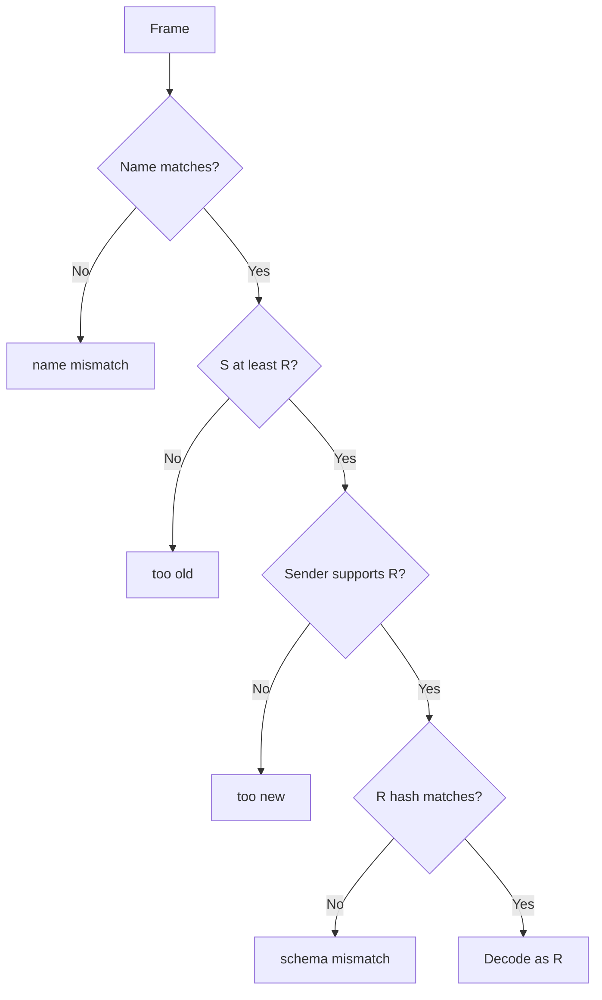
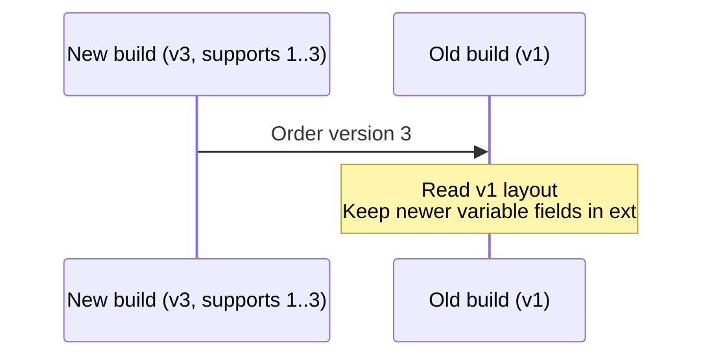
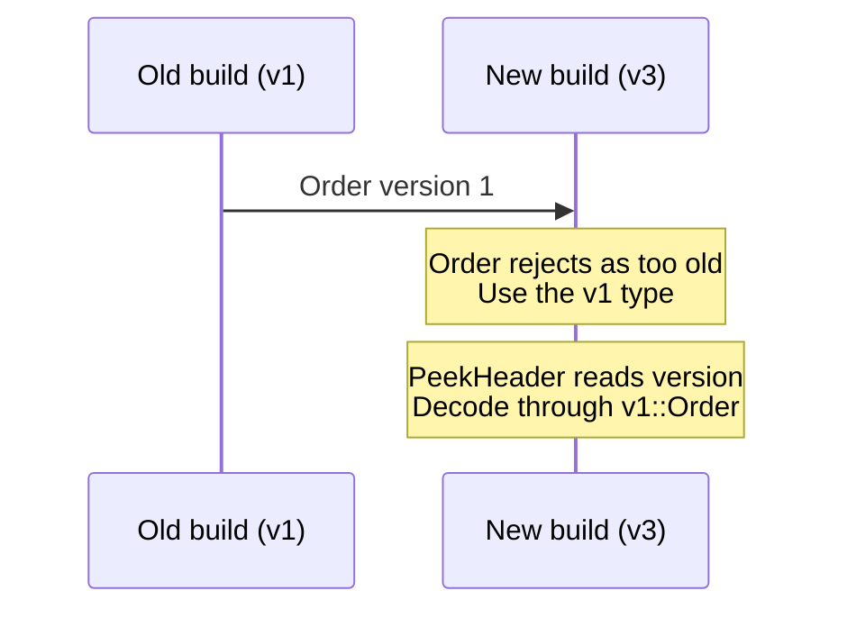
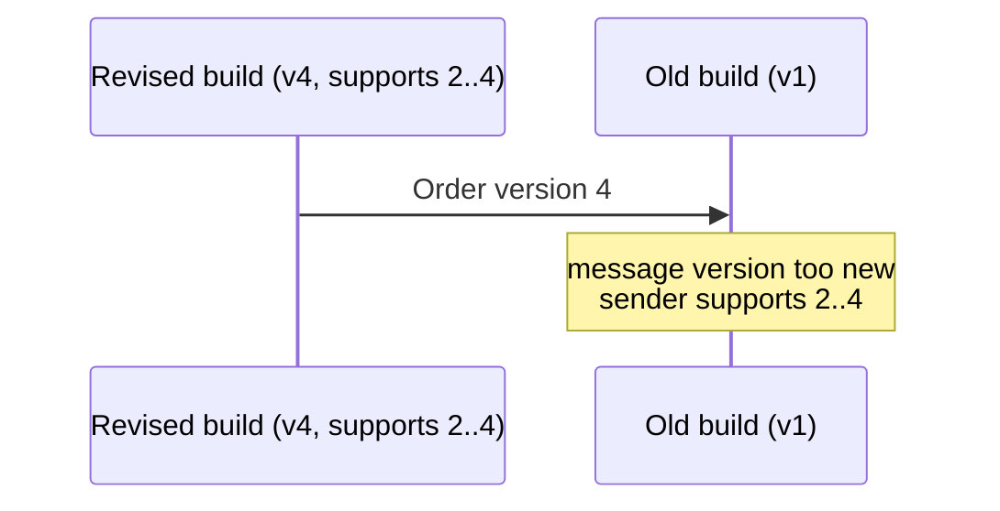
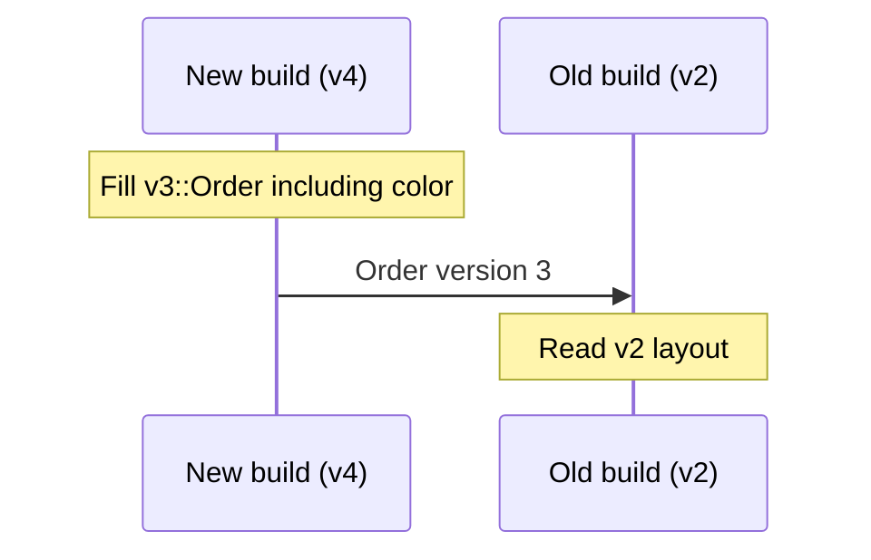

# 🌮 Protaco


[한국어](README.ko.md) · [Examples](examples/README.md) · [Reference](docs/reference.md)

Protaco turns message definitions into code, like Protocol Buffers and FlatBuffers. You describe messages in YAML, and the `protacoc` IDL (Interface Definition Language) tool generates C++ and C# classes that exchange the same bytes. Python output is planned (TODO).


It is light, and that is why it is fast. Protaco provides the features an ordinary project needs in one C++ header or one C# source file: no complicated CMake setup, no installation, no extra project, no lib/dll to link. Fixed-length setters write directly into the frame buffer, so a message with only fixed fields has no encoding step at all. In our measurements, encoding took 79 to 92% less time than with Protocol Buffers ([8.4](#84-measurements-against-protocol-buffers)).


Receivers check the message name, version, and schema fingerprint. A different message or incompatible layout produces an error instead of being silently misread, making communication robust. YAML comments become docstrings, and field changes stay in one schema file. A message from another YAML file can be a field type or a list element, so definitions can describe nested structures.

Protaco currently runs on Windows. 🐧 A Linux version is planned; if you would rather not wait, a fork that gets there first is more than welcome! This manual covers protacoc 0.5.0 and serialization format v3.

Start with a delivery stop in [RouteStop.yaml](examples/schemas/RouteStop.yaml).

```yaml
message: RouteStop
version: 1
namespace: demo
fields:
  - {key: orderId, type: string(16), desc: order number}
  - {key: address, type: string(48), desc: street address}
  - {key: etaMin, type: int, default: 15, desc: minutes until arrival}
```

[DeliveryRoute.yaml](examples/schemas/DeliveryRoute.yaml) uses a list of those messages.

```yaml
message: DeliveryRoute
version: 1
namespace: demo
fields:
  - {key: rider, type: string, required: true, desc: rider id}
  - {key: stops, type: list<RouteStop>, required: true, desc: stops}
  - {key: note, type: string, default: "", desc: why this route}
```

The following C++ and C# code uses the classes generated from the YAML above.

```cpp
#include "DeliveryRoute.g.h"   // Generated by protacoc from DeliveryRoute.yaml

demo::RouteStop stop;
stop.set_orderId("A-100");
stop.set_address("1 Pizza St");

demo::DeliveryRoute route;
route.set_rider("rider-7");
route.get_mutable_stops().push_back(stop);

const std::vector<uint8_t>& bytes = route.Serialize();
demo::DeliveryRoute back = protaco::ToObject<demo::DeliveryRoute>(bytes);
```

```csharp
var route = new demo.DeliveryRoute { Rider = "rider-7" };
route.Stops.Add(new demo.RouteStop { OrderId = "A-100", Address = "1 Pizza St" });
byte[] bytes = route.Serialize();   // The same bytes as C++
var back = Protaco.Codec.ToObject<demo.DeliveryRoute>(bytes);
```

## Contents

1. [Overview](#1-overview)
2. [How it works](#2-how-it-works)
3. [Getting started](#3-getting-started)
4. [Schema language](#4-schema-language)
5. [Extension data](#5-extension-data)
6. [Generated API](#6-generated-api)
7. [Version management](#7-version-management)
8. [Performance](#8-performance)
9. [Text output](#9-text-output)
10. [Serialization format v3](#10-serialization-format-v3)
11. [Limitations and plans](#11-limitations-and-plans)
12. [License](#12-license)

## 1. Overview

### 1.1 Features

- 📄 YAML is the IDL. Each file defines one message, and messages refer to each other by name, so file order never matters.
- Output is header-only C++ (`*.g.h`) and C# source (`*.g.cs`). There is no lib/dll to link. Drop the generated files into your project and you are done!
- 🪶 The C++ runtime uses only the standard library, and the C# runtime only the base framework. Nothing to install.
- Every generation writes the matching runtime next to the generated code, so the generator and runtime versions can never drift apart.
- ⚡ Fixed-field setters write the final bytes directly. In C++, `Serialize()` hands back the last bytes when nothing has changed.
- 🛡️ Receivers check the name, version, and schema fingerprint. A broken message is never read silently, which keeps communication stable and robust.
- Versioning is powerful: each field records its own history with `added` and `removed`, and the generator also produces classes for supported older versions!
- 🧩 Extension data carries key-value pairs that are not in the schema. Turn it off with `allow_extension: false` when you do not need it.
- 📝 One `ToString()` call puts fields and extension data in your logs. Practical by design.

### 1.2 Comparison with Protocol Buffers

The protobuf footprint below comes from a C++ 3.21.12 Release build using v141 x64.

| Item | Protaco | Protocol Buffers (C++) |
|---|---|---|
| Runtime | One header, about 41 KB, no linking | 84 .cc sources in the libprotobuf CMake target, about 20 MB for the static library |
| Dependencies | C++ standard library | Runtime library linking; version 22 adds an Abseil dependency |
| Generator and runtime | Matching runtime written with generated code | Generated code must match the installed runtime; mismatches produce a compile error in the generated header |
| Fixed fields | Setters write directly into the frame | Fields encoded at serialization time, including varint integers |
| Serializing unchanged values again | Last bytes reused (C++) | Encoded again |
| Message identity | Name, version, and schema fingerprint checked | Name and schema absent from the data; unknown fields kept, absent fields use defaults |
| Version history | Supported history in one YAML file, a class per older version | Field numbers track changes, one class per message |
| Schema syntax | Plain YAML with only intuitive features; comments become docstrings | The `.proto` language, with its own syntax to learn |
| Frame size | Fixed widths; header of 28 bytes + name + 4 bytes per supported version | Varints can be smaller when many integers are small |

Speed and frame size depend on the message. See the [measurement conditions and results](#84-measurements-against-protocol-buffers).

## 2. How it works

`protacoc` reads YAML and generates message classes and the runtime. C++ projects include the headers, and C# projects compile the source files. Both use the same frame bytes regardless of transport.


Each message gets a `*.g.h` and a `*.g.cs` file, including its supported older-version classes. Nested message references resolve by name.

## 3. Getting started

### 3.1 Requirements

- Windows, Visual Studio 2017 or later, v141 toolset (MSBuild 15).
- Generator and C# runtime: .NET Framework 4.6.1, C# 7.3.
- C++ runtime and generated headers: C++14 compatible.
- Only for C++ tests: googletest with `include\`, `lib\gtest.lib`, and `lib\gtest_main.lib`, built with `/MD`.

Linux support and Python output are planned.

### 3.2 Build protacoc

Run from the repository root:

```bat
build.cmd
```

The generator is written to `build\bin\protacoc.exe`. This command also regenerates example and test code, runs tests, and runs the example. See [Build and test](docs/reference.md#4-build-and-test) for the steps and environment variables. In Visual Studio, open [protaco.sln](protaco.sln).

### 3.3 Write a schema

Save the earlier `RouteStop.yaml` and `DeliveryRoute.yaml` definitions in a `schemas` folder. Match each file name to its `message` name and use the same namespace for every file in one invocation. The sample files are in [examples/schemas](examples/schemas).

### 3.4 Generate code

```bat
build\bin\protacoc.exe -I schemas --cpp_out gen\cpp --cs_out gen\cs
```

C++ output consists of `RouteStop.g.h`, `DeliveryRoute.g.h`, and `Protaco.hpp`. C# output consists of `RouteStop.g.cs`, `DeliveryRoute.g.cs`, and `Protaco.cs`.

Add `gen\cpp` to the C++ include path and include `DeliveryRoute.g.h`. Add the generated sources and runtime in `gen\cs` to the C# project. The [example guide](examples/README.md#2-build-and-run) shows project settings.

### 3.5 Command-line options

| Option | Purpose |
|---|---|
| `-I <dir>` | YAML folder, repeatable |
| `--cpp_out <dir>` | Write C++ headers and runtime |
| `--cs_out <dir>` | Write C# sources and runtime |
| `--check` | Check generated files without writing them |

You can select just one output language. See the [full command line](docs/reference.md#2-command-line) for other options and selecting messages.

## 4. Schema language

### 4.1 File rules

- One message per file, with the file name matching the message name.
- References resolve by message name. Input order does not matter.
- All input files in one invocation must share a namespace (PC405). Use separate invocations and output folders for different namespaces.
- Comments at the top of a file become the class docstring. Comments immediately above a field, trailing comments, and `desc` become its docstring.
- Use top-level keys and `- {key: ..., type: ...}` entries under `fields:`. The parser supports a subset of YAML; flow lists such as `[a, b]` produce PC102.

### 4.2 Message keys

```yaml
message: PizzaOrder
version: 2
min_version: 1
namespace: shop
allow_extension: true
desc: a pizza order
fields:
  - {key: orderId, type: string(32), desc: order number}
  - {key: giftNote, type: string, added: 2}
```

| Key | Required | Meaning |
|---|---|---|
| `message` | Yes | Message name, matching the file name |
| `version` | Yes | Current version, 1..65535 |
| `namespace` | Yes | A name such as `shop` or `shop.orders` |
| `fields` | Yes | Field list |
| `min_version` | No | Oldest supported version, defaults to `version`; see [Version management](#7-version-management) |
| `allow_extension` | No | Whether extension data is allowed, defaults to `true` |
| `desc` | No | Description included in the docstring |

A namespace does not need a dot. A dotted name such as `shop.orders` becomes `shop::orders` in C++ and `shop.orders` in C#.

**`allow_extension` determines what a receiver accepts.** With `false`, no extension API is generated and unknown keys in a frame of the same version are rejected. Decide on the [extension policy](#5-extension-data) before shipping.

### 4.3 Field attributes

| Attribute | Meaning | Rule |
|---|---|---|
| `key` | Field and accessor name | Starts with an English letter; letters, digits, and `_` allowed |
| `type` | Field type | See [Types](#44-types) |
| `required` | Entry must be present on receipt | Variable fields only, defaults to `false` |
| `default` | Initial value | Type and spelling checked during generation |
| `added` | First version containing the field | Defaults to 1, no later than the current `version` |
| `removed` | First version without the field | Later than `added`, no later than the current `version` |
| `desc` | Field description | Included in the docstring |

Keys cannot start with `_`, `get_`, `set_`, or `mutable_`. C++ and C# keywords and generated member names such as `ext`, `buf`, `cache`, `serialize`, and `tostring` produce PC303. C# property names must also be distinct after capitalizing the first letter (PC311).

`required` applies only to `string`, `bytes`, `list<T>`, and message fields. An absent entry fails decoding with `missing required`. Fixed fields always occupy bytes in the fixed block, so they cannot be absent. The generator rejects `required` on them with PC305; the receiving application validates their values.

protacoc checks `default` during generation and rejects invalid values with PC308.

- `bool`: unquoted `true` or `false`.
- Integers: within the type's range, without quotes, `+`, or unnecessary leading zeros. The minimum `int64` value cannot be a default.
- `double`: unquoted decimal or exponent notation. NaN, infinity, and values that overflow to infinity are rejected.
- Strings: ASCII only, at most N bytes for `string(N)`.
- `bytes`, lists, and messages: no explicit default; they start empty.

### 4.4 Types

Fixed-length types:

| Type | Size and representation | C++ / C# |
|---|---|---|
| `bool` | 1 byte | `bool` / `bool` |
| `int` | 4 bytes | `int32_t` / `int` |
| `int64` | 8 bytes | `int64_t` / `long` |
| `double` | 8 bytes, IEEE 754 | `double` / `double` |
| `string(N)` | N bytes, N is 1..4096, unused bytes zeroed | `std::string` / `string` |

For a value longer than N bytes, a C++ `string(N)` setter returns `false` and keeps the previous value. The C# setter throws `ArgumentException`.

Variable-length types:

| Type | Representation | C++ / C# |
|---|---|---|
| `string` | Variable-length string | `std::string` / `string` |
| `bytes` | Binary data, including 0 and 0xFF unchanged | `std::vector<uint8_t>` / `byte[]` |
| `list<T>` | Element type and list of elements | `std::vector<T>` / `List<T>` |
| Message name | Nested body from another YAML message | Generated class |

List elements can be `int`, `int64`, `double`, `string`, `bytes`, or a message. Lists of lists, `list<bool>`, and `list<string(N)>` produce PC404. Nesting is limited to 8 levels (PC406), and reference cycles are rejected (PC403).

Fixed fields are grouped at the beginning of the body even when declared between variable fields in YAML. They are ordered by the version that added them, then by declaration order.

## 5. Extension data

### 5.1 When to use it

Extension data consists of key-value entries absent from the YAML schema. Use it to attach a delivery channel, priority, or receipt without changing the schema or version. A relay can preserve entries it does not understand, so it does not have to be upgraded before passing them on.

Data that becomes part of the protocol contract belongs in a declared field with `added`. Extension data suits experiments, optional metadata, and information passed through relays. For frequently sent messages containing only fixed fields, `allow_extension: false` makes the intended contract explicit.

### 5.2 Writing and reading

```cpp
route.GetMutableExt().SetString("channel", "web");
route.GetMutableExt().SetInt("priority", 2);
route.GetMutableExt().SetBytes("receipt", std::vector<uint8_t>{0, 0xFF});
std::string channel;
bool found = route.GetExt().GetString("channel", &channel);
```

```csharp
route.Ext.SetString("channel", "web");
route.Ext.SetInt("priority", 2);
route.Ext.SetBytes("receipt", new byte[] { 0, 0xFF });
bool found = route.Ext.TryGetString("channel", out string channel);
```

`SetBool`, `SetInt`, `SetInt64`, `SetDouble`, `SetString`, and `SetBytes` return a `bool` indicating success. C++ `Get*` returns `false` and leaves the output argument unchanged if the key is absent or the type differs. C# provides `TryGetBool`, `TryGetInt`, `TryGetInt64`, `TryGetDouble`, `TryGetString`, and `TryGetBytes`.

| Operation | C++ | C# |
|---|---|---|
| Check presence | `route.GetExt().Has("channel")` | `route.Ext.Has("channel")` |
| Remove | `route.GetMutableExt().Remove("channel")` | `route.Ext.Remove("channel")` |
| Count entries | `route.GetExt().Count()` | `route.Ext.Count` |
| List keys | `route.GetExt().Keys()` | `route.Ext.Keys` |

`Set*` returns `false` for:

- Field keys from any version of the schema.
- Keys starting with `_`.
- Empty keys or keys longer than 255 bytes.

### 5.3 Forwarding and types

Receivers keep keys absent from their schema in ext. Serializing that message again includes those entries, allowing a relay to pass them on without interpreting them. Variable fields introduced in a newer version are also kept in ext by older receivers.

Values set directly through the ext API can be `bool`, `int`, `int64`, `double`, `string`, or `bytes`. They do not receive schema validation, so readers check the key and type. Each entry adds a TLV consisting of a 1-byte key length, the key, a 1-byte type, a 4-byte value length, and the value. `ToString()` displays entries under `ext{...}`.

### 5.4 Closed messages

With `allow_extension: false`, no extension API is generated. An unknown key in a frame of the same version fails with `unknown key (allow_extension false)`. For a newer frame, the receiver checks its own version's fingerprint and discards newer fields.

This setting is part of the schema fingerprint. Changing it in a shipped contract breaks compatibility, so choose the extension policy before deployment.

## 6. Generated API

### 6.1 C++ class

Classes are generated as `<ns>::<Name>`. Below, `<field>` stands for a YAML field key and `T` for its C++ type.

| Item | API | Behavior |
|---|---|---|
| Constructor | `<Name>()` | Initializes defaults, with fixed fields in the frame buffer |
| Fixed scalar | `T get_<field>() const`, `void set_<field>(T)` | Reads and writes the buffer directly |
| Fixed string | `std::string get_<field>() const`, `bool set_<field>(const std::string&)` | Returns `false` on overflow, keeps the previous value |
| Variable field | `const T& get_<field>() const`, `void set_<field>(const T&)` | Reads or assigns the value |
| Mutable access | `T& get_mutable_<field>()` | Reference to a list, bytes, or nested message; not available for `string` |
| Extension data | `const protaco::CExt& GetExt() const`, `protaco::CExt& GetMutableExt()` | Generated only for open messages |
| Envelope | `SetEnvelope(const protaco::Envelope&)`, `protaco::Envelope GetEnvelope() const` | Request id, correlation id, and timestamp in the header |
| Serialization | `const std::vector<uint8_t>& Serialize() const` | Reference to the object's frame buffer |
| Logging | `std::string ToString(const protaco::TextStyle& = protaco::TextStyle()) const` | See [Text output](#9-text-output) |
| Static metadata | `MsgName()`, `MsgVersion()`, `MsgMinVersion()`, `MsgSchemaHash()` | Dispatch and diagnostics |

In 0.5.0, extension accessors are `GetExt()` and `GetMutableExt()`. Only field accessors use `get_`, `set_`, and `get_mutable_`; other public functions use PascalCase.

`Envelope` holds `id` (u32 request id), `corr` (u32 correlation id), and `ts` (i64 timestamp in us), written directly into the header. Use the reference from `Serialize()` until the object changes. Copy the bytes if they or their address must remain stable. See the [reuse rules](#83-reusing-serialize-results).

Older classes are named `<ns>::v<N>::<Name>` and expose that version's fields. Buffers, field lists, and internal constants are private; the runtime accesses them through friendship.

### 6.2 C++ runtime

The runtime is `Protaco.hpp`, in namespace `protaco`.

- `ToObject<T>` accepts a vector or a pointer and length.

  ```cpp
  auto back = protaco::ToObject<demo::DeliveryRoute>(bytes);
  auto again = protaco::ToObject<demo::DeliveryRoute>(bytes.data(), bytes.size());
  ```

- Failures throw `CParseError`. `GetError()` provides `path` and `what`.

  ```cpp
  try { protaco::ToObject<demo::DeliveryRoute>(bytes); }
  catch (const protaco::CParseError& e) { std::cerr << e.GetError().path << ": " << e.GetError().what; }
  ```

- `TryToObject` returns without throwing and leaves the output object unchanged on failure. `error.path` identifies a location such as `delivery.doorCode` or `stops[2].orderId`.

  ```cpp
  demo::DeliveryRoute back; protaco::Error error;
  bool ok = protaco::TryToObject(bytes.data(), bytes.size(), &back, &error);
  ```

- `PeekHeader` reads `Header{name, version, minVersion, schemaHash, env, bodySize}` without decoding the body.

  ```cpp
  protaco::Header header; protaco::Error error;
  bool ok = protaco::PeekHeader(bytes.data(), bytes.size(), &header, &error);
  ```

- `CExt` provides typed extension access.

  ```cpp
  route.GetMutableExt().SetInt("priority", 2);
  int32_t priority = 0; route.GetExt().GetInt("priority", &priority);
  ```

- `TextStyle` controls separators, delimiters, indentation, and text length.

  ```cpp
  auto style = protaco::TextStyle::Pretty(); style.maxText = 32;
  auto log = route.ToString(style);
  ```

Catch `CParseError` inside the module that throws it; do not pass it across a DLL boundary. The `std::cerr` example requires `<iostream>`.

### 6.3 C#

Classes are named `<ns>.<Name>`; `Protaco.cs` provides the runtime in namespace `Protaco`.

- Fields become PascalCase properties. A fixed string throws `ArgumentException` if the value exceeds its byte capacity.

  ```csharp
  var route = new demo.DeliveryRoute { Rider = "rider-7" };
  route.Stops.Add(new demo.RouteStop { OrderId = "A-100", Address = "1 Pizza St" });
  ```

- Open messages expose `Ext`.

  ```csharp
  route.Ext.SetString("channel", "web");
  bool found = route.Ext.TryGetString("channel", out string channel);
  ```

- `Serialize()` allocates a new `byte[]` on each call. Pass an envelope when serializing; it is not stored on the object.

  ```csharp
  byte[] bytes = route.Serialize();
  byte[] tagged = route.Serialize(new Protaco.Envelope { Id = 1, Corr = 0, Ts = 0 });
  ```

- `ToString()` and `ToString(TextStyle)` produce log text.

  ```csharp
  string line = route.ToString();
  string pretty = route.ToString(Protaco.TextStyle.Pretty());
  ```

- `MsgName`, `MsgVersion`, `MsgMinVersion`, and `MsgSchemaHash` are constants.

  ```csharp
  string name = demo.DeliveryRoute.MsgName;
  uint hash = demo.DeliveryRoute.MsgSchemaHash;
  ```

- Supported older versions have their own namespaces. This class comes from the schema in section 7.

  ```csharp
  var oldOrder = new shop.v1.Order();
  ```

- `Codec.ToObject<T>` decodes a message and can also return its envelope.

  ```csharp
  var back = Protaco.Codec.ToObject<demo.DeliveryRoute>(bytes);
  var taggedBack = Protaco.Codec.ToObject<demo.DeliveryRoute>(tagged, out Protaco.Envelope env);
  ```

- `Codec.TryToObject<T>` returns success and a `ProtacoException` on failure.

  ```csharp
  bool ok = Protaco.Codec.TryToObject<demo.DeliveryRoute>(bytes, out var back, out var error);
  if (!ok) System.Console.WriteLine(error.Path + ": " + error.What);
  ```

- `Codec.PeekHeader` inspects the header without decoding the body.

  ```csharp
  bool ok = Protaco.Codec.PeekHeader(bytes, out Protaco.Header header);
  ```

- The throwing decoder reports `ProtacoException.Path` and `What`.

  ```csharp
  try { Protaco.Codec.ToObject<demo.DeliveryRoute>(bytes); }
  catch (Protaco.ProtacoException e) { System.Console.WriteLine(e.Path + ": " + e.What); }
  ```

Internal runtime members use explicit interface implementations. Strings are encoded with the system ANSI code page, `Encoding.Default`.

## 7. Version management

### 7.1 Why it matters

Applications are rarely upgraded all at once. While old and new builds communicate, both need clear rules for accepting messages and reporting incompatibility; every team that owns a protocol runs into this. Protaco keeps the supported version history in one YAML file and reports name, version, and fingerprint failures explicitly.

| Change | What to do in YAML | What older builds see |
|---|---|---|
| Small change (add or remove fields) | Raise `version`, mark fields `added`/`removed` | Communication continues |
| Larger revision | Raise `version` and `min_version` | A clear error instead of a crash or a misread |

### 7.2 Small changes

To add or remove a field, increase `version` and set `added` or `removed` on the field. Keep `min_version` unchanged. Older layout fingerprints remain valid, allowing old and new builds to communicate. If you remove a variable field required by an older receiver, send an older class as described in the [layout rules](#79-layout-rules).

### 7.3 Larger revisions

Raise `min_version` to stop supporting older versions. For example, version 3 with `min_version: 3` gives an older receiver a normal error:

```text
message version too new: Order reads version 1, sender supports 3..3
```

The new build also rejects frames that are too old with `message version too old`. Neither side tries to interpret an incompatible layout. Tests `SenderMinVersionAboveReader` and `OlderFrameNeedsOldType` cover this behavior. For a substantially changed field, mark the existing field `removed` and add a replacement under a new key with `added`.

### 7.4 Declaring versions

```yaml
message: Order
version: 3          # Current version
min_version: 1      # Oldest supported version; defaults to version
namespace: shop
fields:
  - {key: id,     type: string(8)}
  - {key: weight, type: double, default: 0.5, added: 2}
  - {key: qty,    type: int, default: 1, removed: 3}  # Keep fixed bytes, fill with default
  - {key: note,   type: string, removed: 3}           # Not sent from version 3 onward
  - {key: color,  type: string, required: true}
  - {key: tags,   type: list<string>, added: 2}
  - {key: label,  type: string, added: 3}
  - {key: rush,   type: bool, added: 3}
```

A field first exists in its `added` version. It stops existing in its `removed` version, so the preceding version is the last one that contains it. `added` defaults to 1.

`version` is the current version; `min_version` is the oldest still supported. Omitting `min_version` means supporting only the current version. A message can support at most 255 versions.

### 7.5 Generated classes

- `shop::Order`: current version 3.
- `shop::v1::Order`, `shop::v2::Order`: one class per supported older version, exposing its fields.
- C#: `shop.Order`, `shop.v1.Order`, `shop.v2.Order`.

The frame header carries the sender's `version`, `min_version`, and a 4-byte schema fingerprint for every supported version. Adding a version preserves older fingerprints. The [reference](docs/reference.md#1-schema-fingerprint) describes their calculation.

### 7.6 Receiving

Let R be the receiving class's version and S the frame's version. Checks run in this order:



1. A different name produces `message name mismatch: expected Order, got Heartbeat`.
2. If S is older than R, the error is `message version too old: Order reads version 3 or newer, got 1. Use the v1 type`. The type hint appears only when that older class was generated. Inspect the version with `PeekHeader()` and decode through `v1::Order`.
3. If the sender's `min_version` is greater than R, the error is `message version too new: Order reads version 1, sender supports 2..4`.
4. If the frame's fingerprint for R differs from the receiver's `MsgSchemaHash()`, the error is `schema mismatch: Order version 1 expected 0x..., got 0x...`.
5. Otherwise, read R's fixed block and variable fields. Keep newer variable fields in ext for an open message, or discard them for a closed message.

### 7.7 Sending

A class always sends its own version. It includes fingerprints from `min_version` through that version. If a peer needs an older layout, populate an older class such as `v1::Order` and serialize it.

### 7.8 Deployment cases

A newer build sends to an older build:



An older build sends to a newer build:



A revised build sends to a peer it no longer supports:



A newer build chooses an older layout. Here version 4 removed `color`, but the peer still requires it, so the sender uses the version 3 class:



### 7.9 Layout rules

- Fixed fields are ordered by the version that added them, then declaration order. New fixed fields are appended to the existing fixed block.
- Removed fixed fields keep their bytes permanently, filled with the default. Keep their YAML lines too.
- Removed variable fields are not sent. Once `min_version` reaches their `removed` version, delete their YAML lines (PC313).
- If a removed variable field was `required` in an older version, that receiver can reject a new frame with `missing required (frame version 4 read as 2)`. Send an older class that still contains the field.
- Messages used as field types cannot use `min_version`, `added`, or `removed` version features (PC407). Nested bodies do not carry a version. Add a new message when a nested structure needs to change.

### 7.10 Changing a shipped schema

Before deployment, edit freely without increasing the version. **A shipped version's contract is frozen.**

- Increase `version` for each field addition (`added`), field removal (`removed`), or increase in `min_version`. Adding a new message is always allowed.
- Changing an existing field's type, `required`, `default`, name, or order, or reusing a removed key, breaks the old contract. Remove the existing field and add a replacement with a new key.
- Changing the message name or `allow_extension` also breaks compatibility. Define a new message contract or end support for the older versions.
- Name or fingerprint checks reject incompatible frames.
- Comments, `desc`, and `namespace` do not affect serialized bytes.

See the [version management walkthrough](examples/README.md#6-version-management-walkthrough) for actual revisions and exchanges between builds.

## 8. Performance

### 8.1 Footprint

| Component | Size | Requirements |
|---|---|---|
| `Protaco.hpp` | 1,455 lines, about 41 KB | C++14, standard library only |
| `Protaco.cs` | 1,221 lines | .NET Framework 4.6.1, C# 7.3, no packages |
| `protacoc.exe` | About 150 KB, one file | .NET Framework 4.6.1 |

Generated C++ classes contain no reflection, descriptor tables, or virtual functions.

### 8.2 Fixed fields written in place

Fixed fields have known positions in the frame buffer. Setters write the final bytes directly, so a message with only fixed fields and empty ext has no data left to append during `Serialize()`.

```cpp
demo::Heartbeat beat;                    // All fields fixed, allow_extension: false
beat.set_uptimeSec(10);                  // Write directly into the frame buffer
const auto& bytes = beat.Serialize();    // The buffer itself, no copy or encoding
beat.set_uptimeSec(11);                  // bytes already reflects 11
```

If values have not changed, another `Serialize()` call returns the last bytes as they are. Changes made by fixed-field setters are already in the buffer.

Fixed fields are grouped at the start of the body. To append variable fields, serialization computes their total size first and builds them with one allocation.

### 8.3 Reusing Serialize results

C++ does not rebuild the variable block when variable fields and ext have not changed since the last `Serialize()`.

- Calling a variable field's `set_`, changing ext through Set, Remove, or assignment, or decoding new values causes a rebuild.
- After `get_mutable_<field>()` has been called on an object, every serialization rebuilds its variable block. Later writes through that reference cannot be tracked.
- To benefit from reuse, assign lists, bytes, and nested messages through `set_`.
- A copy rebuilds on its first serialization.
- C# allocates a new `byte[]` on every call and does not perform this reuse.

```cpp
route.set_stops(std::vector<demo::RouteStop>{stop});
const auto& first = route.Serialize();
const auto& again = route.Serialize();   // Reuse if variable fields and ext are unchanged
```

This example assumes `get_mutable_stops()` has not been called on the object. The 0.5.0 decoder also keeps up to 16 variable-field entries per body on the stack, avoiding a heap allocation for that list.

### 8.4 Measurements against Protocol Buffers

Measured on an Intel Core i9-13900H, Windows 11, MSVC 14.16 (v141) x64 `/O2 /MD`, with protobuf 3.21.12 as a static library and protaco 0.5.0. Results are averages of 20 rounds of 100,000 calls after 10,000 warmup calls.

Fixed512 has a 512-byte fixed block, Fixed1K has 1,024 bytes, and Mixed256 combines a 196-byte fixed block with two variable strings. Encoding includes setting every field and serializing. Repeated serialization uses an unchanged object. Decoding compares protaco's `TryToObject()` with protobuf's `ParseFromArray()` into a reused message.

| Message, operation | protaco / protobuf | Time saved by protaco |
|---|---|---|
| Fixed512 encode | 20.6 / 214.8 ns | 90% |
| Fixed512 serialize again | 1.2 / 196.5 ns | 99% |
| Fixed512 decode | 61.6 / 240.1 ns | 74% |
| Fixed1K encode | 40.1 / 482.2 ns | 92% |
| Fixed1K serialize again | 1.1 / 449.3 ns | 99% |
| Fixed1K decode | 72.4 / 578.0 ns | 87% |
| Mixed256 encode | 20.2 / 98.3 ns | 79% |
| Mixed256 serialize again | 1.3 / 80.0 ns | 98% |
| Mixed256 decode | 136.4 / 155.1 ns | 12% |

Schemas, measurement code, and reproduction details are in [benchmark/README.md](benchmark/README.md).

Frame sizes (protaco / protobuf) are 556 / 571 B for Fixed512, 1,067 / 1,132 B for Fixed1K, and 300 / 268 B for Mixed256.

The decoding gap is smaller with strings. Protaco decodes internally into a fresh object, allocating for each string longer than 15 bytes in this MSVC environment. Protobuf reuses the target message's strings. These results apply to the measured messages and environment; data and hardware affect the outcome.

## 9. Text output

`ToString()` prints fields in YAML order, followed by extension entries under `ext{...}`.

```cpp
auto line = route.ToString();
auto pretty = route.ToString(protaco::TextStyle::Pretty());
```

```csharp
string line = route.ToString();
string pretty = route.ToString(Protaco.TextStyle.Pretty());
```

- Strings are quoted and escaped. Values beyond `maxText` show the omitted length, as in `"abcd"...(+12)`.
- Bytes show their size and first 8 bytes, for example `<11 bytes: FF D8 00 10 4A 46 49 46 ...>`.
- `TextStyle` defaults: `separator = ", "`, `open = "{"`, `close = "}"`, `indent = 0` (one line), `maxText = 64`.
- `TextStyle::Pretty(indentWidth = 2)` produces indented multiline output. C# uses `Protaco.TextStyle.Pretty()`.
- ASCII values produce the same output in both languages. Length limits count bytes in C++ and characters in C#.

The [example program](examples/README.md#45-text-output) shows the full output.

## 10. Serialization format v3

All integers are little-endian. Strings are raw bytes without a terminating NUL.

```text
Frame
  'P' 'C'          magic
  FrameVer u8      = 3
  NameLen  u8
  Name             message name
  MsgVer   u16     message version
  MinVer   u16     oldest version supported by the sender
  Id       u32 ┐
  Corr     u32 │   envelope
  Ts       i64 ┘
  BodyLen  u32     detects truncation and trailing bytes
  Schema   u32 × (MsgVer - MinVer + 1)   fingerprints of versions MinVer..MsgVer
  Body

Body (nested messages use the same shape)
  FixedLen u32     equals the receiver's fixed block size (same version) or larger (newer version)
  Fixed            fixed fields in serialization order, no padding
  Var*             variable fields as TLV, serialization order
  Ext*             extension entries as TLV, insertion order

TLV
  KeyLen u8 | Key | Type u8 | Len u32 | Value

TacoType
  1 bool    1 byte (0 or 1)
  2 int     4 bytes
  3 int64   8 bytes
  4 double  8 bytes IEEE 754
  5 string  bytes
  6 message Body
  7 list    ElemType u8 | Count u32 | (Len u32 | Value) × Count
  8 bytes   raw bytes
```

Limits:

- Frame size: at most 1,048,575 bytes.
- Nesting: 8 levels, checked during generation and decoding.
- Supported versions: at most 255.
- Variable fields per body: at most 1,024.
- List elements: at most the remaining byte count divided by 4.

See the [reference](docs/reference.md) for fingerprint calculations and diagnostics.

## 11. Limitations and plans

- Currently Windows only, with MSBuild projects and a .NET Framework generator. Linux support and Python output are planned (TODO).
- Recursive messages, lists of lists, `enum`, and fixed-size arrays are not supported.
- Little-endian only.
- Frames include a 28-byte header, the name, 4 fingerprint bytes per supported version, and fixed-string padding. Data with many small integers can be larger than in a varint-based format.
- Strings are raw bytes. C# uses `Encoding.Default`, so non-ASCII text is interoperable between languages when the environments use the same code page. Use `bytes` for binary data.
- Diagnostics and generated boilerplate are in English. Docstrings keep the language of the YAML comments.

## 12. License

[MIT](LICENSE). Copyright (c) 2026 Soo-Hwan Cho (Splendidz).
