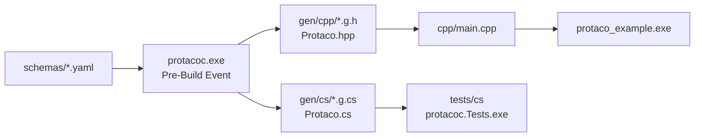
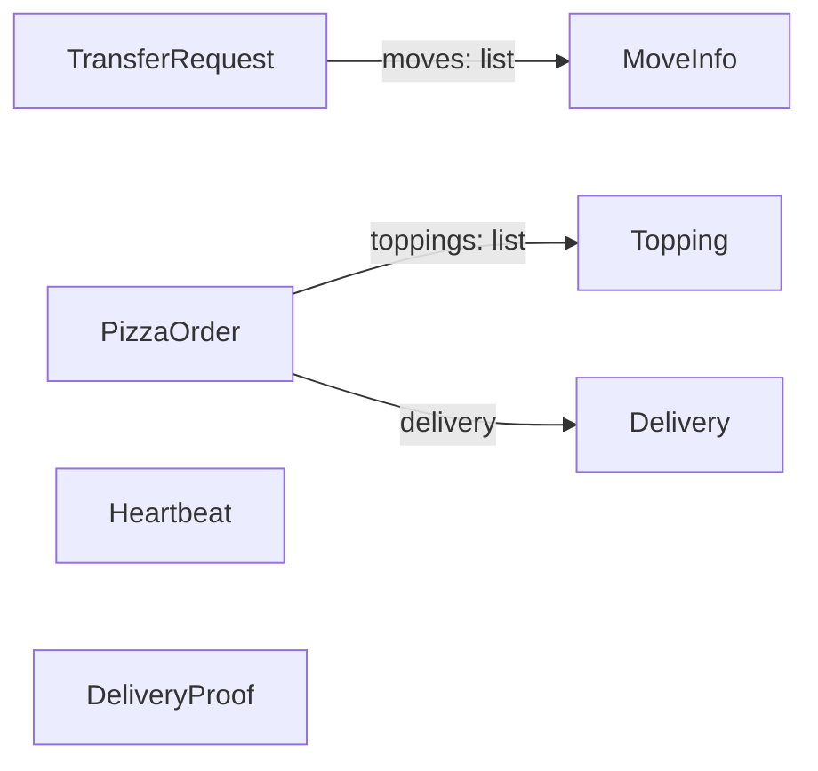
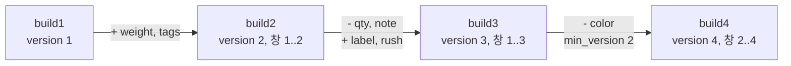

# 🌮 Protaco 예제

이 폴더에는 예제 스키마, 그 스키마로 protacoc가 생성한 코드, 그리고 생성 코드를 사용하는 C++ 프로그램이 있습니다. 6절에서는 `tests/schemas`의 버전 창 시험 스키마로 메시지 하나가 네 번 개정되는 과정을 따라갑니다.

[README](../README.ko.md) · [English](README.md)

## 목차

1. [폴더 구성](#1-폴더-구성)
2. [빌드와 실행](#2-빌드와-실행)
3. [스키마](#3-스키마)
4. [프로그램 설명](#4-프로그램-설명)
5. [생성 코드](#5-생성-코드)
6. [버전 창 예제](#6-버전-창-예제)

## 1. 폴더 구성

```
examples/
  schemas/             YAML 스키마 7개, namespace demo
  gen/cpp/             생성 C++ 헤더와 Protaco.hpp
  gen/cs/              생성 C# 소스와 Protaco.cs
  cpp/main.cpp         생성 헤더를 사용하는 C++ 프로그램
  cpp/example.vcxproj  프로젝트: include 경로와 Pre-Build Event
```

- 빌드 없이 출력을 볼 수 있도록 생성 파일도 저장소에 포함.
- `build.cmd`가 생성 파일 재생성. 생성 파일이 오래되면 C# 시험 `committed example output is up to date (--check)` 실패.
- `gen/cs`의 C# 소스는 C# 시험 프로젝트 `tests/cs/protacoc.Tests.csproj`가 컴파일. 사용자 프로젝트와 같은 방식.



## 2. 빌드와 실행

저장소 루트에서 실행합니다.

```
build.cmd
```

`build.cmd`의 5단계가 예제를 빌드하고 실행합니다. 수동으로 하려면 다음 순서로 실행합니다.

```
build\bin\protacoc.exe -I examples\schemas --cpp_out examples\gen\cpp --cs_out examples\gen\cs
msbuild examples\cpp\example.vcxproj /p:Configuration=Release /p:Platform=x64
build\bin\Release\protaco_example.exe
```

`example.vcxproj`에 필요한 설정은 include 경로에 출력 폴더를 추가하는 것뿐입니다. `build\bin\protacoc.exe`가 있으면 Pre-Build Event가 protacoc를 실행합니다.

```xml
<AdditionalIncludeDirectories>$(ProjectDir)..\..\examples\gen\cpp;%(AdditionalIncludeDirectories)</AdditionalIncludeDirectories>

<PreBuildEvent>
  <Command>if exist "$(ProjectDir)..\..\build\bin\protacoc.exe" "$(ProjectDir)..\..\build\bin\protacoc.exe" -I "$(ProjectDir)..\..\examples\schemas" --cpp_out "$(ProjectDir)..\..\examples\gen\cpp" --cs_out "$(ProjectDir)..\..\examples\gen\cs"</Command>
</PreBuildEvent>
```

프로젝트는 `/W4 /WX`, C++17로 컴파일합니다. 생성 헤더는 C++14로도 컴파일됩니다(`tests/cpp/Cpp14Check.cpp`).

## 3. 스키마

| 스키마 | 보여 주는 기능 | 사용처 |
|---|---|---|
| [MoveInfo](schemas/MoveInfo.yaml) | 전부 고정 필드: `string(32)`, 기본값 있는 `int` | `TransferRequest.moves`의 원소 |
| [TransferRequest](schemas/TransferRequest.yaml) | 가변 필드, `required`, 메시지 목록, `version: 2` | 4.1, 4.4, 4.5절 |
| [Heartbeat](schemas/Heartbeat.yaml) | 전부 고정 필드, `allow_extension: false` | 4.2절 |
| [PizzaOrder](schemas/PizzaOrder.yaml) | 변형 태그 `eq`, 기본값, 중첩 메시지, 목록 | 4.3절 |
| [Topping](schemas/Topping.yaml) | 작은 고정 메시지 | `PizzaOrder.toppings`의 원소 |
| [Delivery](schemas/Delivery.yaml) | `list<int>`, `list<string>` | `PizzaOrder.delivery` 필드 |
| [DeliveryProof](schemas/DeliveryProof.yaml) | `bytes`, `list<bytes>`, required `bytes` | 바이너리 데이터 |



`Heartbeat.yaml`:

```yaml
# Device liveness signal. Every field is fixed-length and ext is off, so Serialize() returns the buffer as is (zero cost).
# Recommended shape for messages sent very often.
message: Heartbeat
version: 1
namespace: demo
# Closed contract: no ext, a frame with an unknown key is rejected.
allow_extension: false
owner: device

fields:
  - {key: node, type: string(32), desc: device name}
  - {key: seq, type: int64, desc: sequence number}
  - {key: healthy, type: bool, default: true, desc: device is healthy}
  - {key: cpuLoad, type: double, desc: "CPU load (0.0..1.0)"}
  - {key: uptimeSec, type: int, desc: uptime in seconds}
```

`PizzaOrder.yaml`은 매장마다 주문 모양이 다른 경우를 메시지 하나로 표현합니다. `eq`가 없는 필드는 모든 매장 공통이고, `woodFired`는 `NAPOLI`, `deepDishCm`은 `CHICAGO` 전용입니다. `eq`는 문서용이며 바이트에는 영향을 주지 않습니다.

## 4. 프로그램 설명

`cpp/main.cpp`는 함수 5개를 순서대로 실행합니다. 아래 출력은 Release x64 빌드에서 얻은 것입니다.

### 4.1 송신과 수신

```cpp
demo::TransferRequest request;
request.set_tm("TM1");
demo::MoveInfo move;
move.set_from("SHELF1");
move.set_to("TABLE3");
move.set_slot(2);
request.get_mutable_moves().push_back(move);
request.set_reason("closest-first");

const std::vector<uint8_t>& bytes = request.Serialize();   // send bytes.data(), bytes.size()
const demo::TransferRequest got = protaco::ToObject<demo::TransferRequest>(bytes);
```

```
TransferRequest: 179 bytes
  tm=TM1 first=SHELF1->TABLE3 slot=2 reason=closest-first
```

- `Serialize()`는 객체의 프레임 버퍼 참조 반환. `data()`, `size()`로 임의의 전송 수단에 전달.
- `ToObject<T>`는 이름, version, 지문 검사 후 디코드. 실패 시 `protaco::CParseError` 예외.

### 4.2 고정 필드만 있는 메시지

```cpp
demo::Heartbeat beat;
beat.set_node("oven-1");
beat.set_uptimeSec(10);
const std::vector<uint8_t>& bytes = beat.Serialize();
beat.set_uptimeSec(11);   // written into the same buffer, no need to call Serialize again
```

```
Heartbeat: received uptime=11, same buffer=yes
```

- `Heartbeat`의 필드는 전부 고정이므로 setter마다 프레임 버퍼에 직접 기록.
- `set_uptimeSec(11)` 전에 받은 `bytes`에 이미 11 반영.
- `Serialize()`는 매번 같은 버퍼 반환. 복사와 인코딩 없음.

### 4.3 확장 데이터

```cpp
demo::PizzaOrder order;
order.set_orderId("A-100");
demo::Topping basil;
basil.set_name("basil");
order.get_mutable_toppings().push_back(basil);
order.get_mutable_ext().SetString("secretSauce", "yes please");   // key not in the yaml
order.get_mutable_ext().SetInt("pineapple", 0);

const demo::PizzaOrder got = protaco::ToObject<demo::PizzaOrder>(order.Serialize());
std::string sauce;
got.get_ext().GetString("secretSauce", &sauce);
```

```
PizzaOrder ext: secretSauce=yes please, schema key in ext=rejected
```

- 스키마 밖의 키는 확장 항목으로 전달되고 수신 측에서 조회 가능.
- `orderId`는 스키마 키이므로 `SetInt("orderId", 9)`는 `false` 반환.

### 4.4 오류 처리

```cpp
const std::vector<uint8_t> bytes = demo::Heartbeat().Serialize();
demo::TransferRequest wrong;
protaco::Error error;
if (!protaco::TryToObject(bytes.data(), bytes.size(), &wrong, &error))
    std::printf("decode failed: path='%s' what='%s'\n", error.path.c_str(), error.what.c_str());
```

```
decode failed: path='' what='message name mismatch: expected TransferRequest, got Heartbeat'
```

- `TryToObject`는 예외 없음. 실패 시 `wrong` 유지.
- 프레임 머리 단계의 실패라서 `error.path`는 빈 문자열. 필드 오류면 필드 위치 표시(예: `moves[2].from`).

### 4.5 텍스트 출력

```cpp
request.get_mutable_ext().SetInt("priority", 5);
std::printf("%s\n", request.ToString().c_str());
std::printf("%s\n", request.ToString(protaco::TextStyle::Pretty()).c_str());
```

```
TransferRequest{tm="TM1", moves=[MoveInfo{from="SHELF1", to="TABLE3", slot=1}], reason="", ext{priority=5}}
TransferRequest{
  tm="TM1",
  moves=[
    MoveInfo{
      from="SHELF1",
      to="TABLE3",
      slot=1
    }
  ],
  reason="",
  ext{
    priority=5
  }
}
```

- `slot=1`은 `MoveInfo.yaml`의 기본값. 이 함수는 `set_slot` 미호출.
- 확장 항목은 스키마 필드 뒤 `ext{...}` 안에 출력.

## 5. 생성 코드

### 5.1 C++

`gen/cpp/TransferRequest.g.h`의 공개 부분(요약):

```cpp
namespace demo
{

/// Robot transfer request.
/// [version 2; schema 0xCE8A25DA; owner planner; source TransferRequest.yaml]
class TransferRequest
{
public:
    TransferRequest();

    static const char* MsgName();          // "TransferRequest"
    static uint16_t MsgVersion();          // 2
    static uint16_t MsgMinVersion();       // 2
    static uint32_t MsgSchemaHash();       // 0xCE8A25DA

    /// robot id
    /// [type string; required, decoding fails if missing]
    const std::string& get_tm() const;
    void set_tm(const std::string& value);

    /// Moves, executed in order.
    /// moves
    /// [type list<MoveInfo>; required, decoding fails if missing]
    const std::vector<MoveInfo>& get_moves() const;
    std::vector<MoveInfo>& get_mutable_moves();
    void set_moves(const std::vector<MoveInfo>& value);

    const std::string& get_reason() const;
    void set_reason(const std::string& value);

    const protaco::CExt& get_ext() const;
    protaco::CExt& get_mutable_ext();

    void SetEnvelope(const protaco::Envelope& env);
    protaco::Envelope GetEnvelope() const;

    const std::vector<uint8_t>& Serialize() const;
    std::string ToString(const protaco::TextStyle& style = protaco::TextStyle()) const;

private:
    // frame buffer, field storage, field lists for serialization and text
};

}  // namespace demo
```

- YAML에서 `moves` 위의 주석(`# Moves, executed in order.`)과 `desc`(`moves`)가 모두 docstring 줄로 변환.
- 대괄호 줄은 protacoc가 기록: 타입, `required`, 기본값, `added`, `removed`.
- 생성 파일은 모든 멤버를 inline으로 정의. 위 목록은 선언만 표시.

### 5.2 C#

`gen/cs`에는 같은 메시지의 C# 코드가 있습니다. 4.1절과 같은 값으로 사용하면 다음과 같습니다.

```csharp
var request = new demo.TransferRequest { Tm = "TM1", Reason = "closest-first" };
request.Moves.Add(new demo.MoveInfo { From = "SHELF1", To = "TABLE3", Slot = 2 });

byte[] bytes = request.Serialize();
demo.TransferRequest got = Protaco.Codec.ToObject<demo.TransferRequest>(bytes);
```

- 같은 값이면 C# 프레임과 C++ 프레임은 바이트 단위로 동일. C# 시험 `same bytes as the C++ golden files`가 검사.
- 고정 문자열 setter(`MoveInfo.From`)는 32바이트 초과 값에 `ArgumentException`.

## 6. 버전 창 예제

`tests/schemas/build1`~`build4`는 `Order.yaml` 하나의 개정판 4개이며, 연속된 빌드 4개가 배포한 상태를 나타냅니다. 네 개정판을 시험 바이너리 하나에 함께 컴파일하려고 개정판마다 namespace를 나눴습니다(`build1`~`build4`). 사용자 프로젝트에서는 namespace 하나를 유지하고 파일 내용만 바꿉니다.



### 6.1 개정 내용

version 1 (`build1/Order.yaml`):

```yaml
message: Order
version: 1
namespace: build1
fields:
  - {key: id, type: string(8)}
  - {key: qty, type: int, default: 1}
  - {key: note, type: string}
  - {key: color, type: string, required: true}
```

version 3 (`build3/Order.yaml`):

```yaml
message: Order
version: 3
min_version: 1
namespace: build3
fields:
  - {key: id, type: string(8)}
  - {key: weight, type: double, default: 0.5, added: 2}
  - {key: qty, type: int, default: 1, removed: 3}
  - {key: note, type: string, removed: 3}
  - {key: color, type: string, required: true}
  - {key: tags, type: list<string>, added: 2}
  - {key: label, type: string, added: 3}
  - {key: rush, type: bool, added: 3}
```

- version 2: `weight`(고정), `tags`(가변) 추가. `weight`는 `id`와 `qty` 사이에 선언했지만 배치는 version 1 고정 필드 뒤.
- version 3: `qty`(고정), `note`(가변) 제거, `label`, `rush` 추가. `min_version`이 1이므로 제거한 두 줄 유지.
- version 4: `required`였던 `color` 제거, `min_version`을 2로 상향. version 1 상대는 지원 종료.

### 6.2 생성 클래스

| 빌드 | 클래스 | 창 |
|---|---|---|
| build1 | `build1::Order` (v1) | 1 |
| build2 | `build2::Order` (v2), `build2::v1::Order` | 1..2 |
| build3 | `build3::Order` (v3), `build3::v1::Order`, `build3::v2::Order` | 1..3 |
| build4 | `build4::Order` (v4), `build4::v2::Order`, `build4::v3::Order` | 2..4 |

옛 version 클래스의 지문은 그 version을 배포한 클래스의 지문과 같습니다(시험 `WindowKeepsOldFingerprints`). 예를 들어 `build3::v1::Order::MsgSchemaHash()`와 `build1::Order::MsgSchemaHash()`는 같은 값입니다.

### 6.3 고정 영역 배치

| version | 고정 필드 순서 | 크기 |
|---|---|---|
| 1 | `id`(8), `qty`(4) | 12바이트 |
| 2 | `id`, `qty`, `weight`(8) | 20바이트 |
| 3, 4 | `id`, `qty`(제거, 바이트 유지), `weight`, `rush`(1) | 21바이트 |

각 영역은 다음 version 영역의 앞부분입니다. 그래서 version 1 수신 측은 version 3 프레임의 앞 12바이트만 해석하면 됩니다.

### 6.4 빌드 간 교환

#### 새 프레임을 옛 수신 측이 받는 경우

시험 `NewerFrameReadAsOwnVersion`의 내용입니다. build3이 `id="A1"`, `weight=2.5`, `color="red"`, `tags=["x"]`, `label="L"`, `rush=true`로 프레임을 보냅니다.

- build1은 version 1로 해석. `qty`는 1(송신 측이 유지 바이트에 기록한 기본값). `note`는 빈 문자열. `tags`, `label`은 확장 항목으로 보관.
- build2는 version 2로 해석. `weight`는 2.5, `tags`는 `["x"]`.

#### 옛 프레임을 새 수신 측이 받는 경우

시험 `OlderFrameNeedsOldType`의 내용입니다. build1이 보낸 프레임을 build3이 디코드합니다.

```
build3::Order       message version too old: Order reads version 3 or newer, got 1. Use the v1 type
build3::v1::Order   Order{id="B2", qty=4, note="n", color="blue"}
```

수신 측은 `PeekHeader()`로 `version`을 읽고 그에 맞는 클래스를 고릅니다.

#### 송신 측 창이 수신 측보다 높은 경우

시험 `SenderWindowAboveReader`의 내용입니다. build4가 창 2..4로 프레임을 보냅니다.

```
build1::Order   message version too new: Order reads version 1, sender supports 2..4
build2::Order   color: missing required (frame version 4 read as 2)
```

- build4는 version 1을 지원하지 않으므로 build1이 거부.
- build2는 창 안에 있지만 `color`가 version 2에서 required, version 4에서 제거. build4는 version 2 상대에게 `color`가 남아 있는 `build4::v3::Order` 또는 `build4::v2::Order`로 송신.
