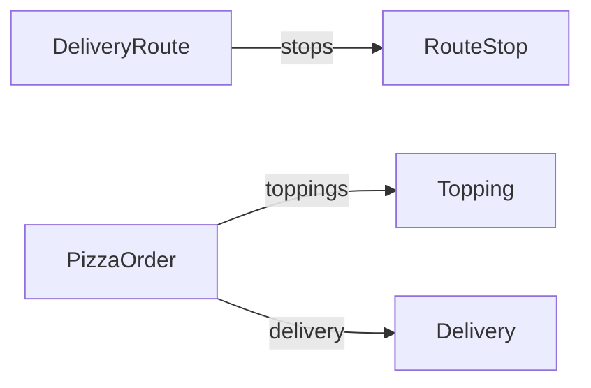

[English](README.md) · [README](../README.ko.md) · [상세 참조](../docs/reference.ko.md)

# 🌮 Protaco 예제

이 폴더에는 protacoc 0.5.0의 YAML 스키마, 실제 생성 코드, 이를 사용하는 C++ 프로그램이 있습니다. C# 생성 소스는 C# 시험 프로젝트에서 함께 컴파일합니다. 마지막 장은 `Order`의 개정 이력으로 버전 관리 방법을 설명합니다.

## 목차

1. [폴더 구성](#1-폴더-구성)
2. [빌드와 실행](#2-빌드와-실행)
3. [스키마](#3-스키마)
4. [프로그램 설명](#4-프로그램-설명)
5. [생성 코드](#5-생성-코드)
6. [버전 관리 예제](#6-버전-관리-예제)

## 1. 폴더 구성

```text
examples/
  schemas/             YAML 스키마, namespace demo
  gen/cpp/             생성 C++ 헤더와 Protaco.hpp
  gen/cs/              생성 C# 소스와 Protaco.cs
  cpp/main.cpp         생성 클래스를 사용하는 C++ 프로그램
  cpp/example.vcxproj  include 경로와 Pre-Build Event 설정
```

생성 파일을 저장소에서 바로 읽을 수 있습니다. `build.cmd`가 재생성하며, C# 시험의 `--check` 검사가 생성 결과의 최신 여부를 확인합니다. [C# 시험 프로젝트](../protaco_compiler/tests/cs/protacoc.Tests.csproj)는 사용자 프로젝트처럼 `gen/cs` 소스를 컴파일합니다.

## 2. 빌드와 실행

저장소 루트에서 실행합니다.

```bat
build.cmd
```

다섯 번째 단계에서 예제를 빌드하고 실행합니다. 수동 실행은 다음과 같습니다.

```bat
bin\Release\protacoc.exe -I examples\schemas --cpp_out examples\gen\cpp --cs_out examples\gen\cs
msbuild examples\cpp\example.vcxproj /p:Configuration=Release /p:Platform=x64
build\bin\Release\protaco_example.exe
```

[example.vcxproj](cpp/example.vcxproj)는 `examples\gen\cpp`만 include 경로에 추가합니다. `bin\Release\protacoc.exe`가 있으면 Pre-Build Event에서 스키마를 다시 생성합니다. 별도 런타임 라이브러리는 링크하지 않습니다.

```xml
<AdditionalIncludeDirectories>$(ProjectDir)..\..\examples\gen\cpp;%(AdditionalIncludeDirectories)</AdditionalIncludeDirectories>
```

프로젝트는 `/W4 /WX`, C++17로 빌드합니다. 생성 헤더의 C++14 호환성은 [Cpp14Check.cpp](../protaco_compiler/tests/cpp/Cpp14Check.cpp)에서도 확인합니다. 전체 빌드와 시험 설정은 [상세 참조](../docs/reference.ko.md#4-빌드와-시험)에 있습니다.

## 3. 스키마

| 스키마 | 보여 주는 기능 | 사용하는 곳 |
|---|---|---|
| [RouteStop](schemas/RouteStop.yaml) | 고정 문자열과 기본값 있는 정수 | `DeliveryRoute.stops`의 원소 |
| [DeliveryRoute](schemas/DeliveryRoute.yaml) | 가변 문자열, required, 중첩 메시지 목록 | 송수신, 오류 처리, 로그 |
| [Heartbeat](schemas/Heartbeat.yaml) | 모든 필드 고정, `allow_extension: false` | 고정 버퍼 직접 기록 |
| [PizzaOrder](schemas/PizzaOrder.yaml) | 기본값, 목록, 중첩 메시지 | 확장 데이터 |
| [Topping](schemas/Topping.yaml) | 작은 고정 필드 메시지 | `PizzaOrder.toppings`의 원소 |
| [Delivery](schemas/Delivery.yaml) | `list<int>`, `list<string>` | `PizzaOrder.delivery` |
| [DeliveryProof](schemas/DeliveryProof.yaml) | `bytes`, `list<bytes>`, required bytes | 바이너리 전달 |



`Heartbeat.yaml`의 실제 정의입니다.

```yaml
# Device liveness signal. Every field is fixed-length and ext is off, so Serialize() returns the buffer as is (zero cost).
# Recommended shape for messages sent very often.
message: Heartbeat
version: 1
namespace: demo
# Closed contract: no ext, a frame with an unknown key is rejected.
allow_extension: false

fields:
  - {key: node, type: string(32), desc: device name}
  - {key: seq, type: int64, desc: sequence number}
  - {key: healthy, type: bool, default: true, desc: device is healthy}
  - {key: cpuLoad, type: double, desc: "CPU load (0.0..1.0)"}
  - {key: uptimeSec, type: int, desc: uptime in seconds}
```

`PizzaOrder`는 매장마다 사용하는 필드가 조금 다른 주문을 표현합니다. `woodFired`와 `deepDishCm`의 용도는 주석으로 설명합니다. 모든 필드는 같은 메시지 계약에 속하며 주석은 직렬화 동작을 바꾸지 않습니다.

## 4. 프로그램 설명

[cpp/main.cpp](cpp/main.cpp)는 송수신, 고정 필드, 확장 데이터, 오류 처리, 텍스트 출력을 차례로 실행합니다. 0.5.0 Release x64 실행 출력입니다.

```text
DeliveryRoute: 182 bytes
  rider=rider-7 first=A-100 at 1 Pizza St in 10 min, note=closest-first
Heartbeat: received uptime=11, same buffer=yes
PizzaOrder ext: secretSauce=yes please, schema key in ext=rejected
decode failed: path='' what='message name mismatch: expected DeliveryRoute, got Heartbeat'
DeliveryRoute{rider="rider-7", stops=[RouteStop{orderId="A-100", address="1 Pizza St", etaMin=15}], note="", ext{priority=5}}
DeliveryRoute{
  rider="rider-7",
  stops=[
    RouteStop{
      orderId="A-100",
      address="1 Pizza St",
      etaMin=15
    }
  ],
  note="",
  ext{
    priority=5
  }
}
```

### 4.1 송신과 수신

```cpp
demo::DeliveryRoute route;
route.set_rider("rider-7");
demo::RouteStop stop;
stop.set_orderId("A-100");
stop.set_address("1 Pizza St");
stop.set_etaMin(10);
route.get_mutable_stops().push_back(stop);
route.set_note("closest-first");

const std::vector<uint8_t>& bytes = route.Serialize();
const demo::DeliveryRoute got = protaco::ToObject<demo::DeliveryRoute>(bytes);
```

`Serialize()`는 객체의 프레임 버퍼 참조를 반환합니다. 전송 수단에는 `bytes.data()`와 `bytes.size()`를 넘깁니다. `ToObject<T>`는 이름, version, 지문을 확인하고 디코딩하며 실패하면 `protaco::CParseError`를 던집니다.

이 예제는 목록을 직접 수정하기 위해 `get_mutable_stops()`를 사용합니다. 해당 객체는 이후 직렬화마다 가변 블록을 다시 만듭니다. 마지막 바이트 재사용이 필요하면 `set_stops(...)`를 사용하는 객체로 구성합니다. [Serialize 재사용](../README.ko.md#83-serialize-재사용)에 조건이 있습니다.

### 4.2 고정 필드만 있는 메시지

```cpp
demo::Heartbeat beat;
beat.set_node("oven-1");
beat.set_uptimeSec(10);
const std::vector<uint8_t>& bytes = beat.Serialize();
beat.set_uptimeSec(11);
```

모든 필드가 고정이므로 setter가 프레임 버퍼를 직접 바꿉니다. 앞서 받은 `bytes`에도 11이 반영되며, 다시 `Serialize()`를 호출해도 같은 버퍼를 반환합니다. 복사나 추가 인코딩이 없습니다.

### 4.3 확장 데이터

```cpp
demo::PizzaOrder order;
order.set_orderId("A-100");
demo::Topping basil;
basil.set_name("basil");
order.get_mutable_toppings().push_back(basil);
order.GetMutableExt().SetString("secretSauce", "yes please");
order.GetMutableExt().SetInt("pineapple", 0);

const demo::PizzaOrder got = protaco::ToObject<demo::PizzaOrder>(order.Serialize());
std::string sauce;
got.GetExt().GetString("secretSauce", &sauce);
```

수신 측도 YAML에 없는 `secretSauce`를 읽을 수 있습니다. `SetInt("orderId", 9)`는 스키마 키와 겹치므로 `false`입니다. 확장 데이터 접근자는 `GetExt()`, `GetMutableExt()`로 필드 접근자와 구분됩니다.

### 4.4 오류 처리

```cpp
const std::vector<uint8_t> bytes = demo::Heartbeat().Serialize();
demo::DeliveryRoute wrong;
protaco::Error error;
if (!protaco::TryToObject(bytes.data(), bytes.size(), &wrong, &error))
    std::printf("decode failed: path='%s' what='%s'\n", error.path.c_str(), error.what.c_str());
```

`TryToObject`는 예외를 던지지 않으며 실패하면 `wrong`을 유지합니다. 이 경우는 이름 검사에서 실패하므로 `error.path`가 비어 있습니다. 필드 오류라면 `stops[2].orderId`처럼 위치가 표시됩니다.

### 4.5 텍스트 출력

```cpp
demo::DeliveryRoute route;
route.set_rider("rider-7");
demo::RouteStop stop;
stop.set_orderId("A-100");
stop.set_address("1 Pizza St");
route.get_mutable_stops().push_back(stop);
route.GetMutableExt().SetInt("priority", 5);
std::printf("%s\n", route.ToString().c_str());
std::printf("%s\n", route.ToString(protaco::TextStyle::Pretty()).c_str());
```

전체 실행 출력의 마지막 부분이 이 코드의 결과입니다. 여기서는 `set_etaMin`을 호출하지 않아 기본값 15가 보입니다. 확장 항목은 `ext{...}`에 출력합니다.

## 5. 생성 코드

### 5.1 C++

다음은 [gen/cpp/DeliveryRoute.g.h](gen/cpp/DeliveryRoute.g.h)에서 그대로 발췌한 필드 접근자입니다.

```cpp
    /// rider id
    /// [type string; required, decoding fails if missing]
    const std::string& get_rider() const
    {
        return rider_;
    }

    void set_rider(const std::string& value)
    {
        rider_ = value;
        cache_.valid = false;
    }

    /// Stops, visited in order.
    /// stops
    /// [type list<RouteStop>; required, decoding fails if missing]
    const std::vector<RouteStop>& get_stops() const
    {
        return stops_;
    }

    std::vector<RouteStop>& get_mutable_stops()
    {
        cache_.exposed = true;
        return stops_;
    }

    void set_stops(const std::vector<RouteStop>& value)
    {
        stops_ = value;
        cache_.valid = false;
    }
```

YAML의 `# Stops, visited in order.`와 `desc: stops`가 모두 docstring에 들어갑니다. 타입과 required 표시는 생성기가 붙입니다. setter는 재사용 상태를 무효화하고, mutable 참조는 이후 변경을 추적할 수 없음을 표시합니다.

확장 데이터 접근자 발췌입니다.

```cpp
    /// Extra key-value data not in the yaml. Unknown keys of received messages are kept here.
    const protaco::CExt& GetExt() const
    {
        return ext_;
    }

    protaco::CExt& GetMutableExt()
    {
        return ext_;
    }
```

직렬화와 텍스트 출력 발췌입니다.

```cpp
    /// Frame bytes. Fixed fields are already written by their setters; only variable fields are appended here.
    /// Unchanged variable fields and ext reuse the last bytes. After a get_mutable_ call the variable block is rebuilt every time.
    /// The returned reference is valid until this object is modified.
    const std::vector<uint8_t>& Serialize() const
    {
        return protaco::detail::Access::Serialize(*this);
    }

    /// Text for logs: field names and values, ext entries under ext{...}. protaco::TextStyle::Pretty() for one field per line.
    std::string ToString(const protaco::TextStyle& style = protaco::TextStyle()) const
    {
        return protaco::detail::Access::ToText(*this, style);
    }
```

생성 헤더에는 함수 본문이 모두 들어 있습니다. 버퍼와 필드 저장소, 런타임용 보조 멤버는 private입니다.

### 5.2 C#

다음은 [gen/cs/DeliveryRoute.g.cs](gen/cs/DeliveryRoute.g.cs)의 실제 속성입니다.

```csharp
        /// <summary>
        /// rider id
        /// [type string; required, decoding fails if missing]
        /// </summary>
        public string Rider { get; set; } = "";

        /// <summary>
        /// Stops, visited in order.
        /// stops
        /// [type list&lt;RouteStop&gt;; required, decoding fails if missing]
        /// </summary>
        public List<RouteStop> Stops { get; set; } = new List<RouteStop>();

        /// <summary>
        /// why this route
        /// [type string; default ""]
        /// </summary>
        public string Note { get; set; } = "";

        /// <summary>Extra key-value data not in the yaml. Unknown keys of received messages are kept here.</summary>
        public Protaco.Ext Ext => ext_;
```

직렬화 함수도 실제 생성 파일에서 발췌했습니다.

```csharp
        /// <summary>Frame bytes.</summary>
        public byte[] Serialize()
        {
            return Protaco.Codec.Serialize(this, default(Protaco.Envelope));
        }

        /// <summary>Frame bytes including the envelope (id, corr, ts).</summary>
        public byte[] Serialize(Protaco.Envelope env)
        {
            return Protaco.Codec.Serialize(this, env);
        }
```

4.1과 같은 값을 채우는 사용 예제입니다.

```csharp
var route = new demo.DeliveryRoute { Rider = "rider-7", Note = "closest-first" };
route.Stops.Add(new demo.RouteStop { OrderId = "A-100", Address = "1 Pizza St", EtaMin = 10 });
byte[] bytes = route.Serialize();
demo.DeliveryRoute got = Protaco.Codec.ToObject<demo.DeliveryRoute>(bytes);
```

같은 값은 C++과 같은 바이트로 직렬화하며, C# 시험이 골든 파일과 비교합니다. `RouteStop.OrderId`는 16바이트, `RouteStop.Address`는 48바이트를 넘는 값에 `ArgumentException`을 던집니다. C# `Serialize()`는 매번 새 배열을 만듭니다.

## 6. 버전 관리 예제

[build1](../protaco_compiler/tests/schemas/build1), [build2](../protaco_compiler/tests/schemas/build2), [build3](../protaco_compiler/tests/schemas/build3), [build4](../protaco_compiler/tests/schemas/build4)는 같은 `Order.yaml`의 배포 이력입니다. 시험에서는 여러 개정을 한 바이너리에 넣기 위해 namespace를 나눕니다. 사용자 프로젝트에서는 하나의 namespace를 유지하며 파일 내용을 개정합니다.

### 6.1 개정 내용

[version 1](../protaco_compiler/tests/schemas/build1/Order.yaml)의 정의입니다. 맨 위 설명 주석은 생략했습니다.

```yaml
message: Order
version: 1
namespace: build1
fields:
  - {key: id, type: string(8)}
  - {key: qty, type: int, default: 1}
  - {key: note, type: string}
  - {key: color, type: string, required: true}
```

[version 3](../protaco_compiler/tests/schemas/build3/Order.yaml)의 정의입니다.

```yaml
message: Order
version: 3
min_version: 1
namespace: build3
fields:
  - {key: id, type: string(8)}
  - {key: weight, type: double, default: 0.5, added: 2}
  - {key: qty, type: int, default: 1, removed: 3}
  - {key: note, type: string, removed: 3}
  - {key: color, type: string, required: true}
  - {key: tags, type: list<string>, added: 2}
  - {key: label, type: string, added: 3}
  - {key: rush, type: bool, added: 3}
```

- version 2: 고정 필드 `weight`와 가변 필드 `tags` 추가. `weight`는 `id`와 `qty` 사이에 선언해도 기존 고정 영역 뒤에 배치.
- version 3: `qty`, `note` 제거, `label`, `rush` 추가. `min_version: 1`이므로 제거한 두 줄 유지.
- version 4: 필수였던 `color` 제거, `min_version: 2`로 version 1 지원 종료.

### 6.2 생성 클래스

| 빌드 | 클래스 | 지원 version |
|---|---|---|
| build1 | `build1::Order` (v1) | 1 |
| build2 | `build2::Order` (v2), `build2::v1::Order` | 1..2 |
| build3 | `build3::Order` (v3), `build3::v1::Order`, `build3::v2::Order` | 1..3 |
| build4 | `build4::Order` (v4), `build4::v2::Order`, `build4::v3::Order` | 2..4 |

옛 version 클래스의 지문은 그 version을 배포한 클래스와 같습니다. 예를 들어 `build3::v1::Order::MsgSchemaHash()`와 `build1::Order::MsgSchemaHash()`는 같은 값입니다.

### 6.3 고정 영역 배치

| version | 고정 필드 순서 |
|---|---|
| 1 | `id`, `qty` |
| 2 | `id`, `qty`, `weight` |
| 3, 4 | `id`, `qty`(제거, 바이트 유지), `weight`, `rush` |

각 고정 영역은 이후 version 고정 영역의 앞부분입니다. 옛 수신 측은 자기 version의 부분만 읽습니다. 제거된 `qty`의 바이트에는 기본값 1을 기록합니다.

### 6.4 빌드 간 교환

새 프레임을 옛 수신 측이 받는 경우입니다. `NewerFrameReadAsOwnVersion` 시험에서 build3이 보내면 build1은 version 1 배치로 읽고, `qty`는 기본값 1, `note`는 빈 문자열이 됩니다. 새 가변 필드 `tags`와 `label`은 ext에 남습니다. build2는 자기 필드인 `weight`와 `tags`를 읽습니다.

옛 프레임을 새 수신 측이 받는 경우입니다. `OlderFrameNeedsOldType` 시험에서 build1의 프레임을 `build3::Order`로 읽으면 다음 오류입니다.

```text
message version too old: Order reads version 3 or newer, got 1. Use the v1 type
```

`PeekHeader()`로 version 1임을 확인하고 `build3::v1::Order`로 디코딩합니다.

송신 측이 옛 version 지원을 종료한 경우입니다. `SenderMinVersionAboveReader` 시험에서 build4의 프레임을 build1이 받으면 다음 오류입니다.

```text
message version too new: Order reads version 1, sender supports 2..4
```

build2는 지원 범위 안이지만 필수 필드 `color`가 version 4에서 제거되어 다음 오류로 거부합니다.

```text
color: missing required (frame version 4 read as 2)
```

이 상대에게는 `color`를 채운 `build4::v3::Order`나 `build4::v2::Order`로 보냅니다. 각각의 송수신 그림은 [배포 경우별 그림](../README.ko.md#78-배포-경우별-그림)에 있습니다.
