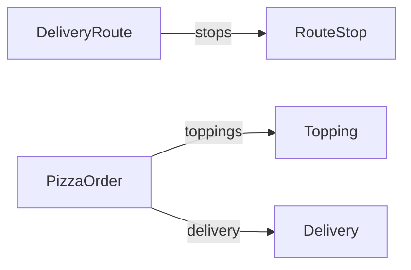

[한국어](README.ko.md) · [README](../README.md) · [Reference](../docs/reference.md)

# 🌮 Protaco examples

This folder contains YAML schemas, actual generated code, and a C++ program using protacoc 0.5.0. The C# test project compiles the generated C# sources. The final section follows revisions of `Order` to show version management.

## Contents

1. [Folder layout](#1-folder-layout)
2. [Build and run](#2-build-and-run)
3. [Schemas](#3-schemas)
4. [Program walkthrough](#4-program-walkthrough)
5. [Generated code](#5-generated-code)
6. [Version management walkthrough](#6-version-management-walkthrough)

## 1. Folder layout

```text
examples/
  schemas/             YAML schemas, namespace demo
  gen/cpp/             generated C++ headers and Protaco.hpp
  gen/cs/              generated C# sources and Protaco.cs
  cpp/main.cpp         C++ program using the generated classes
  cpp/example.vcxproj  include path and Pre-Build Event settings
```

Generated files can be read directly in the repository. `build.cmd` regenerates them, and a C# test uses `--check` to verify that they are current. The [C# test project](../tests/cs/protacoc.Tests.csproj) compiles `gen/cs` just as an application project would.

## 2. Build and run

From the repository root:

```bat
build.cmd
```

The fifth step builds and runs the example. To run those steps manually:

```bat
build\bin\protacoc.exe -I examples\schemas --cpp_out examples\gen\cpp --cs_out examples\gen\cs
msbuild examples\cpp\example.vcxproj /p:Configuration=Release /p:Platform=x64
build\bin\Release\protaco_example.exe
```

[example.vcxproj](cpp/example.vcxproj) adds only `examples\gen\cpp` to the include path. Its Pre-Build Event regenerates the schemas when `build\bin\protacoc.exe` exists. No separate runtime library is linked.

```xml
<AdditionalIncludeDirectories>$(ProjectDir)..\..\examples\gen\cpp;%(AdditionalIncludeDirectories)</AdditionalIncludeDirectories>
```

The project builds with `/W4 /WX` and C++17. [Cpp14Check.cpp](../tests/cpp/Cpp14Check.cpp) also checks the generated headers' C++14 compatibility. See the [reference](../docs/reference.md#4-build-and-test) for full build and test setup.

## 3. Schemas

| Schema | Feature shown | Used by |
|---|---|---|
| [RouteStop](schemas/RouteStop.yaml) | Fixed strings and an integer default | Elements of `DeliveryRoute.stops` |
| [DeliveryRoute](schemas/DeliveryRoute.yaml) | Variable strings, required fields, nested message list | Sending, receiving, error handling, logs |
| [Heartbeat](schemas/Heartbeat.yaml) | All fields fixed, `allow_extension: false` | Direct buffer writes |
| [PizzaOrder](schemas/PizzaOrder.yaml) | Defaults, lists, nested message | Extension data |
| [Topping](schemas/Topping.yaml) | Small message with fixed fields | Elements of `PizzaOrder.toppings` |
| [Delivery](schemas/Delivery.yaml) | `list<int>`, `list<string>` | `PizzaOrder.delivery` |
| [DeliveryProof](schemas/DeliveryProof.yaml) | `bytes`, `list<bytes>`, required bytes | Binary data |



The actual definition in `Heartbeat.yaml`:

```yaml
# Device liveness signal. Every field is fixed-length and ext is off, so Serialize() returns the buffer as is (zero cost).
# Recommended shape for messages sent very often.
message: Heartbeat
version: 1
namespace: demo
# Closed contract: no ext, a frame with an unknown key is rejected.
allow_extension: false

fields:
  - {key: node, type: string(32), desc: device name}
  - {key: seq, type: int64, desc: sequence number}
  - {key: healthy, type: bool, default: true, desc: device is healthy}
  - {key: cpuLoad, type: double, desc: "CPU load (0.0..1.0)"}
  - {key: uptimeSec, type: int, desc: uptime in seconds}
```

`PizzaOrder` represents orders whose fields vary by store. Comments explain the uses of `woodFired` and `deepDishCm`. All fields belong to the same message contract; comments do not alter serialization.

## 4. Program walkthrough

[cpp/main.cpp](cpp/main.cpp) demonstrates sending and receiving, fixed fields, extension data, errors, and text output in that order. This is the 0.5.0 Release x64 output:

```text
DeliveryRoute: 182 bytes
  rider=rider-7 first=A-100 at 1 Pizza St in 10 min, note=closest-first
Heartbeat: received uptime=11, same buffer=yes
PizzaOrder ext: secretSauce=yes please, schema key in ext=rejected
decode failed: path='' what='message name mismatch: expected DeliveryRoute, got Heartbeat'
DeliveryRoute{rider="rider-7", stops=[RouteStop{orderId="A-100", address="1 Pizza St", etaMin=15}], note="", ext{priority=5}}
DeliveryRoute{
  rider="rider-7",
  stops=[
    RouteStop{
      orderId="A-100",
      address="1 Pizza St",
      etaMin=15
    }
  ],
  note="",
  ext{
    priority=5
  }
}
```

### 4.1 Send and receive

```cpp
demo::DeliveryRoute route;
route.set_rider("rider-7");
demo::RouteStop stop;
stop.set_orderId("A-100");
stop.set_address("1 Pizza St");
stop.set_etaMin(10);
route.get_mutable_stops().push_back(stop);
route.set_note("closest-first");

const std::vector<uint8_t>& bytes = route.Serialize();
const demo::DeliveryRoute got = protaco::ToObject<demo::DeliveryRoute>(bytes);
```

`Serialize()` returns a reference to the object's frame buffer. Pass `bytes.data()` and `bytes.size()` to the transport. `ToObject<T>` checks the name, version, and fingerprint before decoding, and throws `protaco::CParseError` on failure.

This example uses `get_mutable_stops()` to edit the list directly. The object will rebuild its variable block on subsequent serialization calls. To reuse the last bytes, use an object populated through `set_stops(...)`. See the [Serialize reuse rules](../README.md#83-reusing-serialize-results).

### 4.2 Fixed fields only

```cpp
demo::Heartbeat beat;
beat.set_node("oven-1");
beat.set_uptimeSec(10);
const std::vector<uint8_t>& bytes = beat.Serialize();
beat.set_uptimeSec(11);
```

Every field is fixed, so setters update the frame buffer directly. The earlier `bytes` reference already reflects 11, and another `Serialize()` call returns the same buffer. No copy or additional encoding is needed.

### 4.3 Extension data

```cpp
demo::PizzaOrder order;
order.set_orderId("A-100");
demo::Topping basil;
basil.set_name("basil");
order.get_mutable_toppings().push_back(basil);
order.GetMutableExt().SetString("secretSauce", "yes please");
order.GetMutableExt().SetInt("pineapple", 0);

const demo::PizzaOrder got = protaco::ToObject<demo::PizzaOrder>(order.Serialize());
std::string sauce;
got.GetExt().GetString("secretSauce", &sauce);
```

The receiver can read `secretSauce` even though it is absent from the YAML. `SetInt("orderId", 9)` returns `false` because the key belongs to the schema. Extension accessors `GetExt()` and `GetMutableExt()` are named separately from field accessors.

### 4.4 Error handling

```cpp
const std::vector<uint8_t> bytes = demo::Heartbeat().Serialize();
demo::DeliveryRoute wrong;
protaco::Error error;
if (!protaco::TryToObject(bytes.data(), bytes.size(), &wrong, &error))
    std::printf("decode failed: path='%s' what='%s'\n", error.path.c_str(), error.what.c_str());
```

`TryToObject` does not throw and leaves `wrong` unchanged on failure. Here `error.path` is empty because the name check failed. A field error identifies a location such as `stops[2].orderId`.

### 4.5 Text output

```cpp
demo::DeliveryRoute route;
route.set_rider("rider-7");
demo::RouteStop stop;
stop.set_orderId("A-100");
stop.set_address("1 Pizza St");
route.get_mutable_stops().push_back(stop);
route.GetMutableExt().SetInt("priority", 5);
std::printf("%s\n", route.ToString().c_str());
std::printf("%s\n", route.ToString(protaco::TextStyle::Pretty()).c_str());
```

The final part of the full program output comes from this code. It shows the default `etaMin=15` because this function does not call `set_etaMin`. Extension entries appear under `ext{...}`.

## 5. Generated code

### 5.1 C++

These field accessors are copied directly from [gen/cpp/DeliveryRoute.g.h](gen/cpp/DeliveryRoute.g.h).

```cpp
    /// rider id
    /// [type string; required, decoding fails if missing]
    const std::string& get_rider() const
    {
        return rider_;
    }

    void set_rider(const std::string& value)
    {
        rider_ = value;
        cache_.valid = false;
    }

    /// Stops, visited in order.
    /// stops
    /// [type list<RouteStop>; required, decoding fails if missing]
    const std::vector<RouteStop>& get_stops() const
    {
        return stops_;
    }

    std::vector<RouteStop>& get_mutable_stops()
    {
        cache_.exposed = true;
        return stops_;
    }

    void set_stops(const std::vector<RouteStop>& value)
    {
        stops_ = value;
        cache_.valid = false;
    }
```

Both the YAML comment `# Stops, visited in order.` and `desc: stops` appear in the docstring. The generator adds the type and required annotations. Setters invalidate the reuse state, and mutable access records that subsequent edits cannot be tracked.

The extension accessors:

```cpp
    /// Extra key-value data not in the yaml. Unknown keys of received messages are kept here.
    const protaco::CExt& GetExt() const
    {
        return ext_;
    }

    protaco::CExt& GetMutableExt()
    {
        return ext_;
    }
```

Serialization and text output:

```cpp
    /// Frame bytes. Fixed fields are already written by their setters; only variable fields are appended here.
    /// Unchanged variable fields and ext reuse the last bytes. After a get_mutable_ call the variable block is rebuilt every time.
    /// The returned reference is valid until this object is modified.
    const std::vector<uint8_t>& Serialize() const
    {
        return protaco::detail::Access::Serialize(*this);
    }

    /// Text for logs: field names and values, ext entries under ext{...}. protaco::TextStyle::Pretty() for one field per line.
    std::string ToString(const protaco::TextStyle& style = protaco::TextStyle()) const
    {
        return protaco::detail::Access::ToText(*this, style);
    }
```

The generated header includes all function bodies. The buffer, field storage, and internal runtime helpers are private.

### 5.2 C#

These are the actual properties in [gen/cs/DeliveryRoute.g.cs](gen/cs/DeliveryRoute.g.cs).

```csharp
        /// <summary>
        /// rider id
        /// [type string; required, decoding fails if missing]
        /// </summary>
        public string Rider { get; set; } = "";

        /// <summary>
        /// Stops, visited in order.
        /// stops
        /// [type list&lt;RouteStop&gt;; required, decoding fails if missing]
        /// </summary>
        public List<RouteStop> Stops { get; set; } = new List<RouteStop>();

        /// <summary>
        /// why this route
        /// [type string; default ""]
        /// </summary>
        public string Note { get; set; } = "";

        /// <summary>Extra key-value data not in the yaml. Unknown keys of received messages are kept here.</summary>
        public Protaco.Ext Ext => ext_;
```

The serialization functions are also copied from the generated file.

```csharp
        /// <summary>Frame bytes.</summary>
        public byte[] Serialize()
        {
            return Protaco.Codec.Serialize(this, default(Protaco.Envelope));
        }

        /// <summary>Frame bytes including the envelope (id, corr, ts).</summary>
        public byte[] Serialize(Protaco.Envelope env)
        {
            return Protaco.Codec.Serialize(this, env);
        }
```

Usage with the same values as section 4.1:

```csharp
var route = new demo.DeliveryRoute { Rider = "rider-7", Note = "closest-first" };
route.Stops.Add(new demo.RouteStop { OrderId = "A-100", Address = "1 Pizza St", EtaMin = 10 });
byte[] bytes = route.Serialize();
demo.DeliveryRoute got = Protaco.Codec.ToObject<demo.DeliveryRoute>(bytes);
```

The same values serialize to the same bytes as C++, which C# tests verify against golden files. `RouteStop.OrderId` throws `ArgumentException` for values longer than 16 bytes; `RouteStop.Address` does so beyond 48 bytes. C# `Serialize()` creates a new array on each call.

## 6. Version management walkthrough

[build1](../tests/schemas/build1), [build2](../tests/schemas/build2), [build3](../tests/schemas/build3), and [build4](../tests/schemas/build4) contain successive shipped revisions of the same `Order.yaml`. Tests use separate namespaces so the revisions can coexist in one binary. An application keeps one namespace and revises the file.

### 6.1 Revisions

The [version 1 definition](../tests/schemas/build1/Order.yaml), with its introductory comment omitted:

```yaml
message: Order
version: 1
namespace: build1
fields:
  - {key: id, type: string(8)}
  - {key: qty, type: int, default: 1}
  - {key: note, type: string}
  - {key: color, type: string, required: true}
```

The [version 3 definition](../tests/schemas/build3/Order.yaml):

```yaml
message: Order
version: 3
min_version: 1
namespace: build3
fields:
  - {key: id, type: string(8)}
  - {key: weight, type: double, default: 0.5, added: 2}
  - {key: qty, type: int, default: 1, removed: 3}
  - {key: note, type: string, removed: 3}
  - {key: color, type: string, required: true}
  - {key: tags, type: list<string>, added: 2}
  - {key: label, type: string, added: 3}
  - {key: rush, type: bool, added: 3}
```

- Version 2 adds fixed `weight` and variable `tags`. Although declared between `id` and `qty`, `weight` is placed after the existing fixed block.
- Version 3 removes `qty` and `note`, then adds `label` and `rush`. Both removed lines remain because `min_version` is 1.
- Version 4 removes the required `color` field and sets `min_version: 2`, ending support for version 1.

### 6.2 Generated classes

| Build | Classes | Supported versions |
|---|---|---|
| build1 | `build1::Order` (v1) | 1 |
| build2 | `build2::Order` (v2), `build2::v1::Order` | 1..2 |
| build3 | `build3::Order` (v3), `build3::v1::Order`, `build3::v2::Order` | 1..3 |
| build4 | `build4::Order` (v4), `build4::v2::Order`, `build4::v3::Order` | 2..4 |

An older-version class has the same fingerprint as the class originally shipped at that version. For example, `build3::v1::Order::MsgSchemaHash()` equals `build1::Order::MsgSchemaHash()`.

### 6.3 Fixed block layout

| Version | Fixed fields in order |
|---|---|
| 1 | `id`, `qty` |
| 2 | `id`, `qty`, `weight` |
| 3, 4 | `id`, `qty` (removed, bytes kept), `weight`, `rush` |

Each fixed block is a prefix of later versions' blocks. An older receiver reads only its own version's portion. The removed `qty` bytes contain its default, 1.

### 6.4 Exchanges between builds

A newer frame reaches an older receiver. In `NewerFrameReadAsOwnVersion`, build3 sends a frame and build1 reads the version 1 layout. `qty` is the default 1, and `note` is empty. New variable fields `tags` and `label` remain in ext. build2 reads its own `weight` and `tags` fields.

An older frame reaches a newer receiver. In `OlderFrameNeedsOldType`, reading build1's frame through `build3::Order` gives:

```text
message version too old: Order reads version 3 or newer, got 1. Use the v1 type
```

Inspect version 1 with `PeekHeader()`, then decode through `build3::v1::Order`.

The sender has ended support for an older version. In `SenderMinVersionAboveReader`, build1 receives build4's frame and reports:

```text
message version too new: Order reads version 1, sender supports 2..4
```

build2 is within the supported range, but version 4 removed its required `color` field, so it rejects the frame with:

```text
color: missing required (frame version 4 read as 2)
```

For that peer, send a `build4::v3::Order` or `build4::v2::Order` with `color` populated. Separate diagrams for these exchanges are in [Deployment cases](../README.md#78-deployment-cases).
