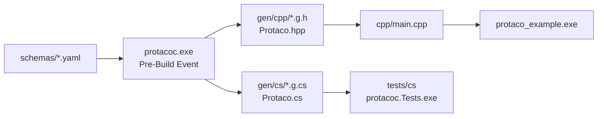
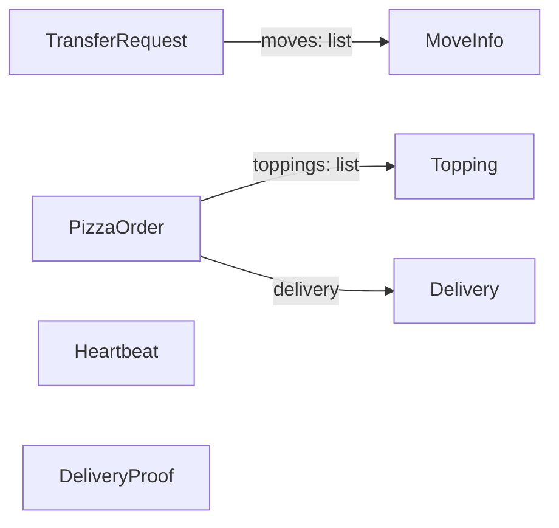
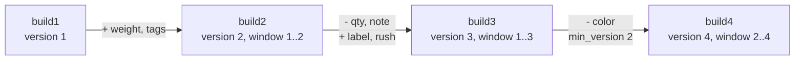

# 🌮 Protaco examples

This folder holds sample schemas, the code protacoc generates from them, and a C++ program that uses the generated code. Section 6 follows one message through four schema revisions, using the version window test schemas in `tests/schemas`.

[README](../README.md) · [한국어](README.ko.md)

## Contents

1. [Folder layout](#1-folder-layout)
2. [Build and run](#2-build-and-run)
3. [Schemas](#3-schemas)
4. [Program walkthrough](#4-program-walkthrough)
5. [Generated code](#5-generated-code)
6. [Version window walkthrough](#6-version-window-walkthrough)

## 1. Folder layout

```
examples/
  schemas/             7 YAML schemas, namespace demo
  gen/cpp/             generated C++ headers and Protaco.hpp
  gen/cs/              generated C# sources and Protaco.cs
  cpp/main.cpp         C++ program using the generated headers
  cpp/example.vcxproj  project: include path and Pre-Build Event
```

- The generated files are committed so the output can be read without building.
- `build.cmd` regenerates them. The C# test `committed example output is up to date (--check)` fails when they are stale.
- The C# sources in `gen/cs` are compiled by the C# test project `tests/cs/protacoc.Tests.csproj`, the same way a user project compiles them.



## 2. Build and run

From the repository root:

```
build.cmd
```

Step 5 of `build.cmd` builds and runs the example. Manual steps:

```
build\bin\protacoc.exe -I examples\schemas --cpp_out examples\gen\cpp --cs_out examples\gen\cs
msbuild examples\cpp\example.vcxproj /p:Configuration=Release /p:Platform=x64
build\bin\Release\protaco_example.exe
```

`example.vcxproj` needs only the output folder on the include path. The Pre-Build Event runs protacoc when `build\bin\protacoc.exe` exists:

```xml
<AdditionalIncludeDirectories>$(ProjectDir)..\..\examples\gen\cpp;%(AdditionalIncludeDirectories)</AdditionalIncludeDirectories>

<PreBuildEvent>
  <Command>if exist "$(ProjectDir)..\..\build\bin\protacoc.exe" "$(ProjectDir)..\..\build\bin\protacoc.exe" -I "$(ProjectDir)..\..\examples\schemas" --cpp_out "$(ProjectDir)..\..\examples\gen\cpp" --cs_out "$(ProjectDir)..\..\examples\gen\cs"</Command>
</PreBuildEvent>
```

The project compiles with `/W4 /WX` and C++17. The generated headers also compile as C++14 (`tests/cpp/Cpp14Check.cpp`).

## 3. Schemas

| Schema | Feature shown | Used by |
|---|---|---|
| [MoveInfo](schemas/MoveInfo.yaml) | All fields fixed: `string(32)`, `int` with a default | Element of `TransferRequest.moves` |
| [TransferRequest](schemas/TransferRequest.yaml) | Variable fields, `required`, list of messages, `version: 2` | Sections 4.1, 4.4, 4.5 |
| [Heartbeat](schemas/Heartbeat.yaml) | All fields fixed, `allow_extension: false` | Section 4.2 |
| [PizzaOrder](schemas/PizzaOrder.yaml) | Variant tags `eq`, defaults, nested message, lists | Section 4.3 |
| [Topping](schemas/Topping.yaml) | Small fixed message | Element of `PizzaOrder.toppings` |
| [Delivery](schemas/Delivery.yaml) | `list<int>`, `list<string>` | Field `PizzaOrder.delivery` |
| [DeliveryProof](schemas/DeliveryProof.yaml) | `bytes`, `list<bytes>`, required `bytes` | Binary data |



`Heartbeat.yaml`:

```yaml
# Device liveness signal. Every field is fixed-length and ext is off, so Serialize() returns the buffer as is (zero cost).
# Recommended shape for messages sent very often.
message: Heartbeat
version: 1
namespace: demo
# Closed contract: no ext, a frame with an unknown key is rejected.
allow_extension: false
owner: device

fields:
  - {key: node, type: string(32), desc: device name}
  - {key: seq, type: int64, desc: sequence number}
  - {key: healthy, type: bool, default: true, desc: device is healthy}
  - {key: cpuLoad, type: double, desc: "CPU load (0.0..1.0)"}
  - {key: uptimeSec, type: int, desc: uptime in seconds}
```

`PizzaOrder.yaml` is one message for stores whose orders differ in shape. Fields without `eq` are shared. `woodFired` belongs to `NAPOLI`, `deepDishCm` to `CHICAGO`. `eq` is documentation only and does not change the bytes.

## 4. Program walkthrough

`cpp/main.cpp` runs five functions in order. The output below is from a Release x64 build.

### 4.1 Send and receive

```cpp
demo::TransferRequest request;
request.set_tm("TM1");
demo::MoveInfo move;
move.set_from("SHELF1");
move.set_to("TABLE3");
move.set_slot(2);
request.get_mutable_moves().push_back(move);
request.set_reason("closest-first");

const std::vector<uint8_t>& bytes = request.Serialize();   // send bytes.data(), bytes.size()
const demo::TransferRequest got = protaco::ToObject<demo::TransferRequest>(bytes);
```

```
TransferRequest: 179 bytes
  tm=TM1 first=SHELF1->TABLE3 slot=2 reason=closest-first
```

- `Serialize()` returns a reference to the object's frame buffer. The bytes go to any transport as `data()` and `size()`.
- `ToObject<T>` checks name, version and fingerprint, then decodes. It throws `protaco::CParseError` on failure.

### 4.2 Fixed fields only

```cpp
demo::Heartbeat beat;
beat.set_node("oven-1");
beat.set_uptimeSec(10);
const std::vector<uint8_t>& bytes = beat.Serialize();
beat.set_uptimeSec(11);   // written into the same buffer, no need to call Serialize again
```

```
Heartbeat: received uptime=11, same buffer=yes
```

- Every `Heartbeat` field is fixed, so each setter writes into the frame buffer.
- `bytes` was taken before `set_uptimeSec(11)` and already holds 11.
- `Serialize()` returns the same buffer each time. No copy and no encoding take place.

### 4.3 Extension data

```cpp
demo::PizzaOrder order;
order.set_orderId("A-100");
demo::Topping basil;
basil.set_name("basil");
order.get_mutable_toppings().push_back(basil);
order.get_mutable_ext().SetString("secretSauce", "yes please");   // key not in the yaml
order.get_mutable_ext().SetInt("pineapple", 0);

const demo::PizzaOrder got = protaco::ToObject<demo::PizzaOrder>(order.Serialize());
std::string sauce;
got.get_ext().GetString("secretSauce", &sauce);
```

```
PizzaOrder ext: secretSauce=yes please, schema key in ext=rejected
```

- Keys outside the schema travel as extension entries and are readable by the receiver.
- `SetInt("orderId", 9)` returns `false`, because `orderId` is a schema key.

### 4.4 Error handling

```cpp
const std::vector<uint8_t> bytes = demo::Heartbeat().Serialize();
demo::TransferRequest wrong;
protaco::Error error;
if (!protaco::TryToObject(bytes.data(), bytes.size(), &wrong, &error))
    std::printf("decode failed: path='%s' what='%s'\n", error.path.c_str(), error.what.c_str());
```

```
decode failed: path='' what='message name mismatch: expected TransferRequest, got Heartbeat'
```

- `TryToObject` never throws. On failure `wrong` is unchanged.
- `error.path` is empty here because the frame header failed. For a field error it names the field, for example `moves[2].from`.

### 4.5 Text output

```cpp
request.get_mutable_ext().SetInt("priority", 5);
std::printf("%s\n", request.ToString().c_str());
std::printf("%s\n", request.ToString(protaco::TextStyle::Pretty()).c_str());
```

```
TransferRequest{tm="TM1", moves=[MoveInfo{from="SHELF1", to="TABLE3", slot=1}], reason="", ext{priority=5}}
TransferRequest{
  tm="TM1",
  moves=[
    MoveInfo{
      from="SHELF1",
      to="TABLE3",
      slot=1
    }
  ],
  reason="",
  ext{
    priority=5
  }
}
```

- `slot=1` is the default from `MoveInfo.yaml`. This function does not call `set_slot`.
- Extension entries appear after the schema fields under `ext{...}`.

## 5. Generated code

### 5.1 C++

Public part of `gen/cpp/TransferRequest.g.h`, abbreviated:

```cpp
namespace demo
{

/// Robot transfer request.
/// [version 2; schema 0xCE8A25DA; owner planner; source TransferRequest.yaml]
class TransferRequest
{
public:
    TransferRequest();

    static const char* MsgName();          // "TransferRequest"
    static uint16_t MsgVersion();          // 2
    static uint16_t MsgMinVersion();       // 2
    static uint32_t MsgSchemaHash();       // 0xCE8A25DA

    /// robot id
    /// [type string; required, decoding fails if missing]
    const std::string& get_tm() const;
    void set_tm(const std::string& value);

    /// Moves, executed in order.
    /// moves
    /// [type list<MoveInfo>; required, decoding fails if missing]
    const std::vector<MoveInfo>& get_moves() const;
    std::vector<MoveInfo>& get_mutable_moves();
    void set_moves(const std::vector<MoveInfo>& value);

    const std::string& get_reason() const;
    void set_reason(const std::string& value);

    const protaco::CExt& get_ext() const;
    protaco::CExt& get_mutable_ext();

    void SetEnvelope(const protaco::Envelope& env);
    protaco::Envelope GetEnvelope() const;

    const std::vector<uint8_t>& Serialize() const;
    std::string ToString(const protaco::TextStyle& style = protaco::TextStyle()) const;

private:
    // frame buffer, field storage, field lists for serialization and text
};

}  // namespace demo
```

- The comment above `moves` in the YAML (`# Moves, executed in order.`) and its `desc` (`moves`) both become docstring lines.
- The bracketed line is written by protacoc: type, `required`, default, `added`, `removed`.
- The generated file defines every member inline. The listing above shows declarations only.

### 5.2 C#

`gen/cs` holds the same messages for C#. Usage with the same values as section 4.1:

```csharp
var request = new demo.TransferRequest { Tm = "TM1", Reason = "closest-first" };
request.Moves.Add(new demo.MoveInfo { From = "SHELF1", To = "TABLE3", Slot = 2 });

byte[] bytes = request.Serialize();
demo.TransferRequest got = Protaco.Codec.ToObject<demo.TransferRequest>(bytes);
```

- The C# frame is byte-for-byte equal to the C++ frame for the same values. The C# test `same bytes as the C++ golden files` checks it.
- A fixed string setter (`MoveInfo.From`) throws `ArgumentException` for a value longer than 32 bytes.

## 6. Version window walkthrough

`tests/schemas/build1` to `build4` hold four revisions of one `Order.yaml`, as shipped by four successive builds. Each revision uses its own namespace (`build1` to `build4`), so all four can be compiled into one test binary. In a user project the file keeps one namespace and only its content changes.



### 6.1 Revisions

Version 1 (`build1/Order.yaml`):

```yaml
message: Order
version: 1
namespace: build1
fields:
  - {key: id, type: string(8)}
  - {key: qty, type: int, default: 1}
  - {key: note, type: string}
  - {key: color, type: string, required: true}
```

Version 3 (`build3/Order.yaml`):

```yaml
message: Order
version: 3
min_version: 1
namespace: build3
fields:
  - {key: id, type: string(8)}
  - {key: weight, type: double, default: 0.5, added: 2}
  - {key: qty, type: int, default: 1, removed: 3}
  - {key: note, type: string, removed: 3}
  - {key: color, type: string, required: true}
  - {key: tags, type: list<string>, added: 2}
  - {key: label, type: string, added: 3}
  - {key: rush, type: bool, added: 3}
```

- Version 2 adds `weight` (fixed) and `tags` (variable). `weight` is declared between `id` and `qty`, but it is laid out after the version 1 fixed fields.
- Version 3 removes `qty` (fixed) and `note` (variable), and adds `label` and `rush`. Both removed lines stay because `min_version` is 1.
- Version 4 removes `color`, which was `required`, and raises `min_version` to 2. Version 1 peers are no longer served.

### 6.2 Generated classes

| Build | Classes | Window |
|---|---|---|
| build1 | `build1::Order` (v1) | 1 |
| build2 | `build2::Order` (v2), `build2::v1::Order` | 1..2 |
| build3 | `build3::Order` (v3), `build3::v1::Order`, `build3::v2::Order` | 1..3 |
| build4 | `build4::Order` (v4), `build4::v2::Order`, `build4::v3::Order` | 2..4 |

An older-version class has the same fingerprint as the class shipped at that version (test `WindowKeepsOldFingerprints`). For example, `build3::v1::Order::MsgSchemaHash()` equals `build1::Order::MsgSchemaHash()`.

### 6.3 Fixed block layout

| Version | Fixed fields in order | Size |
|---|---|---|
| 1 | `id` (8), `qty` (4) | 12 bytes |
| 2 | `id`, `qty`, `weight` (8) | 20 bytes |
| 3 and 4 | `id`, `qty` (removed, bytes kept), `weight`, `rush` (1) | 21 bytes |

Each block is a prefix of the next one. A reader of version 1 reads the first 12 bytes of a version 3 frame.

### 6.4 Exchanges between builds

Newer frame to an older reader (test `NewerFrameReadAsOwnVersion`). A build3 frame with `id="A1"`, `weight=2.5`, `color="red"`, `tags=["x"]`, `label="L"`, `rush=true`:

- build1 reads it as version 1. `qty` is 1, the default the sender writes into the kept bytes. `note` is empty. `tags` and `label` are kept as extension entries.
- build2 reads it as version 2. `weight` is 2.5 and `tags` is `["x"]`.

Older frame to a newer reader (test `OlderFrameNeedsOldType`). A build1 frame decoded by build3:

```
build3::Order       message version too old: Order reads version 3 or newer, got 1. Use the v1 type
build3::v1::Order   Order{id="B2", qty=4, note="n", color="blue"}
```

The receiver reads `version` with `PeekHeader()` and selects the class.

Sender window above the reader (test `SenderWindowAboveReader`). A build4 frame (window 2..4):

```
build1::Order   message version too new: Order reads version 1, sender supports 2..4
build2::Order   color: missing required (frame version 4 read as 2)
```

- build4 no longer serves version 1, so build1 rejects the frame.
- build2 is inside the window, but `color` is required in version 2 and removed in 4. build4 sends to version 2 peers with `build4::v3::Order` or `build4::v2::Order`, which still carry `color`.
